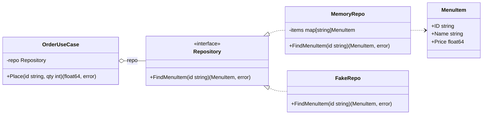
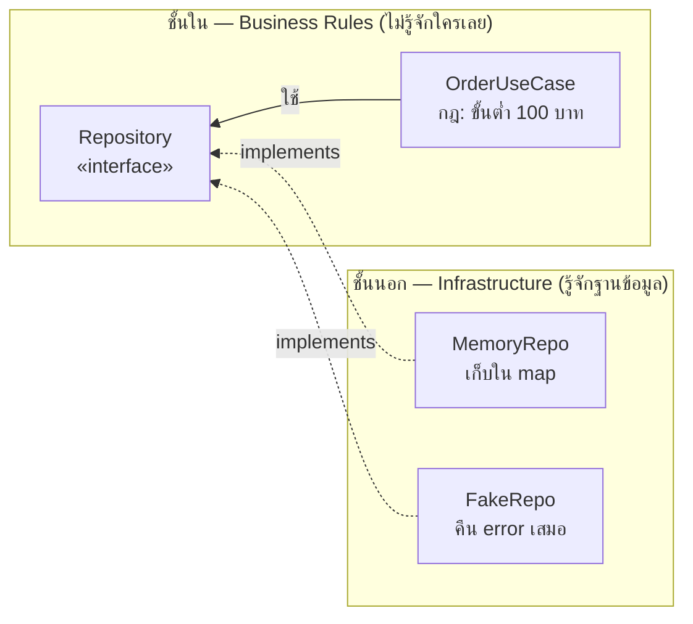
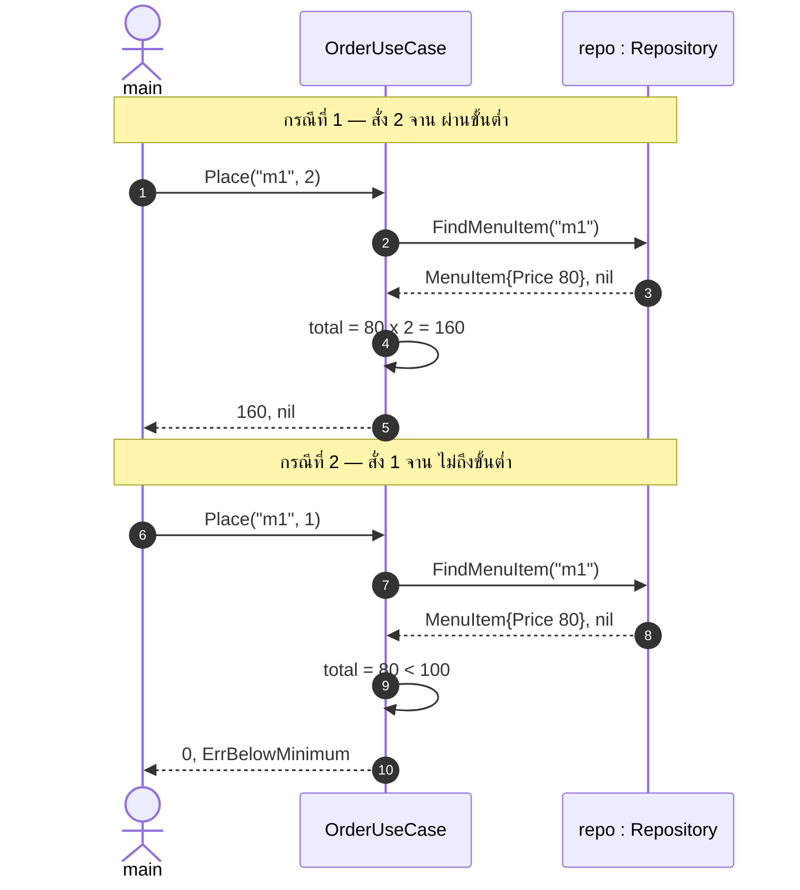
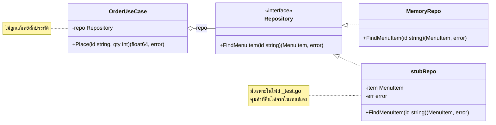
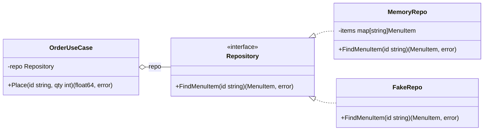

# Go Fundamentals — คู่มือพื้นฐานภาษา Go (CS471 Day 1)

# 1. Introduction to Go Programming

## 1.1 What is Go?

- สร้างที่ Google โดย *Robert Griesemer*, *Rob Pike* และ *Ken Thompson* เปิดตัวปี 2009
- *Ken Thompson* เป็นผู้ร่วมสร้าง UNIX และภาษา B ซึ่งเป็นต้นทางของภาษา C ภาษา Go จึงมีรากมาจากสาย C โดยตรง
- เกิดขึ้นเพื่อแก้ปัญหาที่ Google เจอกับ C++ ในระบบขนาดใหญ่ คือเวลาคอมไพล์ที่นาน ระบบ Dependency ที่ซับซ้อน และการเขียน Concurrent ที่ยากเกินจำเป็น
- คอมไพล์เป็น Native Binary เช่นเดียวกับ C และ C++ แต่มี Garbage Collector จึงไม่ต้องจัดการหน่วยความจำเอง
- มีคำสงวน 25 คำ เทียบกับ C++ ที่มีมากกว่า 90 คำ
- Concurrency อยู่ในตัวภาษาผ่าน Goroutine และ Channel ไม่ใช่ Library อย่าง `pthread` หรือ `std::thread`
- Docker, Kubernetes และ Terraform เขียนด้วยภาษา Go

## 1.2 Go สำหรับคนที่เขียน C, C++ และ TypeScript มาแล้ว

เอกสารนี้ข้ามพื้นฐานอย่างตัวแปร ตัวดำเนินการ เงื่อนไข และการวนซ้ำ เนื้อหาจะเน้นเฉพาะจุดที่ Go ตัดสินใจต่างออกไปจากภาษาที่เคยผ่านมา พร้อมเหตุผลเบื้องหลัง

| C และ C++ | TypeScript | Go |
| --- | --- | --- |
| `int x = 5;` | `let x: number = 5` | ชื่อมาก่อน Type เหมือน TypeScript — `var x int = 5` หรือ `x := 5` |
| Header file และ `#include` | `import` และ `export` รายไฟล์ | Package เป็นหน่วยระดับโฟลเดอร์ ไม่มี Preprocessor |
| `malloc` `free` `new` `delete` | Garbage Collector | Garbage Collector |
| Pointer Arithmetic | ไม่มี Pointer | มี Pointer แต่ชี้ได้อย่างเดียว เลื่อนตำแหน่งไม่ได้ |
| Array สลายเป็น Pointer เมื่อส่งเข้าฟังก์ชัน | Array เป็น Reference เสมอ | Array เป็น Value ถูกคัดลอกทั้งก้อน งานจริงใช้ Slice แทน |
| Implicit Conversion ระหว่างชนิดตัวเลข | มี Type Coercion ตอน Runtime และมี `any` ที่หลุดการตรวจได้ | ไม่มีเลย ต้องเขียนแปลงเองทุกครั้ง และไม่มี `any` |
| Type หายหลังคอมไพล์ | Type หายตอน Transpile เหลือแต่ JavaScript ตอน Runtime | Type อยู่ถึง Runtime ตรวจได้ด้วย Type Assertion และ Reflection |
| `class` Inheritance Virtual Function | `class` `extends` `implements` | Struct ผูกกับ Method และ Interface ไม่มี Inheritance |
| ต้องประกาศว่าสืบทอดจากอะไร | Interface เป็น Structural Typing ไม่ต้องเขียน `implements` | เหมือน TypeScript คือ Implicit Satisfaction |
| `try` `catch` `throw` | `try` `catch` `throw` และ Promise Rejection | คืน `error` กลับมาเป็นค่าธรรมดา |
| Destructor และ RAII | `try` `finally` | `defer` |
| `NULL` | `null` และ `undefined` แยกกัน | `nil` อย่างเดียว และมี Zero Value ทำให้ไม่ค่อยได้ใช้ `nil` กับค่าทั่วไป |
| `condition ? a : b` | `condition ? a : b` | ไม่มี ใช้ If Statement |
| `while` และ `do-while` | `while` `do-while` `for...of` `forEach` | มีคำสงวนวนซ้ำคำเดียวคือ `for` |
| ตัวแปรไม่ได้ใช้ เป็น Warning | เป็น Warning หรือต้องเปิด `noUnusedLocals` เอง | เป็น Compile Error เสมอ ทั้งตัวแปรและ Package ที่ Import |

## 1.3 เตรียมเครื่องและโปรเจกต์ก่อนเริ่ม

### 1.3.1 ติดตั้ง Go และ VS Code Extension

ติดตั้ง Go จาก [https://go.dev/dl/](https://go.dev/dl/) แล้วตรวจว่าได้เวอร์ชัน 1.22 ขึ้นไป

```bash
go version
```

ติดตั้ง Extension 2 ตัวใน VS Code

| Extension | ID | หน้าที่ |
| --- | --- | --- |
| [Go](https://marketplace.visualstudio.com/items?itemName=golang.Go) | `golang.Go` | Autocomplete ตรวจ Error `gofmt` Debugger และรัน Test |
| [Code Runner](https://marketplace.visualstudio.com/items?itemName=formulahendry.code-runner) | `formulahendry.code-runner` | ปุ่ม ▶ รันตัวอย่างด้วยคลิกเดียว |

### 1.3.2 สร้างโปรเจกต์ครั้งเดียว ใช้ตลอดทั้งคาบ

โปรเจกต์ของ Go เรียกว่า Module โดยไฟล์ `go.mod` บันทึกชื่อ Module และเวอร์ชันของ Dependency ทุกตัว แทน Makefile หรือ CMakeLists

```bash
mkdir week-01-go-fundamentals && cd week-01-go-fundamentals
go mod init cs471/week01
```

ได้ `go.mod` หน้าตาแบบนี้ ทุกขั้นตอนหลังจากนี้ทำอยู่ในโฟลเดอร์นี้ทั้งหมด ไม่ต้อง `go mod init` ซ้ำอีก

```go
module cs471/week01

go 1.22
```

<aside>
🚨

บรรทัด `go 1.22` มีผลจริงต่อพฤติกรรมของโปรแกรม ไม่ใช่แค่ข้อมูลประกอบ จะเห็นชัดที่ **ขั้นที่ 21** อย่าแก้เป็นเลขอื่น

</aside>

### 1.3.3 วิธีอ่านเอกสารนี้

เนื้อหาตั้งแต่หัวข้อ 1.4 เป็นต้นไปแบ่งเป็น **68 ขั้น** เรียงตามลำดับที่จะสอนจริง ทุกขั้นมีรูปแบบเดียวกัน

<aside>
📄

**1. สร้างโฟลเดอร์** `mkdir -p 07-slices/02-aliasing`

**2. สร้างไฟล์** `07-slices/02-aliasing/main.go` แล้ววางโค้ดข้างล่างลงไป

**3. รัน** `go run ./07-slices/02-aliasing`

</aside>

ทำตามในกล่องสีเทาจากบนลงล่าง ทุกคำสั่งพิมพ์จากโฟลเดอร์ `week-01-go-fundamentals` เสมอ **ไม่ต้อง** `cd` เข้าไปในโฟลเดอร์ย่อย

1. **สร้างโฟลเดอร์** คัดลอกคำสั่ง `mkdir` ไปวางใน Terminal ส่วน `-p` แปลว่าสร้างโฟลเดอร์ชั้นในให้ด้วยถ้ายังไม่มี
2. **สร้างไฟล์** สร้างไฟล์ตามชื่อที่เขียนไว้ในโฟลเดอร์ที่เพิ่งสร้าง แล้วคัดลอกโค้ดในบล็อกถัดจากกล่องไปวาง
3. **รัน** คัดลอกคำสั่งไปวางใน Terminal หรือกดปุ่ม ▶ ของ Code Runner ก็ได้ผลเหมือนกัน

<aside>
🚨

**ถ้าใช้ Windows** Terminal ของ VS Code จะเป็น PowerShell ซึ่งไม่รู้จัก `-p` ให้ตัดออก เช่นพิมพ์ `mkdir 07-slices/02-aliasing` เฉย ๆ ผลลัพธ์เหมือนกันคือสร้างโฟลเดอร์ชั้นในให้ด้วย

</aside>

<aside>
💡

จะไม่พิมพ์คำสั่งเลยก็ได้ ใน VS Code กดปุ่ม **New File** ที่แถบ Explorer แล้วพิมพ์ path เต็ม `07-slices/02-aliasing/main.go` ลงไปทีเดียว VS Code จะสร้างโฟลเดอร์ที่ยังไม่มีให้เองทั้งหมด วิธีนี้ใช้ได้เหมือนกันทั้ง macOS และ Windows

</aside>

<aside>
💡

มี 3 ขั้นที่ต้องสร้าง **2 ไฟล์ในขั้นเดียว** คือขั้นที่ 2, 3 และ 64 กล่องสีเทาของขั้นเหล่านั้นจะบอกไว้ครบทั้งสองไฟล์ นอกนั้นเป็นไฟล์เดียวทั้งหมด

และมี 3 ขั้นที่หมายเลขโฟลเดอร์ดูเหมือนย้อนกลับ คือขั้นที่ 40, 54 และ 68 ไม่ได้พิมพ์ผิด แต่จงใจยกมาอธิบายตรงจุดที่เนื้อหาเกี่ยวข้องกัน

</aside>

โค้ดในทุกขั้นเป็นโปรแกรมที่สมบูรณ์ คัดลอกทั้งบล็อกไปวางในไฟล์เปล่าแล้วรันได้ทันที ไม่ต้องต่อกับขั้นก่อนหน้า

### 1.3.4 คำสั่งที่ใช้บ่อย

```bash
go run .              # คอมไพล์แล้วรันทันที
go build -o server .  # สร้าง binary ชื่อ server
go fmt ./...          # จัดรูปแบบโค้ดตามมาตรฐาน
go vet ./...          # ตรวจหาโค้ดที่น่าสงสัยว่าจะเป็นบั๊ก
go test ./...         # รันชุดทดสอบทั้งหมด
```

<aside>
💡

`./...` คือ Package ปัจจุบันและทุก Package ในโฟลเดอร์ย่อยลงไป

</aside>

<aside>
💡

Go มีรูปแบบการจัดโค้ดอย่างเป็นทางการแบบเดียว `go fmt` จะจัดให้เหมือนกันทั้งหมด จึงไม่มีการถกเถียงเรื่อง Coding Style ในทีม

</aside>

## 1.4 Go Syntax

### 1.4.1 Program Structure and Packages

- `package main` คอมไพล์เป็นโปรแกรมที่รันได้ ชื่ออื่นคือ Library
- ทุกไฟล์ในโฟลเดอร์เดียวกันอยู่ใน Package เดียวกัน และมองเห็นกันหมดโดยไม่ต้อง Include
- การเข้าถึงกำหนดด้วยตัวอักษรตัวแรกของชื่อ ตัวพิมพ์ใหญ่คือ Exported ตัวพิมพ์เล็กคือเห็นเฉพาะใน Package ไม่มี `public` และ `private`
- ไม่มี Prototype ลำดับการประกาศในไฟล์ไม่มีผลต่อการเรียกใช้

#### ขั้นที่ 1 — โปรแกรม Go ที่เล็กที่สุดที่รันได้

<aside>
📄

**1. สร้างโฟลเดอร์** `mkdir -p 01-hello/01-hello`

**2. สร้างไฟล์** `01-hello/01-hello/main.go` แล้ววางโค้ดข้างล่างลงไป

**3. รัน** `go run ./01-hello/01-hello`

</aside>

```go
package main

import "fmt"

func main() {
	fmt.Println("Hello, Go!")
}
```

**ผลลัพธ์**

```powershell
Hello, Go!
```

**ทำไมถึงเป็นแบบนี้**

package main + func main() = โปรแกรมที่รันได้
ตั้งชื่อ package เป็นอย่างอื่น จะกลายเป็น Library รันตรง ๆ ไม่ได้

<aside>
⚠️

**ลองแก้**

1. เปลี่ยน package main เป็น package demo แล้วรัน → go: cannot run non-main package
2. เพิ่ม import "os" ไว้ข้างบนโดยไม่ใช้ แล้วรัน → "os" imported and not used
</aside>

#### ขั้นที่ 2 — ไฟล์ในโฟลเดอร์เดียวกัน = package เดียวกัน มองเห็นกันหมดโดยไม่ต้อง import

<aside>
📄

**1. สร้างโฟลเดอร์** `mkdir -p 01-hello/02-two-files`

**2. สร้างไฟล์ที่ 1** `01-hello/02-two-files/main.go`

**3. สร้างไฟล์ที่ 2** `01-hello/02-two-files/price.go`

**4. รัน** `go run ./01-hello/02-two-files`

ขั้นนี้มี **2 ไฟล์ในโฟลเดอร์เดียวกัน** สร้างให้ครบทั้งคู่ก่อนรัน

</aside>

ไฟล์ที่ 1 — `main.go`

```go
package main

import "fmt"

func main() {
	// lineTotal อยู่ในไฟล์ price.go โฟลเดอร์เดียวกัน
	fmt.Println(lineTotal(80, 2))

	// เรียก greet ที่ประกาศไว้ "ข้างล่าง" ได้ เพราะ Go ไม่มี Prototype
	fmt.Println(greet("CS471"))
}

func greet(name string) string {
	return "Welcome to " + name
}
```

ไฟล์ที่ 2 — `price.go` อยู่โฟลเดอร์เดียวกัน ไม่ต้อง import หากัน

```go
package main

func lineTotal(price float64, qty int) float64 {
	return price * float64(qty)
}
```

<aside>
🚨

สร้างครบทั้ง 2 ไฟล์ก่อน แล้วค่อยรัน ถ้ารันตอนที่มีแค่ `main.go` จะได้ `undefined: lineTotal` เพราะ Go ยังหาฟังก์ชันนั้นไม่เจอ

</aside>

**ผลลัพธ์**

```powershell
160
Welcome to CS471
```

**ทำไมถึงเป็นแบบนี้**

ไฟล์ในโฟลเดอร์เดียวกัน = package เดียวกัน
มองเห็นกันหมด ไม่ต้อง import
ไม่มี #include ไม่มี Header File
ลำดับการประกาศไม่มีผล เรียก greet() ที่อยู่ข้างล่างได้

<aside>
⚠️

**ลองแก้** — ย้าย func greet ไปไว้บนสุด แล้วดูว่าผลเปลี่ยนไหม

</aside>

#### ขั้นที่ 3 — ตัวพิมพ์ใหญ่ = ข้าม package ได้ / ตัวพิมพ์เล็ก = เห็นเฉพาะใน package ตัวเอง

<aside>
📄

**1. สร้างโฟลเดอร์** `mkdir -p 01-hello/03-exported/menu`

**2. สร้างไฟล์ที่ 1** `01-hello/03-exported/main.go`

**3. สร้างไฟล์ที่ 2** `01-hello/03-exported/menu/menu.go`

**4. รัน** `go run ./01-hello/03-exported`

คำสั่ง `mkdir` ข้างบนสร้างให้ทั้ง `03-exported` และ `menu` ทีเดียว ขั้นนี้มี **2 ไฟล์** โดยไฟล์ที่ 2 อยู่ในโฟลเดอร์ย่อย `menu` ชื่อโฟลเดอร์คือชื่อ Package

</aside>

ไฟล์ที่ 1 — `main.go`

```go
package main

import (
	"fmt"

	"cs471/week01/01-hello/03-exported/menu"
)

func main() {
	item := menu.New("Pad Thai", 80)

	fmt.Println(item.Name)    // ตัวพิมพ์ใหญ่ อ่านได้
	fmt.Println(item.Price()) // ต้องผ่าน Method เพราะ price เป็นตัวพิมพ์เล็ก

	// fmt.Println(item.price)
	// → item.price undefined (type menu.Item has no field or method price,
	//   but does have unexported field price)
}
```

ไฟล์ที่ 2 — `menu/menu.go` ชื่อ Package มาจากชื่อโฟลเดอร์ ไม่ใช่ชื่อไฟล์

```go
package menu

type Item struct {
	Name  string  // ตัวพิมพ์ใหญ่ = package อื่นเห็น
	price float64 // ตัวพิมพ์เล็ก = เห็นเฉพาะใน package menu
}

// Go ไม่มี Constructor ธรรมเนียมคือฟังก์ชันชื่อ New
// จำเป็นต้องมี เพราะไม่งั้น package อื่นตั้งค่า price ไม่ได้เลย
func New(name string, price float64) Item {
	return Item{Name: name, price: price}
}

// เปิดทางให้อ่าน price จากข้างนอกได้
func (i Item) Price() float64 {
	return i.price
}
```

<aside>
🚨

สร้างครบทั้ง 2 ไฟล์ก่อน แล้วค่อยรัน ถ้ารันตอนที่มีแค่ `main.go` จะได้ `no required module provides package cs471/week01/01-hello/03-exported/menu` เพราะ Package `menu` ยังไม่มีอยู่จริง

</aside>

**ผลลัพธ์**

```powershell
Pad Thai
80
```

**ทำไมถึงเป็นแบบนี้**

ตัวพิมพ์ใหญ่ = package อื่นเห็น
ตัวพิมพ์เล็ก = เห็นเฉพาะใน package ตัวเอง
Go ไม่มีคำว่า public / private
ขอบเขตคือ package ไม่ใช่ไฟล์ และไม่ใช่ type

<aside>
⚠️

**ลองแก้**

1. เปิดคอมเมนต์บรรทัด item.price แล้วอ่าน error ให้ครบ
2. เปลี่ยน price เป็น Price ใน menu.go → ชนกับ Method Price() ทันที ชื่อซ้ำใน type เดียวกันไม่ได้
</aside>

### 1.4.2 Variables and Zero Values

ตัวแปรทุกตัวที่ประกาศแล้วได้รับ Zero Value ทันที Go ไม่มีหน่วยความจำที่ยังไม่ถูกกำหนดค่า จึงไม่มี Undefined Behavior จากการอ่านค่าขยะใน Stack แบบภาษา C

<aside>
🧠

**เจาะลึก** ทุกครั้งที่มีการจองหน่วยความจำ Go จะเซ็ตค่าในหน่วยความจำนั้นให้เป็นศูนย์ก่อนเสมอ การทำงานจะคล้ายกับ `calloc` มากกว่า `malloc`

การเซ็ตศูนย์มีต้นทุนอยู่บ้าง แต่แลกมากับการที่ไม่มีบั๊กจากการอ่านค่าที่ยังไม่ได้กำหนด (Uninitialized Read) เลย และถ้าคอมไพเลอร์ตรวจพบว่าตัวแปรนั้นจะถูกเขียนทับอยู่แล้ว ก็จะข้ามการเซ็ตศูนย์ไป

ข้อดีอีกอย่างคือ Struct ที่ทุกฟีลด์เป็น Zero Value มักใช้งานได้ทันทีโดยไม่ต้องเรียก Init ก่อน เช่น `sync.Mutex` และ `bytes.Buffer`

</aside>

<aside>
🚨

ตัวแปรใน Function ที่ไม่ได้ใช้ และ Package ที่ Import แล้วไม่ได้ใช้ เป็น Compile Error ไม่ใช่ Warning หากต้องทิ้งค่าจริง ๆ ให้ใช้ `_`

</aside>

<aside>
🚨

`:=` ใช้ได้เฉพาะใน Function ระดับ Package ต้องใช้ `var`

</aside>

#### ขั้นที่ 4 — ตัวแปรที่ประกาศแล้วไม่ได้กำหนดค่า จะได้ Zero Value ทันที ไม่ใช่ค่าขยะแบบ C

<aside>
📄

**1. สร้างโฟลเดอร์** `mkdir -p 02-variables/01-zero-values`

**2. สร้างไฟล์** `02-variables/01-zero-values/main.go` แล้ววางโค้ดข้างล่างลงไป

**3. รัน** `go run ./02-variables/01-zero-values`

</aside>

```go
package main

import "fmt"

func main() {
	var n int
	var f float64
	var s string
	var b bool
	var p *int
	var sl []int
	var m map[string]int

	fmt.Printf("int      %v\n", n)
	fmt.Printf("float64  %v\n", f)
	fmt.Printf("string   %q\n", s)
	fmt.Printf("bool     %v\n", b)
	fmt.Printf("*int     %v\n", p)
	fmt.Printf("[]int    %v   nil? %t\n", sl, sl == nil)
	fmt.Printf("map      %v   nil? %t\n", m, m == nil)
}
```

**ผลลัพธ์**

```powershell
int      0
float64  0
string   ""
bool     false
*int     <nil>
[]int    []   nil? true
map      map[]   nil? true
```

**ทำไมถึงเป็นแบบนี้**

Go เซ็ตหน่วยความจำเป็นศูนย์ทุกครั้งที่จอง
พฤติกรรมใกล้ calloc มากกว่า malloc
จึงไม่มีบั๊กจากการอ่านค่าที่ยังไม่ได้กำหนด แบบ int x; ใน C

<aside>
⚠️

**ลองแก้** — เพิ่ม var unused int แล้วรัน → declared and not used: unused ตัวแปรใน function ที่ไม่ได้ใช้ เป็น Error ไม่ใช่ Warning

</aside>

#### ขั้นที่ 5 — 3 วิธีประกาศตัวแปร และข้อจำกัดของ :=

<aside>
📄

**1. สร้างโฟลเดอร์** `mkdir -p 02-variables/02-var-forms`

**2. สร้างไฟล์** `02-variables/02-var-forms/main.go` แล้ววางโค้ดข้างล่างลงไป

**3. รัน** `go run ./02-variables/02-var-forms`

</aside>

```go
package main

import "fmt"

// ระดับ package ต้องใช้ var เขียน taxRate := 0.07 ตรงนี้ไม่ได้
var taxRate = 0.07

func main() {
	var name string = "Somchai" // ระบุ type เอง
	var price = 120             // ให้ Go อนุมาน type เป็น int
	count := 3                  // รูปย่อ ใช้ได้เฉพาะใน function

	fmt.Println(name, price, count, taxRate)
	fmt.Printf("%T %T %T %T\n", name, price, count, taxRate)
}
```

**ผลลัพธ์**

```powershell
Somchai 120 3 0.07
string int int float64
```

**ทำไมถึงเป็นแบบนี้**

ชื่อมาก่อน type เหมือน TypeScript ไม่ใช่ int x = 5 แบบ C
:= ใช้ได้เฉพาะในฟังก์ชัน
ระดับ package ต้องใช้ var

<aside>
⚠️

**ลองแก้**

1. ย้าย count := 3 ออกไปนอก func main → syntax error: non-declaration statement outside function body
2. เปลี่ยน var price = 120 เป็น 120.0 แล้วดู %T
</aside>

#### ขั้นที่ 6 — nil slice กับ empty slice ต่างกันตรงไหน และไปโผล่ที่ JSON

<aside>
📄

**1. สร้างโฟลเดอร์** `mkdir -p 02-variables/03-nil-vs-empty`

**2. สร้างไฟล์** `02-variables/03-nil-vs-empty/main.go` แล้ววางโค้ดข้างล่างลงไป

**3. รัน** `go run ./02-variables/03-nil-vs-empty`

</aside>

```go
package main

import (
	"encoding/json"
	"fmt"
)

type Response struct {
	Items []string `json:"items"`
}

func main() {
	var a []string  // nil slice
	b := []string{} // empty slice

	fmt.Printf("a: len=%d  nil? %t\n", len(a), a == nil)
	fmt.Printf("b: len=%d  nil? %t\n", len(b), b == nil)

	a = append(a, "Pad Thai") // append กับ nil slice ทำได้เลย ไม่ต้อง make ก่อน
	fmt.Println("append กับ nil slice ได้ →", a)

	nilJSON, _ := json.Marshal(Response{Items: nil})
	emptyJSON, _ := json.Marshal(Response{Items: []string{}})
	fmt.Println("nil   →", string(nilJSON))
	fmt.Println("empty →", string(emptyJSON))
}
```

**ผลลัพธ์**

```powershell
a: len=0  nil? true
b: len=0  nil? false
append กับ nil slice ได้ → [Pad Thai]
nil   → {"items":null}
empty → {"items":[]}
```

**ทำไมถึงเป็นแบบนี้**

len เท่ากันทั้งคู่ แต่ == nil ไม่เหมือนกัน
ส่ง null ไปให้ Frontend ที่รอ [] คือบั๊กที่เจอบ่อยมาก
เช็คว่าว่างไหม ให้ใช้ len(s) == 0 ไม่ใช่ s == nil

<aside>
⚠️

**ลองแก้** — เปลี่ยน Items: nil เป็น Items: []string{} แล้วดู JSON

</aside>

#### ขั้นที่ 7 — := ในบล็อกใหม่ สร้างตัวแปรใหม่เสมอ ไม่ได้แก้ตัวเดิม

<aside>
📄

**1. สร้างโฟลเดอร์** `mkdir -p 02-variables/05-shadowing`

**2. สร้างไฟล์** `02-variables/05-shadowing/main.go` แล้ววางโค้ดข้างล่างลงไป

**3. รัน** `go run ./02-variables/05-shadowing`

</aside>

```go
package main

import "fmt"

func main() {
	count := 0
	fmt.Printf("ก่อนบล็อก count=%d  ที่อยู่ %p\n", count, &count)

	if true {
		count := 5 // ตัวใหม่ที่บังตัวเดิมไว้
		fmt.Printf("ในบล็อก   count=%d  ที่อยู่ %p\n", count, &count)
	}

	fmt.Printf("หลังบล็อก count=%d  ที่อยู่ %p\n", count, &count)
}
```

**ผลลัพธ์** (เลขที่อยู่เปลี่ยนทุกครั้งที่รัน ดูแค่ว่าตรงกันหรือไม่)

```powershell
ก่อนบล็อก count=0  ที่อยู่ 0x1400000e0a8
ในบล็อก   count=5  ที่อยู่ 0x1400000e0c0   ← คนละที่อยู่
หลังบล็อก count=0  ที่อยู่ 0x1400000e0a8
```

**ทำไมถึงเป็นแบบนี้**

:= คือการประกาศ ไม่ใช่การกำหนดค่า
ประกาศในบล็อกใหม่ = ได้ตัวแปรใหม่ ที่บังตัวเดิมไว้
ดูได้จาก %p ที่คนละที่อยู่

<aside>
⚠️

**ลองแก้** — เปลี่ยน count := 5 เป็น count = 5 แล้วดูที่อยู่กับค่า

</aside>

#### ขั้นที่ 8 — make กับ new ต่างกันยังไง

<aside>
📄

**1. สร้างโฟลเดอร์** `mkdir -p 02-variables/06-make-vs-new`

**2. สร้างไฟล์** `02-variables/06-make-vs-new/main.go` แล้ววางโค้ดข้างล่างลงไป

**3. รัน** `go run ./02-variables/06-make-vs-new`

</aside>

```go
package main

import "fmt"

type MenuItem struct {
	Name  string
	Price float64
}

func main() {
	// new(T) จองหน่วยความจำ เซ็ต Zero Value แล้วคืน *T
	p := new(MenuItem)
	fmt.Printf("new(MenuItem)  → %T  %+v\n", p, *p)

	// เขียนแบบนี้ได้ผลเหมือนกัน และนิยมกว่า
	q := &MenuItem{}
	fmt.Printf("&MenuItem{}    → %T  %+v\n", q, *q)

	// make ใช้ได้กับ slice, map, channel เท่านั้น และคืนค่าที่พร้อมใช้
	m := make(map[string]int)
	m["a"] = 1
	fmt.Println("make(map)      → ใช้ได้เลย", m)

	// new(map) ได้ pointer ไปยัง nil map ซึ่งยังเขียนไม่ได้
	nm := new(map[string]int)
	fmt.Println("new(map)       → *nm เป็น nil?", *nm == nil)
	// (*nm)["a"] = 1
	// → panic: assignment to entry in nil map

	s := make([]int, 2, 5)
	fmt.Printf("make([]int,2,5)→ %v len=%d cap=%d\n", s, len(s), cap(s))
}
```

**ผลลัพธ์**

```powershell
new(MenuItem)  → *main.MenuItem  {Name: Price:0}
&MenuItem{}    → *main.MenuItem  {Name: Price:0}
make(map)      → ใช้ได้เลย map[a:1]
new(map)       → *nm เป็น nil? true
make([]int,2,5)→ [0 0] len=2 cap=5
```

**ทำไมถึงเป็นแบบนี้**

```
new  = จองที่ + เซ็ตศูนย์ + คืน pointer     ใช้ได้กับทุก type
make = สร้างโครงสร้างภายในให้พร้อมใช้       ใช้ได้แค่ slice, map, channel
```

slice, map, channel มีโครงสร้างข้างในที่ต้องสร้างก่อน
แค่เซ็ตศูนย์ไม่พอ ต้องสร้างโครงสร้างนั้นด้วย จึงต้องมี make

<aside>
⚠️

**ลองแก้**

1. เปิดคอมเมนต์ (*nm)["a"] = 1 แล้วรันดู panic
2. ลองเขียน new(int) แล้วพิมพ์ *p ออกมา
3. ในโค้ด Go จริง ๆ แทบไม่มีใครใช้ new เลย ใช้ &T{} แทนหมด ลองหาใน std library ดูว่าเจอที่ไหนบ้าง
</aside>

#### ขั้นที่ 9 — struct ที่มีฟีลด์เป็น map แล้วลืม make

<aside>
📄

**1. สร้างโฟลเดอร์** `mkdir -p 02-variables/07-struct-nil-map`

**2. สร้างไฟล์** `02-variables/07-struct-nil-map/main.go` แล้ววางโค้ดข้างล่างลงไป

**3. รัน** `go run ./02-variables/07-struct-nil-map`

</aside>

```go
package main

import "fmt"

type Cache struct {
	items map[string]int
}

// วิธีที่ถูก คือมี New ที่ make ให้
func NewCache() *Cache {
	return &Cache{items: make(map[string]int)}
}

func main() {
	// Zero Value ของ Cache มี items เป็น nil map
	broken := Cache{}
	fmt.Println("อ่านได้ :", broken.items["a"])
	fmt.Println("items เป็น nil?", broken.items == nil)

	// broken.items["a"] = 1
	// → panic: assignment to entry in nil map

	ok := NewCache()
	ok.items["a"] = 1
	fmt.Println("ผ่าน New:", ok.items)
}
```

**ผลลัพธ์**

```powershell
อ่านได้ : 0
items เป็น nil? true
ผ่าน New: map[a:1]
```

**ทำไมถึงเป็นแบบนี้**

Zero Value เป็นแบบ recursive
Cache{} จึงได้ items เป็น nil map ไม่ใช่ map ว่าง
อ่านได้ แต่เขียนแล้ว panic

นี่คือตัวอย่างของ struct ที่ Zero Value ใช้งานไม่ได้
ต่างจาก sync.Mutex หรือ bytes.Buffer ที่ใช้ได้เลย

<aside>
⚠️

**ลองแก้**

1. เปิดคอมเมนต์ broken.items["a"] = 1 แล้วรันดู
2. เปลี่ยนฟีลด์ items เป็น slice แทน map แล้วลอง append ดูว่ายัง panic ไหม (ไม่ panic — เพราะอะไร)
</aside>

### 1.4.3 Types and Conversion

- `int` ขนาดตามสถาปัตยกรรม โดยทั่วไป 64 บิต มี `int8` ถึง `int64` และ `uint8` ถึง `uint64` เมื่อต้องคุมขนาด
- `float64` เทียบเท่า `double` และเป็นค่าเริ่มต้นที่ควรใช้
- `byte` คือ `uint8` ส่วน `rune` คือ `int32` ใช้แทนอักขระ Unicode หนึ่งตัว
- `string` เก็บเป็น UTF-8 แก้ไขค่าภายในไม่ได้ ไม่มี Null Terminator เพราะเก็บความยาวไว้ในโครงสร้างแล้ว

<aside>
🧠

**เจาะลึก** `string` เก็บข้อมูลเป็น Struct 2 ช่อง คือ Pointer ที่ชี้ไปยังข้อมูล และความยาว รวมแล้ว 16 ไบต์บนเครื่อง 64 บิต เวลาส่ง String เข้าฟังก์ชันจึงคัดลอกแค่ 16 ไบต์ ไม่ได้คัดลอกข้อความทั้งหมด

การตัด Substring ด้วย `s[2:5]` จึงเร็วมากเพราะไม่มีการคัดลอก แต่ String ที่ได้จะใช้หน่วยความจำก้อนเดียวกับต้นฉบับ ถ้าเก็บ Substring สั้น ๆ จากไฟล์ขนาดใหญ่เอาไว้ ข้อมูลทั้งไฟล์จะยังคงอยู่ในหน่วยความจำ

ส่วน `[]rune(s)` และ `[]byte(s)` จะคัดลอกข้อมูลจริง เพราะผลลัพธ์ที่ได้แก้ไขค่าได้ ถ้าเขียน `len([]rune(s))` ไว้ใน Loop จะเสีย Performance โดยไม่รู้ตัว

</aside>

การแปลง String เป็นตัวเลขล้มเหลวได้ จึงไม่ใช่การ Cast แต่เรียกผ่าน `strconv` และคืนค่าสองค่าเสมอ ต่างจาก `atoi` ใน C ที่คืน 0 เมื่อแปลงไม่สำเร็จ ทำให้แยกไม่ออกจากเลขศูนย์จริง

#### ขั้นที่ 10 — Go ไม่แปลง type ให้อัตโนมัติ แม้ระหว่างตัวเลขด้วยกัน

<aside>
📄

**1. สร้างโฟลเดอร์** `mkdir -p 03-types/01-no-implicit`

**2. สร้างไฟล์** `03-types/01-no-implicit/main.go` แล้ววางโค้ดข้างล่างลงไป

**3. รัน** `go run ./03-types/01-no-implicit`

</aside>

```go
package main

import "fmt"

func main() {
	price := 120 // int
	fee := 30.0  // float64

	// total := price + fee
	// → invalid operation: price + fee (mismatched types int and float64)

	total := float64(price) + fee
	fmt.Println(total)

	// ค่าคงที่ต่างจากตัวแปร — 120 ยังไม่มี type จึงปรับตัวเข้ากับบริบทได้
	var f float64 = 120
	fmt.Println(f)
}
```

**ผลลัพธ์**

```powershell
150
120
```

**ทำไมถึงเป็นแบบนี้**

Go ไม่แปลง type ให้อัตโนมัติ แม้ระหว่างตัวเลขด้วยกัน
เพราะ Implicit Conversion ใน C ทำให้ข้อมูลหายเงียบ ๆ ได้

แต่ 120 เฉย ๆ เป็นค่าคงที่ที่ยังไม่มี type
จึงปรับตัวเข้ากับบริบทได้ var f float64 = 120 จึงผ่าน

<aside>
⚠️

**ลองแก้**

1. เปิดคอมเมนต์ total := price + fee แล้วอ่าน error
2. เขียน var x int32 = price → ไม่ได้เช่นกัน แม้ int กับ int32 จะขนาดเท่ากันบนเครื่อง 64 บิต
</aside>

#### ขั้นที่ 11 — แปลง type แล้วข้อมูลหายไปเงียบ ๆ

<aside>
📄

**1. สร้างโฟลเดอร์** `mkdir -p 03-types/02-overflow`

**2. สร้างไฟล์** `03-types/02-overflow/main.go` แล้ววางโค้ดข้างล่างลงไป

**3. รัน** `go run ./03-types/02-overflow`

</aside>

```go
package main

import "fmt"

func main() {
	var b int8 = 127
	fmt.Println("ก่อน b++ :", b)
	b++
	fmt.Println("หลัง b++ :", b)

	big := 300
	fmt.Println("int8(300):", int8(big))

	var u uint8 = 0
	u--
	fmt.Println("uint8 0-1:", u)
}
```

**ผลลัพธ์**

```powershell
ก่อน b++ : 127
หลัง b++ : -128
int8(300): 44
uint8 0-1: 255
```

**ทำไมถึงเป็นแบบนี้**

int8 เก็บได้ -128 ถึง 127
127 = 0111 1111 บวก 1 ได้ 1000 0000 ซึ่งอ่านเป็น -128
int8(300) เก็บเฉพาะ 8 บิตล่างของ 300 จึงเหลือ 44
uint8 ไม่มีเครื่องหมาย 0 - 1 จึงยืมจนได้ 255

Go ไม่ตรวจ Overflow ตอน Runtime เพื่อไม่ให้เสีย Performance
แต่ตรวจให้ตอนคอมไพล์ ถ้าเป็นค่าคงที่

<aside>
⚠️

**ลองแก้**

1. เขียน var c int8 = 128 → constant 128 overflows int8 (ไม่ผ่านตั้งแต่คอมไพล์)
2. เปลี่ยน big := 300 เป็น 256 แล้วเดาก่อนว่า int8(big) ได้เท่าไหร่
</aside>

#### ขั้นที่ 12 — 0.1 + 0.2 ไม่เท่ากับ 0.3

<aside>
📄

**1. สร้างโฟลเดอร์** `mkdir -p 03-types/03-float`

**2. สร้างไฟล์** `03-types/03-float/main.go` แล้ววางโค้ดข้างล่างลงไป

**3. รัน** `go run ./03-types/03-float`

</aside>

```go
package main

import "fmt"

func main() {
	// ต้องใส่ในตัวแปรก่อน เหตุผลอยู่ท้ายไฟล์
	a := 0.1
	b := 0.2
	sum := a + b

	fmt.Println("แบบย่อ  :", sum)
	fmt.Printf("ค่าจริง : %.20f\n", sum)
	fmt.Printf("0.3     : %.20f\n", 0.3)
	fmt.Println("เท่ากันไหม:", sum == 0.3)

	fmt.Println("7 / 2   =", 7/2)   // int หาร int ได้ int
	fmt.Println("7.0 / 2 =", 7.0/2) // ต้องมีฝั่งใดฝั่งหนึ่งเป็น float
}
```

**ผลลัพธ์**

```powershell
แบบย่อ  : 0.30000000000000004
ค่าจริง : 0.30000000000000004441
0.3     : 0.29999999999999998890
เท่ากันไหม: false
7 / 2   = 3
7.0 / 2 = 3.5
```

**ทำไมถึงเป็นแบบนี้**

0.1 กับ 0.2 เขียนเป็นเลขฐานสองแบบลงตัวไม่ได้
ทุกภาษาที่ใช้ IEEE 754 เป็นเหมือนกันหมด

```
ห้ามใช้ == กับ float ให้เทียบด้วย |a-b| < 1e-9
ห้ามใช้ float เก็บเงิน ให้เก็บเป็นสตางค์ในรูป int  80.10 บาท → 8010
```

**ทำไมต้องใส่ในตัวแปร a กับ b ก่อน**

เขียน sum := 0.1 + 0.2 ตรง ๆ จะได้ true
เพราะ 0.1 กับ 0.2 เป็นค่าคงที่ที่ยังไม่มี type
Go คำนวณค่าคงที่ตอนคอมไพล์ด้วยความละเอียดสูงมาก แล้วค่อยปัดตอนใส่ตัวแปร
พอใส่ตัวแปรก่อน ทั้งคู่เป็น float64 แล้วบวกกันตอน Runtime จึงเห็นค่าคลาด

<aside>
⚠️

**ลองแก้**

1. เปลี่ยนเป็น sum := 0.1 + 0.2 บรรทัดเดียว แล้วรันใหม่ จะได้ true
2. บวก 0.1 สิบครั้งด้วย for loop แล้วเทียบกับ 1.0
</aside>

#### ขั้นที่ 13 — len ของสตริง นับไบต์ ไม่ใช่ตัวอักษร

<aside>
📄

**1. สร้างโฟลเดอร์** `mkdir -p 03-types/04-string-bytes`

**2. สร้างไฟล์** `03-types/04-string-bytes/main.go` แล้ววางโค้ดข้างล่างลงไป

**3. รัน** `go run ./03-types/04-string-bytes`

</aside>

```go
package main

import "fmt"

func main() {
	s := "ผัดไทย"

	fmt.Println("len(s)        =", len(s))
	fmt.Println("len([]rune(s))=", len([]rune(s)))
	fmt.Println("s[0]          =", s[0])

	for i, r := range s {
		fmt.Printf("index %2d: %c\n", i, r)
	}

	// s[0] = 'x'
	// → cannot assign to s[0] (สตริงแก้ไขค่าภายในไม่ได้)
}
```

**ผลลัพธ์**

```powershell
len(s)        = 18
len([]rune(s))= 6
s[0]          = 224
index  0: ผ
index  3: ั
index  6: ด
index  9: ไ
index 12: ท
index 15: ย
```

**ทำไมถึงเป็นแบบนี้**

อักษรไทยใช้ 3 ไบต์ต่อตัวใน UTF-8 จึงได้ 6 × 3 = 18
s[0] ได้ไบต์เดียว ไม่ใช่ตัวอักษร
range ให้ rune พร้อมตำแหน่ง "ไบต์" จึงกระโดดทีละ 3
Go เก็บความยาวไว้แล้ว จึงไม่มี Null Terminator และ len() เป็น O(1)

<aside>
⚠️

**ลองแก้**

1. เปลี่ยน s เป็น "Pad Thai" แล้วดูว่า len กับ len([]rune) ต่างกันไหม
2. เปิดคอมเมนต์ s[0] = 'x' แล้วอ่าน error
</aside>

#### ขั้นที่ 14 — แปลงสตริงเป็นตัวเลข ล้มเหลวได้ จึงคืน (value, error)

<aside>
📄

**1. สร้างโฟลเดอร์** `mkdir -p 03-types/05-strconv`

**2. สร้างไฟล์** `03-types/05-strconv/main.go` แล้ววางโค้ดข้างล่างลงไป

**3. รัน** `go run ./03-types/05-strconv`

</aside>

```go
package main

import (
	"fmt"
	"strconv"
)

func main() {
	n, err := strconv.Atoi("3")
	fmt.Println(`Atoi("3")      →`, n, err)

	bad, err := strconv.Atoi("สามสิบ")
	fmt.Println(`Atoi("สามสิบ") →`, bad, err)

	zero, err := strconv.Atoi("0")
	fmt.Println(`Atoi("0")      →`, zero, err)

	fmt.Println(`Itoa(42)       →`, strconv.Itoa(42))
	fmt.Println(`string(rune(65)) →`, string(rune(65)))
}
```

**ผลลัพธ์**

```powershell
Atoi("3")      → 3 <nil>
Atoi("สามสิบ") → 0 strconv.Atoi: parsing "สามสิบ": invalid syntax
Atoi("0")      → 0 <nil>
Itoa(42)       → 42
string(rune(65)) → A
```

**ทำไมถึงเป็นแบบนี้**

บรรทัดที่ 2 กับ 3 ได้ 0 เหมือนกัน แต่ err ต่างกัน
atoi ใน C คืน 0 เฉย ๆ จึงแยก "แปลงไม่ได้" กับ "แปลงได้ค่า 0" ไม่ออกตลอดกาล

string(rune(65)) ได้ "A" ไม่ใช่ "65"
เป็นกับดักคลาสสิกของคนย้ายมาจากภาษาอื่น

<aside>
⚠️

**ลองแก้** — เขียน n := strconv.Atoi("3") โดยไม่รับ err → assignment mismatch: 1 variable but strconv.Atoi returns 2 values Go บังคับให้รับค่าให้ครบ จะทิ้งต้องเขียน _ ให้เห็นชัด

</aside>

#### ขั้นที่ 15 — float64 เก็บจำนวนเต็มได้แม่นยำถึงแค่ 2^53

<aside>
📄

**1. สร้างโฟลเดอร์** `mkdir -p 03-types/06-float-limit`

**2. สร้างไฟล์** `03-types/06-float-limit/main.go` แล้ววางโค้ดข้างล่างลงไป

**3. รัน** `go run ./03-types/06-float-limit`

</aside>

```go
package main

import "fmt"

func main() {
	const limit = 1 << 53 // 9,007,199,254,740,992

	var a float64 = limit
	var b float64 = limit + 1

	fmt.Printf("2^53     = %.0f\n", a)
	fmt.Printf("2^53 + 1 = %.0f\n", b)
	fmt.Println("เท่ากันไหม:", a == b)

	// ต่ำกว่านั้นยังแยกออก
	var c float64 = 1 << 52
	fmt.Println("2^52 กับ +1 เท่ากันไหม:", c == c+1)

	// int64 ไม่มีปัญหานี้
	var i int64 = limit
	fmt.Println("int64 เท่ากันไหม:", i == i+1)
}
```

**ผลลัพธ์**

```powershell
2^53     = 9007199254740992
2^53 + 1 = 9007199254740992
เท่ากันไหม: true
2^52 กับ +1 เท่ากันไหม: false
int64 เท่ากันไหม: false
```

**ทำไมถึงเป็นแบบนี้**

float64 แบ่งบิตเป็น เครื่องหมาย 1 + เลขชี้กำลัง 11 + ตัวเลข 52
จำนวนเต็มจึงเก็บได้แม่นยำถึง 2^53 เท่านั้น
เกินกว่านั้น ช่องว่างระหว่างตัวเลขที่เก็บได้จะห่างกว่า 1
x + 1 จึงถูกปัดกลับมาเป็น x

<aside>
⚠️

**ลองแก้**

1. เปลี่ยน limit เป็น 1 << 54 แล้วดูว่า x กับ x+2 เท่ากันไหม
2. ลองเก็บ ID ของ user เป็น float64 แล้วคิดว่าจะเกิดอะไรขึ้นเมื่อ ID เกิน 2^53
</aside>

#### ขั้นที่ 16 — ต่อ string ด้วย + ใน loop ช้าแค่ไหน

<aside>
📄

**1. สร้างโฟลเดอร์** `mkdir -p 03-types/08-string-builder`

**2. สร้างไฟล์** `03-types/08-string-builder/main.go` แล้ววางโค้ดข้างล่างลงไป

**3. รัน** `go run ./03-types/08-string-builder`

</aside>

```go
package main

import (
	"fmt"
	"strings"
	"time"
)

func main() {
	const n = 50000

	start := time.Now()
	s := ""
	for i := 0; i < n; i++ {
		s += "x" // จอง array ใหม่ + คัดลอกของเดิมทั้งหมด ทุกรอบ
	}
	plus := time.Since(start)

	start = time.Now()
	var b strings.Builder
	for i := 0; i < n; i++ {
		b.WriteString("x") // เขียนต่อท้าย buffer เดิม
	}
	built := b.String()
	builder := time.Since(start)

	fmt.Println("ความยาวเท่ากันไหม:", len(s) == len(built))
	fmt.Printf("ต่อด้วย +        : %v\n", plus)
	fmt.Printf("strings.Builder  : %v\n", builder)
	fmt.Printf("ต่างกันประมาณ    : %.0f เท่า\n", float64(plus)/float64(builder))
}
```

**ผลลัพธ์** (ตัวเลขเปลี่ยนตามเครื่อง แต่สัดส่วนจะใกล้เคียงกัน)

```powershell
ความยาวเท่ากันไหม: true
ต่อด้วย +        : 85.596375ms
strings.Builder  : 143.542µs
ต่างกันประมาณ    : 596 เท่า
```

**ทำไมถึงเป็นแบบนี้**

string แก้ไขค่าภายในไม่ได้
s += "x" จึงต้องจอง array ใหม่ที่ยาวขึ้น 1 ไบต์ แล้วคัดลอกของเดิมทั้งหมดไป
วน n รอบ = คัดลอก 1 + 2 + 3 + ... + n ครั้ง = O(n²)

strings.Builder เก็บเป็น []byte ข้างใน และใช้กลไกเดียวกับ append
คือขยาย buffer เป็นเท่าตัวเมื่อเต็ม จึงเป็น O(n)

<aside>
⚠️

**ลองแก้**

1. เปลี่ยน n เป็น 100000 แล้วดูว่าฝั่ง + ช้าขึ้นกี่เท่า (ควรช้าขึ้นประมาณ 4 เท่า เพราะเป็น O(n²) ไม่ใช่ 2 เท่า)
2. เพิ่ม b.Grow(n) ก่อน loop แล้วดูว่าเร็วขึ้นอีกไหม
3. ลองใช้ []byte กับ append แล้วแปลงเป็น string ตอนท้าย เทียบความเร็วดู
</aside>

### 1.4.4 Control Flow

- เงื่อนไขไม่ต้องใส่วงเล็บ แต่ปีกกาบังคับเสมอ ปิดช่องโหว่ Dangling Else ของภาษา C
- ปีกกาเปิดต้องอยู่บรรทัดเดียวกับเงื่อนไข เพราะคอมไพเลอร์เติม Semicolon ให้อัตโนมัติเมื่อจบบรรทัด
- Switch หยุดเองเมื่อ Case ตรง ไม่ต้องเขียน `break` ซึ่งกลับด้านกับ C หากต้องการ Fallthrough ต้องเขียน `fallthrough` ให้ชัดเจน
- `for` เป็นคำสงวนเดียวสำหรับการวนซ้ำ ไม่มี `while` และ `do-while`

<aside>
🧠

**เจาะลึก** ภาษา Go มี Semicolon เหมือนภาษา C แต่ไม่ต้องเขียนเอง เพราะ Lexer จะเติมให้อัตโนมัติเมื่อจบบรรทัด โดยจะเติมเมื่อตัวสุดท้ายของบรรทัดเป็นชื่อตัวแปร ค่าคงที่ `return` `break` หรือวงเล็บปิด

ด้วยเหตุนี้ ถ้าขึ้นบรรทัดใหม่ก่อนปีกกาเปิด `if n > 0` จะกลายเป็น `if n > 0;` แล้วคอมไพล์ไม่ผ่าน ภาษา Go จึงมีรูปแบบการวางปีกกาแบบเดียว เพราะไวยากรณ์บังคับไว้ ไม่ใช่แค่ข้อตกลงของทีม

</aside>

#### ขั้นที่ 17 — if ประกาศตัวแปรก่อนตรวจเงื่อนไขได้ และตัวแปรมีขอบเขตแค่ในบล็อก

<aside>
📄

**1. สร้างโฟลเดอร์** `mkdir -p 04-control-flow/01-if-scope`

**2. สร้างไฟล์** `04-control-flow/01-if-scope/main.go` แล้ววางโค้ดข้างล่างลงไป

**3. รัน** `go run ./04-control-flow/01-if-scope`

</aside>

```go
package main

import (
	"fmt"
	"strconv"
)

func main() {
	fmt.Println(parse("12"))
	fmt.Println(parse("abc"))
}

func parse(input string) (int, error) {
	// รูปแบบนี้ใช้บ่อยมาก แต่ n กับ err ใช้ได้แค่ในบล็อก if
	if n, err := strconv.Atoi(input); err != nil {
		return 0, fmt.Errorf("แปลงไม่ได้: %w", err)
	} else {
		return n, nil
	}

	// return n, nil  ตรงนี้ไม่ได้ n ใช้ไม่ได้แล้วเมื่อออกจากบล็อก
}
```

**ผลลัพธ์**

```powershell
12 <nil>
0 แปลงไม่ได้: strconv.Atoi: parsing "abc": invalid syntax
```

**ทำไมถึงเป็นแบบนี้**

if x := f(); cond ทำให้ตัวแปรใช้ได้แค่ในบล็อกที่ใช้จริง
Scope แคบ = โอกาสใช้ผิดตัวน้อยลง
เงื่อนไขไม่ต้องใส่วงเล็บ แต่ปีกกาบังคับเสมอ

**ลองแก้** — เขียนใหม่เป็นแบบ Early Return ซึ่งใช้จริงมากกว่า

```go
func parse(input string) (int, error) {
	n, err := strconv.Atoi(input)
	if err != nil {
		return 0, fmt.Errorf("แปลงไม่ได้: %w", err)
	}
	return n, nil
}
```

#### ขั้นที่ 18 — ทำไม Go ถึงวางปีกกาได้แบบเดียว

<aside>
📄

**1. สร้างโฟลเดอร์** `mkdir -p 04-control-flow/02-semicolon`

**2. สร้างไฟล์** `04-control-flow/02-semicolon/main.go` แล้ววางโค้ดข้างล่างลงไป

**3. รัน** `go run ./04-control-flow/02-semicolon`

</aside>

```go
package main

import "fmt"

func main() {
	n := 5

	if n > 0 {
		fmt.Println("positive")
	}

	// เขียนแบบนี้ไม่ได้
	//
	//   if n > 0
	//   {
	//       fmt.Println("positive")
	//   }
	//
	// → syntax error: unexpected newline, expected { after if clause
}
```

**ผลลัพธ์**

```powershell
positive
```

**ทำไมถึงเป็นแบบนี้**

Go มี Semicolon เหมือน C แต่ Lexer เติมให้เองเมื่อจบบรรทัด
ถ้าขึ้นบรรทัดใหม่ก่อนปีกกา if n > 0 จะกลายเป็น if n > 0; แล้วพัง
รูปแบบการวางปีกกาจึงถูกบังคับโดยตัวภาษา ไม่ใช่แค่ข้อตกลงของทีม
ผลคือไม่มีการถกเถียงเรื่อง Coding Style ในทีม

<aside>
⚠️

**ลองแก้** — เปิดคอมเมนต์บล็อก if ข้างบนแล้วรัน อ่าน error ที่ได้

</aside>

#### ขั้นที่ 19 — switch หยุดเองเมื่อ case ตรง ไม่ต้องเขียน break — กลับด้านกับ C

<aside>
📄

**1. สร้างโฟลเดอร์** `mkdir -p 04-control-flow/03-switch`

**2. สร้างไฟล์** `04-control-flow/03-switch/main.go` แล้ววางโค้ดข้างล่างลงไป

**3. รัน** `go run ./04-control-flow/03-switch`

</aside>

```go
package main

import "fmt"

func main() {
	day := "Sunday"

	switch day {
	case "Saturday", "Sunday": // ระบุหลายค่าใน case เดียวได้
		fmt.Println("Weekends")
	default:
		fmt.Println("Weekdays")
	}

	// switch ที่ไม่ระบุตัวแปร ใช้แทน if-else หลายชั้น
	total := 1200
	switch {
	case total >= 1000:
		fmt.Println("ลด 15%")
	case total >= 500:
		fmt.Println("ลด 10%")
	default:
		fmt.Println("ไม่ลด")
	}
}
```

**ผลลัพธ์**

```powershell
Weekends
ลด 15%
```

**ทำไมถึงเป็นแบบนี้**

switch หยุดเองเมื่อ case ตรง ไม่ต้องเขียน break
ใน C ลืม break แล้วโค้ดไหลลง case ถัดไป เป็นบั๊กคลาสสิก
Go กลับด้านให้ปลอดภัยเป็นค่าเริ่มต้น อยากให้ไหลลงต้องเขียน fallthrough

<aside>
⚠️

**ลองแก้** — ใส่ fallthrough เป็นบรรทัดสุดท้ายของ case "Saturday", "Sunday" แล้วรันดู

</aside>

#### ขั้นที่ 20 — for เป็นคำสงวนเดียวสำหรับการวนซ้ำ ไม่มี while ไม่มี do-while

<aside>
📄

**1. สร้างโฟลเดอร์** `mkdir -p 04-control-flow/04-for`

**2. สร้างไฟล์** `04-control-flow/04-for/main.go` แล้ววางโค้ดข้างล่างลงไป

**3. รัน** `go run ./04-control-flow/04-for`

</aside>

```go
package main

import "fmt"

func main() {
	fmt.Print("แบบเต็ม  : ")
	for i := 0; i < 3; i++ {
		fmt.Print(i, " ")
	}

	fmt.Print("\nแทน while: ")
	n := 0
	for n < 3 {
		fmt.Print(n, " ")
		n++
	}

	fmt.Print("\nวนไม่สิ้นสุด: ")
	k := 0
	for {
		if k == 3 {
			break
		}
		fmt.Print(k, " ")
		k++
	}

	menu := []string{"Pad Thai", "Tom Yum"}

	fmt.Print("\nrange    : ")
	for i, name := range menu {
		fmt.Printf("%d=%s ", i, name)
	}

	fmt.Print("\nทิ้ง index: ")
	for _, name := range menu {
		fmt.Print(name, " ")
	}
	fmt.Println()
}
```

**ผลลัพธ์**

```powershell
แบบเต็ม  : 0 1 2
แทน while: 0 1 2
วนไม่สิ้นสุด: 0 1 2
range    : 0=Pad Thai 1=Tom Yum
ทิ้ง index: Pad Thai Tom Yum
```

**ทำไมถึงเป็นแบบนี้**

for cond {} ทำงานเหมือน while ทุกอย่าง
การมีคำสงวน 2 คำที่ทำเรื่องเดียวกันคือความซ้ำซ้อน
Go มีคำสงวน 25 คำ เทียบกับ C++ ที่เกิน 90 คำ

<aside>
⚠️

**ลองแก้** — ลบ _ ออกจาก for _, name := range menu แล้วรัน → จะกลายเป็นการวนเอา index แทน name

</aside>

#### ขั้นที่ 21 — ตัวแปรของ for แต่ละรอบ เป็นคนละตัวกัน (Go 1.22 เป็นต้นไป)

<aside>
📄

**1. สร้างโฟลเดอร์** `mkdir -p 04-control-flow/05-loop-closure`

**2. สร้างไฟล์** `04-control-flow/05-loop-closure/main.go` แล้ววางโค้ดข้างล่างลงไป

**3. รัน** `go run ./04-control-flow/05-loop-closure`

</aside>

```go
package main

import "fmt"

func main() {
	funcs := []func(){}

	for i := 0; i < 3; i++ {
		funcs = append(funcs, func() {
			fmt.Print(i, " ")
		})
	}

	for _, f := range funcs {
		f()
	}
	fmt.Println()
}
```

**ผลลัพธ์** (Go 1.22 ขึ้นไป)

```powershell
0 1 2
```

**ผลลัพธ์ถ้าใช้ Go 1.21 หรือเก่ากว่า**

```powershell
3 3 3
```

**ทำไมถึงเป็นแบบนี้**

ก่อน Go 1.22 ตัวแปร i ถูกใช้ซ้ำทุกรอบ
ทุก closure จึงชี้ไปที่ตัวเดียวกัน พอ loop จบ i เป็น 3 ทั้งหมด
ตั้งแต่ Go 1.22 แต่ละรอบมีตัวแปรของตัวเอง บั๊กนี้จึงหมดไป
go.mod บรรทัด go 1.22 เป็นตัวกำหนดว่าจะใช้พฤติกรรมแบบไหน

<aside>
⚠️

**ลองแก้** — แก้ go.mod เป็น go 1.21 แล้วรันใหม่ จะเห็น 3 3 3 (อย่าลืมแก้กลับเป็น 1.22)

</aside>

#### ขั้นที่ 22 — range คัดลอกค่ามาให้ แก้ตัวแปรใน loop ไม่ได้แก้ข้อมูลจริง

<aside>
📄

**1. สร้างโฟลเดอร์** `mkdir -p 04-control-flow/06-range-copies`

**2. สร้างไฟล์** `04-control-flow/06-range-copies/main.go` แล้ววางโค้ดข้างล่างลงไป

**3. รัน** `go run ./04-control-flow/06-range-copies`

</aside>

```go
package main

import "fmt"

type MenuItem struct {
	Name  string
	Price float64
}

func main() {
	items := []MenuItem{
		{Name: "Pad Thai", Price: 80},
		{Name: "Tom Yum", Price: 120},
	}

	// แบบที่ไม่ได้ผล
	for _, item := range items {
		item.Price = 0 // แก้สำเนา
	}
	fmt.Println("หลังแก้ผ่านตัวแปร:", items)

	// แบบที่ได้ผล — เข้าถึงผ่าน index
	for i := range items {
		items[i].Price = 0
	}
	fmt.Println("หลังแก้ผ่าน index:", items)

	// ดูที่อยู่ให้เห็นชัดว่าเป็นคนละตัว
	for i, item := range items {
		fmt.Printf("items[%d] อยู่ที่ %p   item อยู่ที่ %p\n", i, &items[i], &item)
	}
}
```

**ผลลัพธ์** (เลขที่อยู่เปลี่ยนทุกครั้งที่รัน)

```powershell
หลังแก้ผ่านตัวแปร: [{Pad Thai 80} {Tom Yum 120}]
หลังแก้ผ่าน index: [{Pad Thai 0} {Tom Yum 0}]
items[0] อยู่ที่ 0x14000110000   item อยู่ที่ 0x1400010c0a8
items[1] อยู่ที่ 0x14000110018   item อยู่ที่ 0x1400010c0c0
```

**ทำไมถึงเป็นแบบนี้**

range คัดลอก element ออกมาใส่ตัวแปร item
item จึงเป็นคนละตัวกับ items[i] ดูได้จาก %p ที่ไม่ตรงกัน

สังเกตอีกอย่าง: item เปลี่ยนที่อยู่ทุกรอบด้วย
เพราะ Go 1.22 ให้แต่ละรอบมีตัวแปรของตัวเอง (ดูขั้นที่ 21)
ถ้ารันด้วย Go 1.21 จะเห็น item อยู่ที่เดิมทุกรอบ

<aside>
⚠️

**ลองแก้**

1. เปลี่ยน []MenuItem เป็น []*MenuItem แล้วลองแก้ผ่านตัวแปรดู คราวนี้ได้ผล เพราะสิ่งที่คัดลอกคือ pointer ไม่ใช่ struct
2. ถ้า MenuItem มี 20 ฟีลด์ การคัดลอกทุกรอบจะมีต้นทุน ลองคิดว่าเมื่อไหร่ควรใช้ index แทน
</aside>

#### ขั้นที่ 23 — break ใน switch ออกจาก switch ไม่ใช่ออกจาก for

<aside>
📄

**1. สร้างโฟลเดอร์** `mkdir -p 04-control-flow/07-break-label`

**2. สร้างไฟล์** `04-control-flow/07-break-label/main.go` แล้ววางโค้ดข้างล่างลงไป

**3. รัน** `go run ./04-control-flow/07-break-label`

</aside>

```go
package main

import "fmt"

func main() {
	fmt.Println("แบบที่ไม่ได้ผล")
	for i := 0; i < 5; i++ {
		switch i {
		case 2:
			fmt.Println("   เจอ 2 แล้ว break")
			break // ออกจาก switch เฉย ๆ
		}
		fmt.Println("   i =", i)
	}

	fmt.Println("แบบที่ได้ผล — ใช้ label")
Loop:
	for i := 0; i < 5; i++ {
		switch i {
		case 2:
			fmt.Println("   เจอ 2 แล้ว break Loop")
			break Loop // ออกจาก for
		}
		fmt.Println("   i =", i)
	}

	fmt.Println("continue กับ label ก็ใช้ได้")
Outer:
	for i := 1; i <= 3; i++ {
		for j := 1; j <= 3; j++ {
			if j == 2 {
				continue Outer // ขึ้นรอบใหม่ของ loop นอก
			}
			fmt.Printf("   i=%d j=%d\n", i, j)
		}
	}
}
```

**ผลลัพธ์**

```powershell
แบบที่ไม่ได้ผล
   i = 0
   i = 1
   เจอ 2 แล้ว break
   i = 2
   i = 3
   i = 4
แบบที่ได้ผล — ใช้ label
   i = 0
   i = 1
   เจอ 2 แล้ว break Loop
continue กับ label ก็ใช้ได้
   i=1 j=1
   i=2 j=1
   i=3 j=1
```

**ทำไมถึงเป็นแบบนี้**

break ผูกกับโครงสร้างที่ใกล้ที่สุดที่ break ได้
ซึ่งได้แก่ for, switch และ select
switch อยู่ใกล้กว่า for จึงออกจาก switch

สังเกตว่าบรรทัด i = 2 ยังถูกพิมพ์ เพราะ loop ทำงานต่อ

<aside>
⚠️

**ลองแก้**

1. เอา label ออกจากตัวที่สอง แล้วดูว่าผลกลับไปเหมือนตัวแรกไหม
2. เปลี่ยน continue Outer เป็น continue เฉย ๆ แล้วดูผล
3. ลองใส่ label ที่ for ตัวใน แล้วดูว่าต่างกันอย่างไร
</aside>

### 1.4.5 Functions

รูปแบบการประกาศฟังก์ชัน ชื่อพารามิเตอร์มาก่อน Type และ Type ที่ซ้ำกันรวบเขียนได้

```go
func lineTotal(price float64, qty int) float64 {
	return price * float64(qty)
}

func add(a, b int) int { // parameter type เดียวกันรวบเขียนได้
	return a + b
}
```

ฟังก์ชันคืนค่าได้มากกว่าหนึ่งค่า จึงไม่ต้องใช้ Output Parameter แบบภาษา C และรูปแบบที่ใช้ทั่วทั้งภาษาคือ `(value, error)`

<aside>
🧠

**เจาะลึก** การคืนหลายค่าไม่ได้สร้าง Struct ชั่วคราวขึ้นมาเหมือน `std::pair` หรือ `std::tuple` ตั้งแต่ Go 1.17 ค่าที่คืนกลับจะถูกส่งผ่าน Register โดยตรง จึงไม่มีการจองหน่วยความจำเพิ่ม

การคืน `(value, error)` ทุกครั้งจึงไม่ได้ช้าอย่างที่คิด ต่างจาก `throw` ใน C++ ที่ต้องคลี่ Stack และค้นหา Handler ซึ่งมีต้นทุนสูงกว่ามากเมื่อเกิด Error จริง

</aside>

<aside>
💡

Go ไม่มี Function Overloading และไม่มี Default Parameter หากต้องการความยืดหยุ่นให้ตั้งชื่อฟังก์ชันต่างกัน หรือใช้รูปแบบ Functional Options

</aside>

#### ขั้นที่ 24 — ฟังก์ชันคืนค่าได้มากกว่าหนึ่งค่า จึงไม่ต้องใช้ Output Parameter แบบ C

<aside>
📄

**1. สร้างโฟลเดอร์** `mkdir -p 05-functions/01-multi-return`

**2. สร้างไฟล์** `05-functions/01-multi-return/main.go` แล้ววางโค้ดข้างล่างลงไป

**3. รัน** `go run ./05-functions/01-multi-return`

</aside>

```go
package main

import (
	"errors"
	"fmt"
)

func applyDiscount(total float64, code string) (float64, error) {
	if code == "" {
		return total, nil
	}
	if code != "WELCOME" {
		return 0, errors.New("unknown discount code")
	}
	return total * 0.9, nil
}

func main() {
	fmt.Println(applyDiscount(500, "WELCOME"))
	fmt.Println(applyDiscount(500, "HACK"))
	fmt.Println(applyDiscount(500, ""))
}
```

**ผลลัพธ์**

```powershell
450 <nil>
0 unknown discount code
500 <nil>
```

**ทำไมถึงเป็นแบบนี้**

รูปแบบ (value, error) ใช้ทั่วทั้งภาษา จึงไม่ต้องใช้ Output Parameter แบบ C

```
C  : int parse(const char *s, int *out);
Go : func parse(s string) (int, error)
```

<aside>
⚠️

**ลองแก้**

1. เพิ่ม parameter ที่มีค่าเริ่มต้น → ทำไม่ได้ Go ไม่มี Default Parameter
2. เขียนฟังก์ชันชื่อ applyDiscount อีกตัวที่รับ parameter ต่างกัน → ไม่ได้เช่นกัน Go ไม่มี Function Overloading
</aside>

#### ขั้นที่ 25 — Closure จับตัวแปรรอบตัวเอาไว้ และแต่ละตัวนับแยกกัน

<aside>
📄

**1. สร้างโฟลเดอร์** `mkdir -p 05-functions/02-closure`

**2. สร้างไฟล์** `05-functions/02-closure/main.go` แล้ววางโค้ดข้างล่างลงไป

**3. รัน** `go run ./05-functions/02-closure`

</aside>

```go
package main

import "fmt"

func counter() func() int {
	count := 0 // ตัวแปรนี้ยังอยู่ต่อหลังจาก counter() จบไปแล้ว
	return func() int {
		count++
		return count
	}
}

func main() {
	next := counter()
	fmt.Println(next(), next(), next())

	other := counter() // ตัวใหม่ นับแยกจากตัวแรก
	fmt.Println(other())
	fmt.Println(next())
}
```

**ผลลัพธ์**

```powershell
1 2 3
1
4
```

**ทำไมถึงเป็นแบบนี้**

count ควรหายไปพร้อมกับ counter() แต่ closure ยังถืออยู่
คอมไพเลอร์เห็นว่า count หลุดออกไปนอก scope จึงย้ายไปไว้บน Heap
เรียกว่า Escape Analysis ดูขั้นที่ 52

next กับ other เรียก counter() คนละครั้ง จึงได้ count คนละตัว

<aside>
⚠️

**ลองแก้** — ย้าย count := 0 ออกไปไว้นอกฟังก์ชัน counter แล้วรันใหม่ จะเห็นว่า next กับ other นับรวมกัน เพราะใช้ตัวแปรตัวเดียวกัน

</aside>

#### ขั้นที่ 26 — ตั้งชื่อค่าที่คืนได้ และ defer แก้ค่านั้นได้ด้วย

<aside>
📄

**1. สร้างโฟลเดอร์** `mkdir -p 05-functions/03-named-return`

**2. สร้างไฟล์** `05-functions/03-named-return/main.go` แล้ววางโค้ดข้างล่างลงไป

**3. รัน** `go run ./05-functions/03-named-return`

</aside>

```go
package main

import (
	"errors"
	"fmt"
)

func split(total int) (food, delivery int) {
	delivery = 30
	food = total - delivery
	return // naked return — คืน food กับ delivery ที่ตั้งชื่อไว้
}

func loadMenu() (err error) {
	defer func() {
		if err != nil {
			err = fmt.Errorf("loadMenu: %w", err) // แก้ค่าที่กำลังจะคืนออกไป
		}
	}()

	return errors.New("disk full")
}

func main() {
	fmt.Println(split(100))
	fmt.Println(loadMenu())
}
```

**ผลลัพธ์**

```powershell
70 30
loadMenu: disk full
```

**ทำไมถึงเป็นแบบนี้**

ตั้งชื่อค่าที่คืนไว้ในลายเซ็น ทำให้ defer เข้าถึงและแก้ค่านั้นได้
จึงเพิ่มบริบทให้ error ได้จากที่เดียว
ถ้าเขียน func loadMenu() error เฉย ๆ defer จะแก้ค่าที่คืนไม่ได้

<aside>
⚠️

**ลองแก้** — ลบชื่อ err ออกจาก func loadMenu() (err error) ให้เหลือ error เฉย ๆ → ผลลัพธ์กลายเป็น disk full เพราะ defer แก้ค่าที่คืนไม่ได้แล้ว

</aside>

#### ขั้นที่ 27 — รับ argument กี่ตัวก็ได้ด้วย ... และกาง slice เข้าไปด้วย ...

<aside>
📄

**1. สร้างโฟลเดอร์** `mkdir -p 05-functions/04-variadic`

**2. สร้างไฟล์** `05-functions/04-variadic/main.go` แล้ววางโค้ดข้างล่างลงไป

**3. รัน** `go run ./05-functions/04-variadic`

</aside>

```go
package main

import "fmt"

func sum(nums ...float64) float64 {
	fmt.Printf("   ข้างในฟังก์ชัน nums=%v  ptr=%p\n", nums, nums)
	total := 0.0
	for _, n := range nums {
		total += n
	}
	return total
}

func main() {
	fmt.Println("sum(1,2,3) =", sum(1, 2, 3))

	prices := []float64{10, 20, 30}
	fmt.Printf("prices ptr=%p\n", prices)
	fmt.Println("sum(prices...) =", sum(prices...))
}
```

**ผลลัพธ์** (เลขที่อยู่เปลี่ยนทุกครั้งที่รัน ดูแค่ว่าตรงกันหรือไม่)

```powershell
   ข้างในฟังก์ชัน nums=[1 2 3]  ptr=0x1400010e018
sum(1,2,3) = 6
prices ptr=0x1400010e048
   ข้างในฟังก์ชัน nums=[10 20 30]  ptr=0x1400010e048
sum(prices...) = 60
```

**ทำไมถึงเป็นแบบนี้**

```
nums คือ slice ธรรมดา
ส่ง 1,2,3    → Go สร้าง slice ใหม่ให้
ส่ง prices...→ ใช้ slice เดิม ptr จึงตรงกัน
แปลว่าถ้าฟังก์ชันแก้ nums[i] ข้อมูลใน prices จะเปลี่ยนตามด้วย
```

<aside>
⚠️

**ลองแก้** — เพิ่ม nums[0] = 999 ไว้ต้นฟังก์ชัน sum แล้วพิมพ์ prices หลังเรียก จะเห็นว่า prices เปลี่ยนจริง

</aside>

#### ขั้นที่ 28 — ฟังก์ชันเป็นค่าตัวหนึ่ง ส่งไปมาได้เหมือนตัวแปรทั่วไป

<aside>
📄

**1. สร้างโฟลเดอร์** `mkdir -p 05-functions/05-func-value`

**2. สร้างไฟล์** `05-functions/05-func-value/main.go` แล้ววางโค้ดข้างล่างลงไป

**3. รัน** `go run ./05-functions/05-func-value`

</aside>

```go
package main

import (
	"fmt"
	"sort"
)

type MenuItem struct {
	Name  string
	Price float64
}

// รับฟังก์ชันเป็น parameter
func mapPrices(items []MenuItem, f func(float64) float64) []float64 {
	out := make([]float64, 0, len(items))
	for _, it := range items {
		out = append(out, f(it.Price))
	}
	return out
}

func main() {
	items := []MenuItem{
		{Name: "Pad Thai", Price: 80},
		{Name: "Tom Yum", Price: 120},
		{Name: "Som Tam", Price: 60},
	}

	// เก็บฟังก์ชันไว้ในตัวแปร
	withVAT := func(p float64) float64 { return p * 1.07 }
	fmt.Printf("รวม VAT: %.2f\n", mapPrices(items, withVAT))

	// เขียนแบบไม่ตั้งชื่อก็ได้
	fmt.Printf("ลด 10%%: %.2f\n", mapPrices(items, func(p float64) float64 {
		return p * 0.9
	}))

	// sort.Slice รับฟังก์ชันไปตัดสินว่าตัวไหนมาก่อน
	sort.Slice(items, func(i, j int) bool {
		return items[i].Price < items[j].Price
	})
	fmt.Println("เรียงตามราคา:", items)

	// ฟังก์ชันที่เป็น nil เรียกแล้ว panic
	var f func()
	fmt.Println("f เป็น nil?", f == nil)
	// f()
	// → panic: runtime error: invalid memory address or nil pointer dereference
}
```

**ผลลัพธ์**

```powershell
รวม VAT: [85.60 128.40 64.20]
ลด 10%: [72.00 108.00 54.00]
เรียงตามราคา: [{Som Tam 60} {Pad Thai 80} {Tom Yum 120}]
f เป็น nil? true
```

**ทำไมถึงเป็นแบบนี้**

ฟังก์ชันใน Go เป็น First-class Value
เก็บในตัวแปรได้ ส่งเข้าฟังก์ชันได้ คืนออกมาได้ ใส่ใน slice หรือ map ได้

Zero Value ของ func คือ nil เรียกแล้ว panic
ต้องเช็คก่อนถ้าไม่แน่ใจว่าถูกเซ็ตค่าหรือยัง

<aside>
⚠️

**ลองแก้**

1. เปิดคอมเมนต์ f() แล้วรันดู panic
2. เปลี่ยน sort.Slice ให้เรียงจากมากไปน้อย (สลับ < เป็น >)
3. เก็บฟังก์ชันหลายตัวไว้ใน map[string]func(float64) float64 แล้วเลือกเรียกตาม key ดู
</aside>

### 1.4.6 defer

`defer` เลื่อนการทำงานของฟังก์ชันไปจนกว่าฟังก์ชันที่ครอบอยู่จะจบ ทำหน้าที่แทน Destructor และ RAII โดยทำงานเสมอไม่ว่าจะจบด้วยเส้นทางใด

<aside>
💡

`defer` หลายคำสั่งในฟังก์ชันเดียวกันทำงานแบบ Stack คือประกาศทีหลังทำงานก่อน

</aside>

<aside>
🧠

**เจาะลึก** `defer` ผูกกับฟังก์ชัน ไม่ได้ผูกกับบล็อก ถ้าเขียน `defer f.Close()` ไว้ใน Loop ที่วนหลายรอบ ไฟล์จะถูกเปิดค้างไว้ทั้งหมดจนกว่าฟังก์ชันจะจบ ทางแก้คือแยกส่วนที่อยู่ใน Loop ออกมาเป็นฟังก์ชันย่อย ดูขั้นที่ 31

ตั้งแต่ Go 1.14 คอมไพเลอร์จะแทรกโค้ดของ `defer` ไว้ตรงจุดที่ฟังก์ชันจะจบ (Open-coded Defer) ทำให้เร็วเกือบเท่ากับการเรียกฟังก์ชันปกติ จึงไม่ต้องหลีกเลี่ยง `defer` เพื่อ Performance

</aside>

#### ขั้นที่ 29 — defer หลายตัวทำงานแบบ Stack คือประกาศทีหลังทำงานก่อน

<aside>
📄

**1. สร้างโฟลเดอร์** `mkdir -p 06-defer/01-order`

**2. สร้างไฟล์** `06-defer/01-order/main.go` แล้ววางโค้ดข้างล่างลงไป

**3. รัน** `go run ./06-defer/01-order`

</aside>

```go
package main

import "fmt"

func main() {
	defer fmt.Println("1. ปิดไฟล์")
	defer fmt.Println("2. ปิด transaction")
	defer fmt.Println("3. ปลดล็อก mutex")

	fmt.Println("ทำงานปกติ")
}
```

**ผลลัพธ์**

```powershell
ทำงานปกติ
3. ปลดล็อก mutex
2. ปิด transaction
1. ปิดไฟล์
```

**ทำไมถึงเป็นแบบนี้**

defer ทำงานแบบ Stack ประกาศทีหลังทำงานก่อน เพราะทรัพยากรที่เปิดทีหลัง มักต้องปิดก่อน

```
เปิดไฟล์ → เปิด transaction → ล็อก
ปลดล็อก  → ปิด transaction → ปิดไฟล์
```

เป็นลำดับเดียวกับที่ Destructor ของ C++ ทำงาน

<aside>
⚠️

**ลองแก้** — เพิ่ม return ไว้ก่อน fmt.Println("ทำงานปกติ") แล้วรันใหม่ defer ทั้ง 3 ตัวยังทำงานครบ

</aside>

#### ขั้นที่ 30 — ค่าที่ส่งให้ defer ถูกคำนวณตั้งแต่บรรทัดที่เขียน defer ไม่ใช่ตอนทำงานจริง

<aside>
📄

**1. สร้างโฟลเดอร์** `mkdir -p 06-defer/02-arg-eval`

**2. สร้างไฟล์** `06-defer/02-arg-eval/main.go` แล้ววางโค้ดข้างล่างลงไป

**3. รัน** `go run ./06-defer/02-arg-eval`

</aside>

```go
package main

import "fmt"

func main() {
	i := 0

	defer fmt.Println("แบบส่งค่า   :", i) // จำค่า 0 ไว้ตั้งแต่ตอนนี้

	defer func() {
		fmt.Println("แบบ closure :", i) // อ่านค่าตอนทำงานจริง
	}()

	i = 42
	fmt.Println("ค่าปัจจุบัน  :", i)
}
```

**ผลลัพธ์**

```powershell
ค่าปัจจุบัน  : 42
แบบ closure : 42
แบบส่งค่า   : 0
```

**ทำไมถึงเป็นแบบนี้**

defer fmt.Println(..., i) คำนวณ i ทันทีตอนอ่านถึงบรรทัดนั้น แล้วเก็บไว้
ส่วน closure ไม่ได้รับ i เป็น argument
จึงไปอ่านค่าล่าสุดตอนถูกเรียก

ต้องการค่าล่าสุด → เขียนเป็น closure เสมอ

<aside>
⚠️

**ลองแก้** — ย้าย i = 42 ไปไว้ก่อน defer ทั้งสองตัว แล้วเดาก่อนว่าผลจะเป็นอะไร

</aside>

#### ขั้นที่ 31 — defer ผูกกับ "ฟังก์ชัน" ไม่ได้ผูกกับบล็อก เขียนใน loop จึงสะสมไว้จนจบฟังก์ชัน

<aside>
📄

**1. สร้างโฟลเดอร์** `mkdir -p 06-defer/03-in-loop`

**2. สร้างไฟล์** `06-defer/03-in-loop/main.go` แล้ววางโค้ดข้างล่างลงไป

**3. รัน** `go run ./06-defer/03-in-loop`

</aside>

```go
package main

import "fmt"

func badLoop() {
	fmt.Println("badLoop เริ่ม")
	for i := 1; i <= 3; i++ {
		defer fmt.Println("   ปิดไฟล์", i)
	}
	fmt.Println("badLoop จบ")
}

func goodLoop() {
	fmt.Println("goodLoop เริ่ม")
	for i := 1; i <= 3; i++ {
		processOne(i)
	}
	fmt.Println("goodLoop จบ")
}

func processOne(i int) {
	defer fmt.Println("   ปิดไฟล์", i)
	// ทำงานกับไฟล์ที่ i ตรงนี้
}

func main() {
	badLoop()
	goodLoop()
}
```

**ผลลัพธ์**

```powershell
badLoop เริ่ม
badLoop จบ
   ปิดไฟล์ 3
   ปิดไฟล์ 2
   ปิดไฟล์ 1
goodLoop เริ่ม
   ปิดไฟล์ 1
   ปิดไฟล์ 2
   ปิดไฟล์ 3
goodLoop จบ
```

**ทำไมถึงเป็นแบบนี้**

defer ผูกกับ "ฟังก์ชัน" ไม่ได้ผูกกับบล็อก
ใน badLoop ไฟล์ทั้ง 3 จึงถูกเปิดค้างไว้จนกว่าฟังก์ชันจะจบ
ถ้าวน 10,000 รอบจะได้ too many open files

ทางแก้คือแยกงานในแต่ละรอบเป็นฟังก์ชันย่อย ให้ defer ทำงานทันทีที่จบรอบ

<aside>
⚠️

**ลองแก้** — เปลี่ยน badLoop ให้วน 5 รอบ แล้วดูลำดับที่พิมพ์ออกมา

</aside>

#### ขั้นที่ 32 — defer ทำหน้าที่แทน Destructor และ RAII ทำงานเสมอไม่ว่าจะ return ตรงไหน

<aside>
📄

**1. สร้างโฟลเดอร์** `mkdir -p 06-defer/04-cleanup`

**2. สร้างไฟล์** `06-defer/04-cleanup/main.go` แล้ววางโค้ดข้างล่างลงไป

**3. รัน** `go run ./06-defer/04-cleanup`

</aside>

```go
package main

import (
	"fmt"
	"os"
)

func readMenu(path string) error {
	f, err := os.Open(path)
	if err != nil {
		return err // ยังไม่ถึงบรรทัด defer จึงไม่มีอะไรต้องปิด — ถูกต้องแล้ว
	}
	defer f.Close() // ทำงานตอน readMenu จบ ไม่ว่าจะ return ที่บรรทัดไหน

	fmt.Println("   เปิดไฟล์สำเร็จ")
	return nil
}

func main() {
	// สร้างไฟล์ชั่วคราวไว้ทดสอบ แล้วลบทิ้งตอนจบ
	tmp, _ := os.CreateTemp("", "menu-*.txt")
	tmp.WriteString("Pad Thai\n")
	tmp.Close()
	defer os.Remove(tmp.Name())

	fmt.Println("ไฟล์ที่ไม่มี:", readMenu("ไม่มีไฟล์นี้.txt"))
	fmt.Println("ไฟล์ที่มี  :", readMenu(tmp.Name()))
}
```

**ผลลัพธ์**

```powershell
ไฟล์ที่ไม่มี: open ไม่มีไฟล์นี้.txt: no such file or directory
   เปิดไฟล์สำเร็จ
ไฟล์ที่มี  : <nil>
```

**ทำไมถึงเป็นแบบนี้**

สังเกตตำแหน่งของ defer f.Close() ว่าอยู่ "หลัง" การตรวจ err เสมอ
ถ้าเขียนก่อนตรวจ err จะเรียก Close บน f ที่เป็น nil แล้ว panic

```
เทียบกับภาษาอื่น
  C++  Destructor / RAII  ผูกกับ scope ของตัวแปร
  TS   try / finally      ผูกกับบล็อก
  Go   defer              ผูกกับฟังก์ชัน
```

<aside>
⚠️

**ลองแก้** — ย้าย defer f.Close() ขึ้นไปไว้ก่อน if err != nil แล้วรันดู

</aside>

## 1.5 Composite Types

### 1.5.1 Arrays and Slices

- `[n]Type` คือ Array ความยาวเป็นส่วนหนึ่งของ Type กล่าวคือ `[3]string` กับ `[4]string` คนละชนิดกัน ส่งเข้าฟังก์ชันแล้วถูกคัดลอกทั้งก้อน ไม่สลายเป็น Pointer
- `[]Type` คือ Slice ความยาวเปลี่ยนได้ ใกล้เคียง `std::vector` และเป็นสิ่งที่ใช้จริงเกือบทั้งหมด
- Slice คือโครงสร้าง 3 ส่วน ได้แก่ Pointer ชี้ไปยัง Array เบื้องหลัง, `len` และ `cap` เป็นหน้าต่างที่มองไปยัง Array ไม่ได้เก็บข้อมูลเอง

<aside>
🚨

`append` คืน Slice ตัวใหม่ ไม่ได้แก้ไขในที่ ต้องเขียน `menu = append(menu, ...)` เสมอ

</aside>

<aside>
🚨

Slice ที่ตัดมาจาก Slice อื่นใช้ Array เบื้องหลังก้อนเดียวกัน แก้ตัวหนึ่งกระทบอีกตัวหนึ่ง เรียกว่า Slice Aliasing

</aside>

<aside>
💡

`cap` เพิ่มเป็นเท่าตัวด้วยเหตุผลเดียวกับ `std::vector` คือให้ต้นทุนเฉลี่ยของ Append เป็น O(1) หากทราบจำนวนล่วงหน้าให้จองด้วย `make([]T, 0, n)`

</aside>

<aside>
🧠

**เจาะลึก** Slice Header มีขนาด 24 ไบต์บนเครื่อง 64 บิต คือ Pointer, `len` และ `cap` อย่างละ 8 ไบต์ การส่ง Slice เข้าฟังก์ชันจึงคัดลอกแค่ 24 ไบต์ ไม่ว่าข้างในจะมีข้อมูลกี่ตัวก็ตาม

`cap` ไม่ได้เพิ่มเป็น 2 เท่าเสมอไป จะเป็น 2 เท่าเฉพาะตอนที่ Slice ยังมีขนาดเล็ก หลังจากนั้นอัตราจะลดลงเรื่อย ๆ จนเหลือประมาณ 1.25 เท่า เพื่อไม่ให้ Slice ขนาดใหญ่ใช้หน่วยความจำเกินจำเป็น จะเห็นตัวเลขจริงในขั้นที่ 35

อีกเรื่องที่ต้องระวังคือ Slice เล็ก ๆ ทำให้ Array ขนาดใหญ่ไม่ถูกลบทิ้ง เพราะ GC เห็นว่ายังมี Pointer ชี้อยู่ ทางแก้คือใช้ `copy` สร้างก้อนใหม่ก่อนคืนค่าออกไป ดูขั้นที่ 39

</aside>

#### ขั้นที่ 33 — Array เป็น Value ส่งไปไหนก็ถูกคัดลอกทั้งชุด

<aside>
📄

**1. สร้างโฟลเดอร์** `mkdir -p 07-slices/01-array-copy`

**2. สร้างไฟล์** `07-slices/01-array-copy/main.go` แล้ววางโค้ดข้างล่างลงไป

**3. รัน** `go run ./07-slices/01-array-copy`

</aside>

```go
package main

import "fmt"

func main() {
	a := [4]int{1, 2, 3, 4}
	b := a // คัดลอกทั้งชุด

	b[0] = 99

	fmt.Println("a =", a)
	fmt.Println("b =", b)
}
```

**ผลลัพธ์**

```powershell
a = [1 2 3 4]
b = [99 2 3 4]
```

**ทำไมถึงเป็นแบบนี้**

ความยาวเป็นส่วนหนึ่งของ type
[4]int กับ [5]int เป็นคนละชนิดกัน
คอมไพเลอร์จึงรู้ขนาดแน่นอน และคัดลอกได้ทั้งชุด
ต่างจาก C ที่ Array กลายเป็น pointer ทันทีที่ส่งเข้าฟังก์ชัน

<aside>
⚠️

**ลองแก้** — เปลี่ยน a := [4]int{...} เป็น a := []int{...} (ลบเลข 4 ออก) ผลจะกลับกันทันที เพราะกลายเป็น Slice — ดูเหตุผลในขั้นถัดไป

</aside>

#### ขั้นที่ 34 — Slice ที่ตัดมาจากตัวเดียวกัน ใช้หน่วยความจำร่วมกัน

<aside>
📄

**1. สร้างโฟลเดอร์** `mkdir -p 07-slices/02-aliasing`

**2. สร้างไฟล์** `07-slices/02-aliasing/main.go` แล้ววางโค้ดข้างล่างลงไป

**3. รัน** `go run ./07-slices/02-aliasing`

</aside>

```go
package main

import "fmt"

func main() {
	a := []int{1, 2, 3, 4}
	b := a[0:2]

	b[0] = 99

	fmt.Printf("a = %v  ptr=%p len=%d cap=%d\n", a, a, len(a), cap(a))
	fmt.Printf("b = %v      ptr=%p len=%d cap=%d\n", b, b, len(b), cap(b))
}
```

**ผลลัพธ์** (เลขที่อยู่เปลี่ยนทุกครั้งที่รัน ดูแค่ว่าตรงกันหรือไม่)

```powershell
a = [99 2 3 4]  ptr=0x14000120000 len=4 cap=4
b = [99 2]      ptr=0x14000120000 len=2 cap=4
```

**ทำไมถึงเป็นแบบนี้**

ptr ตรงกัน = backing array ตัวเดียวกัน
แก้ b[0] จึงกระทบ a[0]
a[0:2] ไม่ได้คัดลอกข้อมูล แค่สร้าง Header ใหม่ที่ชี้ที่เดิม

สังเกต b มี len=2 แต่ cap=4
ช่องที่ b มองไม่เห็นแต่ยังจองไว้อยู่ คือต้นเหตุของขั้นที่ 36

<aside>
⚠️

**ลองแก้**

1. เปลี่ยนเป็น b := a[1:3] แล้วดูว่า ptr ต่างจาก a กี่ไบต์ (int ขนาด 8 ไบต์)
2. cap ของ a[1:3] เป็นเท่าไหร่ ทำไมถึงไม่ใช่ 4
</aside>

#### ขั้นที่ 35 — append เกิน cap แล้วเกิดอะไรขึ้น

<aside>
📄

**1. สร้างโฟลเดอร์** `mkdir -p 07-slices/03-append-grow`

**2. สร้างไฟล์** `07-slices/03-append-grow/main.go` แล้ววางโค้ดข้างล่างลงไป

**3. รัน** `go run ./07-slices/03-append-grow`

</aside>

```go
package main

import "fmt"

func main() {
	s := make([]int, 0, 4)
	s = append(s, 1, 2, 3, 4)
	fmt.Printf("ก่อน: %v ptr=%p len=%d cap=%d\n", s, s, len(s), cap(s))

	s = append(s, 5)
	fmt.Printf("หลัง: %v ptr=%p len=%d cap=%d\n", s, s, len(s), cap(s))

	// ไล่ดูว่า cap เปลี่ยนที่จุดไหนบ้าง
	var g []int
	last := -1
	for i := 0; i < 2000; i++ {
		g = append(g, i)
		if cap(g) != last {
			fmt.Print(cap(g), " ")
			last = cap(g)
		}
	}
	fmt.Println()
}
```

**ผลลัพธ์** (เลขที่อยู่เปลี่ยนทุกครั้งที่รัน)

```powershell
ก่อน: [1 2 3 4] ptr=0x14000120000 len=4 cap=4
หลัง: [1 2 3 4 5] ptr=0x14000122000 len=5 cap=8
1 2 4 8 16 32 64 128 256 512 848 1280 1792 2560
```

**ทำไมถึงเป็นแบบนี้**

พอ cap เต็ม append จะจอง Array ก้อนใหม่
คัดลอกของเดิมไป แล้วคืน Slice ใหม่ ptr จึงเปลี่ยน

ทำไมไม่โตทีละ 1 — จะต้องคัดลอกทุกครั้ง append n ครั้งเป็น O(n²)
การโตเท่าตัวทำให้ต้นทุนเฉลี่ยเป็น O(1) หลักเดียวกับ std::vector

แต่ดูตัวเลขให้ดี พอ slice ใหญ่ขึ้น อัตราลดลงเหลือราว 1.25 เท่า
เพราะถ้าโตเท่าตัวตลอด แปลว่า slice 600 MB จะขอเพิ่มอีก 600 MB ในครั้งเดียว

<aside>
⚠️

**ลองแก้**

1. เปลี่ยน make([]int, 0, 4) เป็น make([]int, 0, 5) แล้วดูว่า ptr ยังเปลี่ยนไหม
2. ลบ s = ข้างหน้า append ออก → append(...) evaluated but not used
</aside>

#### ขั้นที่ 36 — append บน Slice ที่ตัดมา ไปทับข้อมูลของคนอื่น

<aside>
📄

**1. สร้างโฟลเดอร์** `mkdir -p 07-slices/04-append-overwrite`

**2. สร้างไฟล์** `07-slices/04-append-overwrite/main.go` แล้ววางโค้ดข้างล่างลงไป

**3. รัน** `go run ./07-slices/04-append-overwrite`

</aside>

```go
package main

import "fmt"

func main() {
	prices := []float64{100, 200, 300, 400}
	weekend := prices[0:2]

	fmt.Printf("ก่อน  prices=%v  weekend=%v len=%d cap=%d\n",
		prices, weekend, len(weekend), cap(weekend))

	weekend = append(weekend, 999)

	fmt.Printf("หลัง  prices=%v  weekend=%v\n", prices, weekend)
}
```

**ผลลัพธ์**

```powershell
ก่อน  prices=[100 200 300 400]  weekend=[100 200] len=2 cap=4
หลัง  prices=[100 200 999 400]  weekend=[100 200 999]
```

**ทำไมถึงเป็นแบบนี้**

300 หายไป ถูก 999 ทับ ทั้งที่โค้ดไม่ได้แตะ prices เลยสักบรรทัด

weekend มี len=2 แต่ cap=4
แปลว่ายังมีที่ว่างเหลือ 2 ช่อง
append เห็นว่ามีที่ ก็เขียนลงช่องนั้นเลย
ช่องนั้นคือ prices[2]

อันตรายตรงที่มันเกิดเฉพาะตอน cap เหลือ
ข้อมูลน้อย → cap เหลือ → ทับ
ข้อมูลเยอะ → cap เต็ม → จอง array ใหม่ → ไม่ทับ
เทสต์ตอนแรกจึงผ่าน พอขึ้น production แล้วพัง

<aside>
⚠️

**ลองแก้**

1. เปลี่ยน prices ให้มีแค่ 2 ตัว แล้วรันใหม่ คราวนี้ไม่ทับใคร เพราะอะไร
2. วิธีป้องกันอยู่ในขั้นถัดไป
</aside>

#### ขั้นที่ 37 — s[low:high:max] จำกัด cap เพื่อกันไม่ให้ append ไปทับข้อมูลของคนอื่น

<aside>
📄

**1. สร้างโฟลเดอร์** `mkdir -p 07-slices/05-three-index`

**2. สร้างไฟล์** `07-slices/05-three-index/main.go` แล้ววางโค้ดข้างล่างลงไป

**3. รัน** `go run ./07-slices/05-three-index`

</aside>

```go
package main

import "fmt"

func main() {
	prices := []float64{100, 200, 300, 400}
	weekend := prices[0:2:2] // เลขตัวที่ 3 คือ max ทำให้ cap = max - low = 2

	fmt.Printf("ก่อน  prices=%v  weekend=%v len=%d cap=%d\n",
		prices, weekend, len(weekend), cap(weekend))

	weekend = append(weekend, 999)

	fmt.Printf("หลัง  prices=%v  weekend=%v\n", prices, weekend)
}
```

**ผลลัพธ์**

```powershell
ก่อน  prices=[100 200 300 400]  weekend=[100 200] len=2 cap=2
หลัง  prices=[100 200 300 400]  weekend=[100 200 999]
```

**ทำไมถึงเป็นแบบนี้**

s[low:high:max] กำหนด cap = max - low
ในที่นี้ cap=2 เท่ากับ len พอดี ไม่มีที่ว่างเหลือ
append จึงถูกบังคับให้จอง array ใหม่ prices ไม่ถูกแตะ

เทียบกับขั้นที่ 36 ที่ prices[2] โดนทับ

<aside>
⚠️

**ลองแก้** — เปลี่ยนเป็น prices[0:2:3] แล้วเดาก่อนว่าผลจะเป็นแบบขั้นที่ 36 หรือขั้นที่ 37

</aside>

#### ขั้นที่ 38 — ต้องการสำเนาที่แยกจากกันจริง ๆ ให้ใช้ copy

<aside>
📄

**1. สร้างโฟลเดอร์** `mkdir -p 07-slices/06-copy`

**2. สร้างไฟล์** `07-slices/06-copy/main.go` แล้ววางโค้ดข้างล่างลงไป

**3. รัน** `go run ./07-slices/06-copy`

</aside>

```go
package main

import "fmt"

func main() {
	src := []int{1, 2, 3, 4}

	dst := make([]int, 2)
	n := copy(dst, src)
	dst[0] = 111

	fmt.Printf("src = %v  ptr=%p\n", src, src)
	fmt.Printf("dst = %v      ptr=%p\n", dst, dst)
	fmt.Println("copy คืนค่า n =", n)

	// กับดัก: copy ดูที่ len ไม่ใช่ cap
	empty := make([]int, 0, 4)
	fmt.Println("copy ไปยัง len=0 ได้ n =", copy(empty, src), "→", empty)
}
```

**ผลลัพธ์** (เลขที่อยู่เปลี่ยนทุกครั้งที่รัน)

```powershell
src = [1 2 3 4]  ptr=0x14000120000
dst = [111 2]      ptr=0x1400011c010
copy คืนค่า n = 2
copy ไปยัง len=0 ได้ n = 0 → []
```

**ทำไมถึงเป็นแบบนี้**

ptr คนละตัว แก้ dst จึงไม่กระทบ src
copy คัดลอกเท่าจำนวนที่น้อยกว่าระหว่าง len ของสองฝั่ง จึงได้ n=2 ไม่ใช่ 4
และไม่เคยเขียนเกินขอบ ต่างจาก memcpy ใน C ที่เขียนทะลุได้

บรรทัดสุดท้ายคือกับดักที่เจอบ่อย
make([]int, 0, 4) มี cap=4 แต่ len=0 copy จึงได้ 0 ตัว
ต้องใช้ make([]int, len(src)) แทน

<aside>
⚠️

**ลองแก้** — เปลี่ยน make([]int, 2) เป็น make([]int, len(src)) แล้วดูว่า n เป็นเท่าไหร่

</aside>

#### ขั้นที่ 39 — Slice 10 ไบต์ ที่ทำให้ข้อมูล 50 MB ไม่ถูกคืน

<aside>
📄

**1. สร้างโฟลเดอร์** `mkdir -p 07-slices/07-memory-retention`

**2. สร้างไฟล์** `07-slices/07-memory-retention/main.go` แล้ววางโค้ดข้างล่างลงไป

**3. รัน** `go run ./07-slices/07-memory-retention`

</aside>

```go
package main

import (
	"fmt"
	"runtime"
)

func heapMB() float64 {
	var m runtime.MemStats
	runtime.ReadMemStats(&m)
	return float64(m.HeapAlloc) / (1 << 20)
}

func main() {
	fmt.Printf("เริ่มต้น              %5.1f MB\n", heapMB())

	big := make([]byte, 50<<20) // 50 MB
	big[0] = 7
	fmt.Printf("จอง big 50 MB        %5.1f MB\n", heapMB())

	small := big[:10] // Header ใหม่ len=10 แต่ ptr ยังชี้ Array 50 MB ตัวเดิม
	big = nil         // ทิ้งตัวแปร big แล้ว
	runtime.GC()
	fmt.Printf("ทิ้ง big แล้ว GC     %5.1f MB   ← ยังไม่ลด\n", heapMB())
	runtime.KeepAlive(small)

	safe := make([]byte, len(small))
	copy(safe, small) // คัดลอกออกมาเป็นของใหม่ขนาด 10 ไบต์
	small = nil
	runtime.GC()
	fmt.Printf("copy แล้วทิ้ง small  %5.1f MB   ← ลดแล้ว\n", heapMB())
	runtime.KeepAlive(safe)
}
```

**ผลลัพธ์**

```powershell
เริ่มต้น                0.2 MB
จอง big 50 MB          50.2 MB
ทิ้ง big แล้ว GC       50.2 MB   ← ยังไม่ลด
copy แล้วทิ้ง small      0.2 MB   ← ลดแล้ว
```

**ทำไมถึงเป็นแบบนี้**

GC ปลดปล่อยหน่วยความจำได้ ก็ต่อเมื่อไม่มี pointer ชี้ไปที่ก้อนนั้นเลย
small มี len=10 ก็จริง แต่ ptr ยังชี้ไปยัง Array 50 MB ตัวเดิม
ขนาดของ slice ที่ถืออยู่ไม่เกี่ยว สิ่งที่เกี่ยวคือ ptr ชี้ไปที่ไหน

copy สร้าง Array ก้อนใหม่ขนาด 10 ไบต์ ข้อมูล 50 MB จึงไม่มีใครชี้แล้ว

<aside>
⚠️

**ลองแก้**

1. ลบ 2 บรรทัด copy ออก แล้วดูว่าตัวเลขบรรทัดสุดท้ายเปลี่ยนไหม
2. ลอง small := big[:10:10] (จำกัด cap) แล้วดูว่าช่วยไหม → ไม่ช่วย เพราะ cap ไม่เกี่ยวกับ ptr
</aside>

### 1.5.2 Maps

`map[KeyType]ValueType` คือ Hash Table ในตัวภาษา เทียบกับ `std::unordered_map` อ่าน Key ที่ไม่มีอยู่จะไม่ Panic แต่คืน Zero Value ของ Value Type การแยกว่า Key มีอยู่จริงหรือไม่ต้องใช้ comma-ok

<aside>
🚨

`if prices["x"] == 0` แยกไม่ออกว่าไม่มีเมนูนั้น หรือมีแต่ราคา 0 บาท

</aside>

<aside>
🚨

ลำดับของ `range` บน Map ถูกสุ่มใหม่ทุกครั้งที่รัน เพื่อไม่ให้มีใครเขียนโค้ดที่พึ่งพาลำดับโดยไม่รู้ตัว หากต้องการผลลัพธ์ที่เรียง ต้องดึง Key ออกมาใส่ Slice แล้วเรียงเอง

</aside>

<aside>
🧠

**เจาะลึก** Map ของ Go เก็บข้อมูลเป็น Bucket โดย 1 Bucket เก็บได้ 8 คู่ ภายใน Bucket จะเก็บ Key ทั้งหมดไว้ก่อน แล้วจึงตามด้วย Value ทั้งหมด ไม่ได้เก็บสลับกันเป็นคู่ ๆ เพื่อลด Padding ที่เกิดจาก Alignment

เหตุผลที่ Go ไม่อนุญาตให้เขียน `&m[key]` คือเมื่อ Map ขยายขนาด ข้อมูลจะถูกย้ายไป Bucket ใหม่ Pointer ที่เคยได้ไปจะชี้ไปยังตำแหน่งที่ไม่มีข้อมูลแล้ว คอมไพเลอร์จึงห้ามไว้ตั้งแต่แรก ด้วยเหตุนี้ถ้า Value เป็น Struct จะเขียน `m[k].Field = v` ไม่ได้ ต้องดึงออกมาแก้แล้วใส่กลับ หรือเปลี่ยนไปใช้ `map[K]*V` แทน ดูขั้นที่ 43

ส่วนการสุ่มลำดับ ไม่ได้สุ่มข้อมูลทั้งหมด แต่สุ่มเฉพาะ Bucket ที่จะเริ่มต้น แล้วไล่ต่อไปตามปกติ จึงแทบไม่มีต้นทุน

</aside>

#### ขั้นที่ 40 — nil map อ่านได้ แต่เขียนแล้ว panic

<aside>
📄

**1. สร้างโฟลเดอร์** `mkdir -p 02-variables/04-nil-map`

**2. สร้างไฟล์** `02-variables/04-nil-map/main.go` แล้ววางโค้ดข้างล่างลงไป

**3. รัน** `go run ./02-variables/04-nil-map`

โฟลเดอร์ของขั้นนี้อยู่ในกลุ่ม `02-variables` ไม่ใช่ `08-maps` เพราะเป็นเรื่อง Zero Value ของ Map แต่ยกมาอธิบายตรงนี้เพราะเกี่ยวกับ Map โดยตรง

</aside>

```go
package main

import "fmt"

func main() {
	var m map[string]int

	fmt.Println("อ่าน m[\"a\"] =", m["a"]) // ได้ 0 ไม่ panic
	fmt.Println("len(m)      =", len(m))

	// m["a"] = 1
	// → panic: assignment to entry in nil map

	m = make(map[string]int) // ต้อง make ก่อนถึงจะเขียนได้
	m["a"] = 1
	fmt.Println("หลัง make   =", m)
}
```

**ผลลัพธ์**

```powershell
อ่าน m["a"] = 0
len(m)      = 0
หลัง make   = map[a:1]
```

**ทำไมถึงเป็นแบบนี้**

nil map อ่านได้ คืน Zero Value
แต่เขียนแล้ว panic
ต่างจาก nil slice ที่ append ได้เลย
เพราะ append คืน slice ตัวใหม่ ส่วนการเขียน map ต้องแก้โครงสร้างเดิม

<aside>
⚠️

**ลองแก้** — เปิดคอมเมนต์บรรทัด m["a"] = 1 ตัวบน แล้วรันดู panic เต็ม ๆ

</aside>

#### ขั้นที่ 41 — อ่าน key ที่ไม่มีอยู่ ไม่ error แต่คืน Zero Value

<aside>
📄

**1. สร้างโฟลเดอร์** `mkdir -p 08-maps/01-comma-ok`

**2. สร้างไฟล์** `08-maps/01-comma-ok/main.go` แล้ววางโค้ดข้างล่างลงไป

**3. รัน** `go run ./08-maps/01-comma-ok`

</aside>

```go
package main

import "fmt"

func main() {
	prices := map[string]float64{
		"pad-thai":   80,
		"free-water": 0, // มีเมนูนี้จริง แต่ราคา 0 บาท
	}

	fmt.Println(`prices["missing"]    =`, prices["missing"])
	fmt.Println(`prices["free-water"] =`, prices["free-water"])

	// เช็คแบบนี้แยกสองกรณีนี้ไม่ออก
	if prices["free-water"] == 0 {
		fmt.Println("เช็คด้วย == 0  → คิดว่าไม่มีเมนูนี้  (ผิด)")
	}

	// comma-ok บอกได้ว่า key มีอยู่จริงหรือไม่
	if price, ok := prices["free-water"]; ok {
		fmt.Printf("เช็คด้วย comma-ok → มีเมนูนี้ ราคา %.0f บาท  (ถูก)\n", price)
	}

	if _, ok := prices["missing"]; !ok {
		fmt.Println("เช็คด้วย comma-ok → ไม่มี missing จริง ๆ")
	}
}
```

**ผลลัพธ์**

```powershell
prices["missing"]    = 0
prices["free-water"] = 0
เช็คด้วย == 0  → คิดว่าไม่มีเมนูนี้  (ผิด)
เช็คด้วย comma-ok → มีเมนูนี้ ราคา 0 บาท  (ถูก)
เช็คด้วย comma-ok → ไม่มี missing จริง ๆ
```

**ทำไมถึงเป็นแบบนี้**

อ่าน key ที่ไม่มีอยู่ ไม่ error แต่คืน Zero Value
ทั้งสองบรรทัดแรกจึงได้ 0 เหมือนกัน แต่ความหมายต่างกันสิ้นเชิง
การอ่าน map จึงมีรูปแบบพิเศษที่คืน 2 ค่า คือค่ากับ "มีอยู่จริงไหม"

<aside>
⚠️

**ลองแก้** — เปลี่ยน map เป็น map[string]*float64 แล้วเช็คด้วย == nil แทน ใช้ได้เหมือนกัน แต่เขียนยากกว่าและต้อง dereference ทุกครั้ง

</aside>

#### ขั้นที่ 42 — ลำดับของ range บน map ถูกสุ่มใหม่ทุกครั้ง

<aside>
📄

**1. สร้างโฟลเดอร์** `mkdir -p 08-maps/02-range-order`

**2. สร้างไฟล์** `08-maps/02-range-order/main.go` แล้ววางโค้ดข้างล่างลงไป

**3. รัน** `go run ./08-maps/02-range-order` แล้วลองรันซ้ำหลายรอบ

</aside>

```go
package main

import (
	"fmt"
	"sort"
)

func main() {
	prices := map[string]float64{
		"pad-thai": 80,
		"tom-yum":  120,
		"som-tam":  60,
	}

	fmt.Print("รอบที่ 1: ")
	for k := range prices {
		fmt.Print(k, " ")
	}

	fmt.Print("\nรอบที่ 2: ")
	for k := range prices {
		fmt.Print(k, " ")
	}

	// ต้องการลำดับที่แน่นอน ต้องดึง key มาเรียงเอง
	keys := make([]string, 0, len(prices))
	for k := range prices {
		keys = append(keys, k)
	}
	sort.Strings(keys)

	fmt.Print("\nเรียงแล้ว: ")
	for _, k := range keys {
		fmt.Print(k, " ")
	}
	fmt.Println()
}
```

**ผลลัพธ์** (ลำดับ 2 บรรทัดแรกเปลี่ยนทุกครั้งที่รัน)

```powershell
รอบที่ 1: som-tam pad-thai tom-yum
รอบที่ 2: tom-yum som-tam pad-thai
เรียงแล้ว: pad-thai som-tam tom-yum
```

**ทำไมถึงเป็นแบบนี้**

Go จงใจสุ่มลำดับ เพื่อไม่ให้ใครเขียนโค้ดที่พึ่งพาลำดับโดยไม่รู้ตัว
เพราะลำดับจริง ๆ ขึ้นกับการจัดวางภายใน ซึ่งเปลี่ยนได้เมื่อ map ขยายขนาด
ถ้าไม่สุ่ม โค้ดจะทำงานถูกตอนทดสอบ แล้วพังตอนข้อมูลเยอะขึ้น

ต้องการลำดับที่แน่นอน ต้องดึง key มาเรียงเอง

<aside>
⚠️

**ลองแก้** — รันซ้ำ 5 ครั้ง สังเกตว่า 2 บรรทัดแรกเปลี่ยนไปเรื่อย ๆ แต่บรรทัดที่ 3 คงที่เสมอ

</aside>

#### ขั้นที่ 43 — แก้ฟีลด์ของ struct ที่เก็บเป็น value ใน map ไม่ได้

<aside>
📄

**1. สร้างโฟลเดอร์** `mkdir -p 08-maps/03-struct-value`

**2. สร้างไฟล์** `08-maps/03-struct-value/main.go` แล้ววางโค้ดข้างล่างลงไป

**3. รัน** `go run ./08-maps/03-struct-value`

</aside>

```go
package main

import "fmt"

type MenuItem struct {
	Name  string
	Price float64
}

func main() {
	items := map[string]MenuItem{
		"m1": {Name: "Pad Thai", Price: 80},
	}

	// items["m1"].Price = 90
	// → cannot assign to struct field items["m1"].Price in map

	// วิธีที่ 1: ดึงออกมาแก้แล้วใส่กลับ
	it := items["m1"]
	it.Price = 90
	items["m1"] = it
	fmt.Println("แก้แบบดึงออกมา:", items["m1"])

	// วิธีที่ 2: เก็บเป็น pointer แทน
	ptrItems := map[string]*MenuItem{
		"m1": {Name: "Pad Thai", Price: 80},
	}
	ptrItems["m1"].Price = 95
	fmt.Println("แก้ผ่าน pointer:", *ptrItems["m1"])
}
```

**ผลลัพธ์**

```powershell
แก้แบบดึงออกมา: {Pad Thai 90}
แก้ผ่าน pointer: {Pad Thai 95}
```

**ทำไมถึงเป็นแบบนี้**

เมื่อ map ขยายขนาด ข้อมูลจะถูกย้ายที่อยู่
ถ้าอนุญาตให้เขียน &m[key] pointer ที่เคยได้ไปจะชี้ไปยังที่ที่ไม่มีข้อมูลแล้ว
คอมไพเลอร์จึงห้ามไว้ตั้งแต่แรก
และข้อห้ามนี้ลามมาถึง m[k].Field = v ด้วย

<aside>
⚠️

**ลองแก้**

1. เปิดคอมเมนต์ items["m1"].Price = 90 แล้วอ่าน error
2. เขียน p := &items["m1"] → cannot take address of items["m1"]
</aside>

#### ขั้นที่ 44 — Go ไม่มี Set ในตัวภาษา ใช้ map[T]struct{} แทน

<aside>
📄

**1. สร้างโฟลเดอร์** `mkdir -p 08-maps/04-set`

**2. สร้างไฟล์** `08-maps/04-set/main.go` แล้ววางโค้ดข้างล่างลงไป

**3. รัน** `go run ./08-maps/04-set`

</aside>

```go
package main

import (
	"fmt"
	"unsafe"
)

func main() {
	seen := map[string]struct{}{}

	seen["pad-thai"] = struct{}{}
	seen["tom-yum"] = struct{}{}

	_, ok := seen["pad-thai"]
	fmt.Println("มี pad-thai ไหม:", ok)
	fmt.Println("จำนวนสมาชิก   :", len(seen))

	delete(seen, "pad-thai")
	fmt.Println("หลังลบ        :", len(seen))

	fmt.Println("ขนาดของ struct{} =", unsafe.Sizeof(struct{}{}), "ไบต์")
	fmt.Println("ขนาดของ bool     =", unsafe.Sizeof(false), "ไบต์")
}
```

**ผลลัพธ์**

```powershell
มี pad-thai ไหม: true
จำนวนสมาชิก   : 2
หลังลบ        : 1
ขนาดของ struct{} = 0 ไบต์
ขนาดของ bool     = 1 ไบต์
```

**ทำไมถึงเป็นแบบนี้**

Go ไม่มี Set ในตัวภาษา ใช้ map ที่ไม่สนใจ value แทน
struct{} คือ struct ที่ไม่มีฟีลด์เลย จึงมีขนาด 0 ไบต์
ใช้เป็น value จึงไม่เปลืองหน่วยความจำเลยแม้แต่ไบต์เดียว
ถ้าใช้ map[string]bool จะเปลืองเพิ่ม 1 ไบต์ต่อสมาชิก

<aside>
⚠️

**ลองแก้** — เปลี่ยนเป็น map[string]bool ทั้งไฟล์ แล้วเทียบว่าโค้ดอ่านง่ายขึ้นแค่ไหน

</aside>

#### ขั้นที่ 45 — แก้ map ระหว่างที่กำลัง range อยู่

<aside>
📄

**1. สร้างโฟลเดอร์** `mkdir -p 08-maps/05-modify-while-range`

**2. สร้างไฟล์** `08-maps/05-modify-while-range/main.go` แล้ววางโค้ดข้างล่างลงไป

**3. รัน** `go run ./08-maps/05-modify-while-range` แล้วลองรันซ้ำหลายรอบ

</aside>

```go
package main

import "fmt"

func main() {
	// ลบระหว่าง range — ปลอดภัย และตัวที่ลบไปแล้วจะไม่ถูกวนถึง
	m := map[string]int{"a": 1, "b": 2, "c": 3}
	for k := range m {
		if k == "a" {
			delete(m, "b") // b อาจถูกวนถึงไปแล้ว หรืออาจไม่ถูกวนเลย
		}
	}
	fmt.Println("หลังลบ:", m)

	// เพิ่มระหว่าง range — ไม่รับประกันว่าตัวใหม่จะถูกวนถึงหรือไม่
	n := map[int]bool{1: true}
	count := 0
	for k := range n {
		count++
		if k < 5 {
			n[k+1] = true
		}
		if count > 100 { // กันวนไม่รู้จบ
			break
		}
	}
	fmt.Println("จำนวนรอบที่วน:", count, " ขนาด map สุดท้าย:", len(n))
}
```

**ผลลัพธ์** (ตัวเลขบรรทัดที่ 2 เปลี่ยนทุกครั้งที่รัน)

```powershell
หลังลบ: map[a:1 c:3]
จำนวนรอบที่วน: 3  ขนาด map สุดท้าย: 5
```

**ทำไมถึงเป็นแบบนี้**

spec ของ Go บอกไว้ชัดว่า

```
ลบ key ที่ยังไม่ถูกวนถึง      → รับประกันว่าจะไม่ถูกวน
เพิ่ม key ใหม่ระหว่าง range   → อาจถูกวนถึงหรือไม่ก็ได้
```

บรรทัดที่ 2 จึงได้ตัวเลขไม่เท่ากันในแต่ละครั้งที่รัน
ขึ้นกับว่า key ใหม่ไปอยู่ bucket ไหน และวนไปถึงแล้วหรือยัง

<aside>
⚠️

**ลองแก้**

1. รันซ้ำ 5 ครั้ง ดูว่า "จำนวนรอบที่วน" เปลี่ยนไหม
2. ลองลบ break ออก แล้วดูว่าเกิดอะไรขึ้น (ระวังวนนาน)
3. ถ้าต้องเพิ่มข้อมูลจากการวน ให้เก็บใส่ slice ก่อน แล้วค่อยใส่ map ทีหลัง
</aside>

### 1.5.3 Structs

Struct แทนที่ทั้ง `struct` และ `class` ของ C++ แต่ไม่มี Constructor, Destructor, Access Modifier รายฟีลด์ และ Inheritance เมื่อไม่มี Constructor ธรรมเนียมคือเขียนฟังก์ชันขึ้นต้นด้วย `New` แทน

<aside>
💡

ระบุชื่อฟีลด์เสมอ เพราะเมื่อมีคนเพิ่มฟีลด์ใหม่ในภายหลัง โค้ดเดิมยังทำงานได้ ส่วนการเขียนแบบอิงตำแหน่งจะพังทันที

</aside>

<aside>
🧠

**เจาะลึก** Struct ใช้กฎ Alignment เหมือนภาษา C และคอมไพเลอร์จะไม่สลับตำแหน่งฟีลด์ให้ ลำดับที่เขียนจึงมีผลต่อขนาดจริงของ Struct การเรียงฟีลด์จากขนาดใหญ่ไปหาเล็กจะช่วยลด Padding ลงได้ เรื่องนี้จะเห็นผลชัดเมื่อมี Struct นั้นอยู่ใน Slice หลายล้านตัว ตรวจสอบขนาดได้ด้วย `unsafe.Sizeof` หรือ `go vet -fieldalignment` ดูขั้นที่ 48

`struct{}` คือ Struct ที่ไม่มีฟีลด์เลย จึงมีขนาด 0 ไบต์ นิยมนำมาเขียนเป็น `map[string]struct{}` แทน Set เพราะไม่เปลืองหน่วยความจำในฝั่ง Value ดูขั้นที่ 44

</aside>

#### ขั้นที่ 46 — struct แทนที่ทั้ง struct และ class ของ C++ แต่ไม่มี Constructor และ Inheritance

<aside>
📄

**1. สร้างโฟลเดอร์** `mkdir -p 09-structs/01-basics`

**2. สร้างไฟล์** `09-structs/01-basics/main.go` แล้ววางโค้ดข้างล่างลงไป

**3. รัน** `go run ./09-structs/01-basics`

</aside>

```go
package main

import "fmt"

type MenuItem struct {
	ID    string
	Name  string
	Price float64
}

func main() {
	// ระบุชื่อฟีลด์เสมอ
	a := MenuItem{ID: "m1", Name: "Pad Thai", Price: 80}

	// เขียนแบบอิงตำแหน่งก็ได้ แต่ไม่ควร
	b := MenuItem{"m2", "Tom Yum", 120}

	var empty MenuItem // ทุกฟีลด์ได้ Zero Value

	fmt.Printf("a     = %v\n", a)
	fmt.Printf("b     = %+v\n", b) // %+v แสดงชื่อฟีลด์ด้วย
	fmt.Printf("empty = %+v\n", empty)

	// struct เทียบด้วย == ได้ ถ้าทุกฟีลด์เทียบได้
	fmt.Println("a == b            :", a == b)
	fmt.Println("empty == MenuItem{}:", empty == MenuItem{})
}
```

**ผลลัพธ์**

```powershell
a     = {m1 Pad Thai 80}
b     = {ID:m2 Name:Tom Yum Price:120}
empty = {ID: Name: Price:0}
a == b            : false
empty == MenuItem{}: true
```

**ทำไมถึงเป็นแบบนี้**

```
%v  แสดงค่าอย่างเดียว
%+v แสดงชื่อฟีลด์ด้วย ใช้ debug ได้ดีกว่ามาก
struct เทียบด้วย == ได้ ถ้าทุกฟีลด์เทียบได้
```

ทำไมต้องระบุชื่อฟีลด์
วันที่มีคนเพิ่มฟีลด์ใหม่ โค้ดแบบระบุชื่อยังทำงานได้
แต่โค้ดแบบอิงตำแหน่งจะพังทันที

<aside>
⚠️

**ลองแก้** — เพิ่มฟีลด์ Spicy bool ไว้เป็นฟีลด์ที่ 2 ของ MenuItem แล้วรันใหม่ บรรทัด a ยังผ่าน แต่บรรทัด b พังทันที

</aside>

#### ขั้นที่ 47 — Go ไม่มี Constructor ธรรมเนียมคือเขียนฟังก์ชันขึ้นต้นด้วย New

<aside>
📄

**1. สร้างโฟลเดอร์** `mkdir -p 09-structs/02-constructor`

**2. สร้างไฟล์** `09-structs/02-constructor/main.go` แล้ววางโค้ดข้างล่างลงไป

**3. รัน** `go run ./09-structs/02-constructor`

</aside>

```go
package main

import (
	"errors"
	"fmt"
)

type MenuItem struct {
	ID    string
	Name  string
	Price float64
}

func NewMenuItem(id, name string, price float64) (MenuItem, error) {
	if price < 0 {
		return MenuItem{}, errors.New("price cannot be negative")
	}
	return MenuItem{ID: id, Name: name, Price: price}, nil
}

func main() {
	ok, err := NewMenuItem("m1", "Pad Thai", 80)
	fmt.Println("ปกติ  :", ok, err)

	bad, err := NewMenuItem("m2", "Broken", -10)
	fmt.Println("ราคาติดลบ:", bad, err)

	// ไม่มีอะไรห้ามคนสร้าง struct ตรง ๆ โดยข้าม New
	sneaky := MenuItem{Price: -999}
	fmt.Println("ข้าม New:", sneaky)
}
```

**ผลลัพธ์**

```powershell
ปกติ  : {m1 Pad Thai 80} <nil>
ราคาติดลบ: {  0} price cannot be negative
ข้าม New: {  -999}
```

**ทำไมถึงเป็นแบบนี้**

Go ไม่มี Constructor ธรรมเนียมคือฟังก์ชันขึ้นต้นด้วย New

แต่ดูบรรทัดสุดท้าย — New ไม่ได้บังคับอะไรได้เลย
ใครก็สร้าง MenuItem{Price: -999} ได้ตรง ๆ
ถ้าต้องการบังคับจริง ต้องทำฟีลด์เป็นตัวพิมพ์เล็กและย้ายไปอีก package ดูขั้นที่ 3

<aside>
⚠️

**ลองแก้** — ทำไมถึงคืน MenuItem{} ตอน error ไม่ใช่ nil → เพราะ MenuItem เป็น struct ไม่ใช่ pointer จึงเป็น nil ไม่ได้ ลองเปลี่ยนให้คืน (*MenuItem, error) แล้วคืน nil ดู

</aside>

#### ขั้นที่ 48 — ลำดับการเรียงฟีลด์ มีผลต่อขนาดจริงของ struct

<aside>
📄

**1. สร้างโฟลเดอร์** `mkdir -p 09-structs/03-alignment`

**2. สร้างไฟล์** `09-structs/03-alignment/main.go` แล้ววางโค้ดข้างล่างลงไป

**3. รัน** `go run ./09-structs/03-alignment`

</aside>

```go
package main

import (
	"fmt"
	"unsafe"
)

type Bad struct {
	a bool  // 1 ไบต์ + ช่องว่าง 7
	b int64 // 8
	c bool  // 1 ไบต์ + ช่องว่าง 7
}

type Good struct {
	b int64 // 8
	a bool  // 1
	c bool  // 1 + ช่องว่าง 6
}

func main() {
	fmt.Println("Bad  =", unsafe.Sizeof(Bad{}), "ไบต์")
	fmt.Println("Good =", unsafe.Sizeof(Good{}), "ไบต์")

	fmt.Println("\nตำแหน่งของแต่ละฟีลด์ใน Bad")
	fmt.Println("  a อยู่ที่ไบต์ที่", unsafe.Offsetof(Bad{}.a))
	fmt.Println("  b อยู่ที่ไบต์ที่", unsafe.Offsetof(Bad{}.b))
	fmt.Println("  c อยู่ที่ไบต์ที่", unsafe.Offsetof(Bad{}.c))
}
```

**ผลลัพธ์**

```powershell
Bad  = 24 ไบต์
Good = 16 ไบต์

ตำแหน่งของแต่ละฟีลด์ใน Bad
  a อยู่ที่ไบต์ที่ 0
  b อยู่ที่ไบต์ที่ 8
  c อยู่ที่ไบต์ที่ 16
```

**ทำไมถึงเป็นแบบนี้**

ฟีลด์เหมือนกันเป๊ะ ต่างกันแค่ลำดับ แต่ขนาดต่างกัน 8 ไบต์

int64 ต้องเริ่มที่ตำแหน่งที่หารด้วย 8 ลงตัว
ใน Bad ตัว a กินไบต์ที่ 0 ทำให้ b ต้องรอถึงไบต์ที่ 8
ช่อง 1-7 จึงถูกทิ้งว่าง

Go ใช้กฎเดียวกับ C และคอมไพเลอร์จะไม่สลับตำแหน่งฟีลด์ให้

<aside>
⚠️

**ลองแก้**

1. สลับ a กับ c ใน Bad แล้วดูว่าขนาดเปลี่ยนไหม
2. รัน go vet -fieldalignment ./... เพื่อให้เครื่องมือหาให้อัตโนมัติ
</aside>

#### ขั้นที่ 49 — Go ไม่มี Inheritance ใช้ Embedding ซึ่งเป็น has-a ไม่ใช่ is-a

<aside>
📄

**1. สร้างโฟลเดอร์** `mkdir -p 09-structs/04-embedding`

**2. สร้างไฟล์** `09-structs/04-embedding/main.go` แล้ววางโค้ดข้างล่างลงไป

**3. รัน** `go run ./09-structs/04-embedding`

</aside>

```go
package main

import "fmt"

type MenuItem struct {
	Name  string
	Price float64
}

func (m MenuItem) Label() string {
	return fmt.Sprintf("%s %.2f บาท", m.Name, m.Price)
}

// เขียนชื่อ type โดยไม่ตั้งชื่อฟีลด์ = Embedding
type DiscountedItem struct {
	MenuItem
	Percent float64
}

func main() {
	d := DiscountedItem{
		MenuItem: MenuItem{Name: "Pad Thai", Price: 80},
		Percent:  10,
	}

	// ฟีลด์และ method ของ MenuItem เรียกได้ตรง ๆ เหมือนเป็นของตัวเอง
	fmt.Println("d.Name    =", d.Name)
	fmt.Println("d.Label() =", d.Label())

	// ที่จริงคือทางนี้ ตัวข้างบนเป็นแค่ทางลัด
	fmt.Println("d.MenuItem.Name =", d.MenuItem.Name)

	// แต่ DiscountedItem ไม่ใช่ MenuItem
	// var m MenuItem = d
	// → cannot use d (variable of type DiscountedItem) as MenuItem value
	var m MenuItem = d.MenuItem // ต้องหยิบตัวข้างในออกมาเอง
	fmt.Println("ต้องเขียนแบบนี้แทน:", m.Name)
}
```

**ผลลัพธ์**

```powershell
d.Name    = Pad Thai
d.Label() = Pad Thai 80.00 บาท
d.MenuItem.Name = Pad Thai
ต้องเขียนแบบนี้แทน: Pad Thai
```

**ทำไมถึงเป็นแบบนี้**

Embedding คือการเขียนชื่อ type โดยไม่ตั้งชื่อฟีลด์
ฟีลด์และ method ของตัวที่ฝังไว้ เรียกได้ตรง ๆ เหมือนเป็นของตัวเอง
[d.Name](http://d.Name) เป็นแค่ทางลัดของ [d.MenuItem.Name](http://d.MenuItem.Name)

แต่เป็นแค่ทางลัดในการเขียน ไม่ใช่ความสัมพันธ์แบบ is-a
DiscountedItem "มี" MenuItem อยู่ข้างใน ไม่ได้ "เป็น" MenuItem
จึงใช้แทนกันไม่ได้

<aside>
⚠️

**ลองแก้**

1. เปิดคอมเมนต์ var m MenuItem = d แล้วอ่าน error
2. เพิ่ม method Label() ให้ DiscountedItem ด้วย แล้วดูว่าตัวไหนถูกเรียก
</aside>

### 1.5.4 Pointers

`&` และ `*` ทำงานเหมือนภาษา C และการส่ง Struct เข้าฟังก์ชันเป็นการส่งสำเนา จุดที่ต่างจาก C มี 3 ข้อ

1. ไม่มี Pointer Arithmetic จึงไม่มีบั๊กประเภทเดินออกนอกขอบเขต Array ผ่าน Pointer
2. ไม่มี Arrow Operator Go Dereference ให้อัตโนมัติ เขียน `line.Qty` ได้แม้ `line` เป็น Pointer
3. คืนที่อยู่ของตัวแปร Local ออกจากฟังก์ชันได้อย่างปลอดภัย คอมไพเลอร์วิเคราะห์เองว่าต้องจองบน Heap หรือไม่ ในภาษา C คือบั๊กร้ายแรง

<aside>
🧠

**เจาะลึก** สิ่งที่ทำให้การคืน `&line` ปลอดภัยคือ **Escape Analysis** คอมไพเลอร์จะวิเคราะห์ตอนคอมไพล์ว่า Pointer ของตัวแปรใดหลุดออกไปนอก Scope หรือไม่ ถ้าหลุด ตัวแปรนั้นจะถูกย้ายไปจองบน Heap แทน Stack โดยอัตโนมัติ

กล่าวอีกนัยหนึ่งคือ **คนเขียนไม่ได้เป็นคนตัดสินว่าอะไรอยู่ Stack หรือ Heap** ต่างจาก C ที่การเลือกระหว่าง Local Variable กับ `malloc` เป็นหน้าที่ของโปรแกรมเมอร์

การจองบน Stack ถูกกว่ามากเพราะคืนด้วยการเลื่อน Stack Pointer เฉย ๆ และไม่สร้างภาระให้ GC เวลาปรับ Performance จึงมักเริ่มจากการดูว่ามีอะไรหลุดออกไป Heap โดยไม่จำเป็น ตรวจดูผลการวิเคราะห์ได้ในขั้นที่ 52

</aside>

เลือก Pointer เมื่อต้องแก้ค่าต้นฉบับ Struct ใหญ่ หรือต้องแยก `nil` ออกจากค่าศูนย์ นอกนั้นใช้ Value

#### ขั้นที่ 50 — ส่ง struct เข้าฟังก์ชัน = ส่งสำเนา ถ้าจะแก้ต้นฉบับต้องส่ง pointer

<aside>
📄

**1. สร้างโฟลเดอร์** `mkdir -p 10-pointers/01-value-vs-pointer`

**2. สร้างไฟล์** `10-pointers/01-value-vs-pointer/main.go` แล้ววางโค้ดข้างล่างลงไป

**3. รัน** `go run ./10-pointers/01-value-vs-pointer`

</aside>

```go
package main

import "fmt"

type OrderLine struct {
	Name string
	Qty  int
}

func addByValue(line OrderLine) {
	line.Qty++ // แก้สำเนา หายไปทันทีที่ฟังก์ชันจบ
}

func addByPointer(line *OrderLine) {
	line.Qty++ // แก้ตัวจริง
}

func main() {
	line := OrderLine{Name: "Pad Thai", Qty: 1}
	fmt.Printf("เริ่มต้น          Qty=%d  ที่อยู่ %p\n", line.Qty, &line)

	addByValue(line)
	fmt.Printf("หลัง addByValue   Qty=%d\n", line.Qty)

	addByPointer(&line)
	fmt.Printf("หลัง addByPointer Qty=%d\n", line.Qty)
}
```

**ผลลัพธ์** (เลขที่อยู่เปลี่ยนทุกครั้งที่รัน)

```powershell
เริ่มต้น          Qty=1  ที่อยู่ 0x14000102000
หลัง addByValue   Qty=1
หลัง addByPointer Qty=2
```

**ทำไมถึงเป็นแบบนี้**

ส่ง struct เข้าฟังก์ชัน = ส่งสำเนา
addByValue แก้สำเนา พอฟังก์ชันจบ สำเนาก็หายไป ต้นฉบับไม่เปลี่ยน
addByPointer ได้ที่อยู่ของตัวจริง จึงแก้ตัวจริงได้

<aside>
⚠️

**ลองแก้** — เพิ่ม fmt.Printf ใน addByValue เพื่อพิมพ์ &line ข้างใน จะเห็นว่าที่อยู่ไม่ตรงกับใน main เพราะเป็นคนละตัว

</aside>

#### ขั้นที่ 51 — Go ไม่มี Arrow Operator และไม่มี Pointer Arithmetic

<aside>
📄

**1. สร้างโฟลเดอร์** `mkdir -p 10-pointers/02-auto-deref`

**2. สร้างไฟล์** `10-pointers/02-auto-deref/main.go` แล้ววางโค้ดข้างล่างลงไป

**3. รัน** `go run ./10-pointers/02-auto-deref`

</aside>

```go
package main

import "fmt"

type OrderLine struct {
	Name string
	Qty  int
}

func main() {
	line := OrderLine{Name: "Pad Thai", Qty: 1}
	p := &line

	// ไม่ต้องเขียน p->Qty และไม่ต้องเขียน (*p).Qty
	fmt.Println("p.Qty =", p.Qty)

	p.Qty = 5 // เขียนผ่าน pointer ได้ตรง ๆ
	fmt.Println("line.Qty =", line.Qty)

	n := 10
	np := &n
	*np = 20 // แต่กับ type พื้นฐาน ยังต้องเขียน * เอง
	fmt.Println("n =", n)

	// np++
	// → invalid operation: np++ (non-numeric type *int)
}
```

**ผลลัพธ์**

```powershell
p.Qty = 1
line.Qty = 5
n = 20
```

**ทำไมถึงเป็นแบบนี้**

Go เติม * ให้เองเวลาเข้าถึงฟีลด์หรือ method ของ struct
จึงเขียน p.Qty ได้เลย ไม่ต้อง p->Qty หรือ (*p).Qty

แต่ถ้าเป็น type พื้นฐานอย่าง int ยังต้องเขียน * เอง
เพราะ int ไม่มีฟีลด์ให้เข้าถึง

<aside>
⚠️

**ลองแก้** — เปิดคอมเมนต์ np++ แล้วอ่าน error

</aside>

#### ขั้นที่ 52 — คืนที่อยู่ของตัวแปร Local ออกจากฟังก์ชันได้อย่างปลอดภัย

<aside>
📄

**1. สร้างโฟลเดอร์** `mkdir -p 10-pointers/03-return-local`

**2. สร้างไฟล์** `10-pointers/03-return-local/main.go` แล้ววางโค้ดข้างล่างลงไป

**3. รัน** `go run ./10-pointers/03-return-local`

</aside>

```go
package main

import "fmt"

type OrderLine struct {
	Name string
	Qty  int
}

// ในภาษา C บรรทัด return &line คือ Dangling Pointer บั๊กร้ายแรง
// ใน Go ปลอดภัย เพราะคอมไพเลอร์ย้าย line ไปไว้บน Heap ให้เอง
func newOrderLine() *OrderLine {
	line := OrderLine{Name: "Tom Yum", Qty: 1}
	return &line
}

// ตัวนี้ไม่หลุดออกไปไหน จึงอยู่บน Stack ตามปกติ
func totalQty() int {
	line := OrderLine{Name: "Som Tam", Qty: 3}
	return line.Qty
}

func main() {
	p := newOrderLine()
	fmt.Println("newOrderLine() =", *p)
	fmt.Println("totalQty()     =", totalQty())
}
```

**ผลลัพธ์**

```powershell
newOrderLine() = {Tom Yum 1}
totalQty()     = 3
```

**ทำไมถึงเป็นแบบนี้**

ในภาษา C การคืน &line คือบั๊กร้ายแรง
เพราะ line อยู่บน stack และหายไปทันทีที่ฟังก์ชันจบ
pointer ที่คืนมาจะชี้ไปที่หน่วยความจำที่ไม่ใช่ของเราแล้ว

ใน Go คอมไพเลอร์เห็นว่า line ถูกส่งออกไปข้างนอก
จึงย้ายไปไว้บน heap ให้ ซึ่งไม่หายไปตอนฟังก์ชันจบ เรียกว่า Escape Analysis

**ลองแก้** — รันคำสั่งนี้เพื่อดูว่าตัวแปรไหนถูกย้ายไป Heap

```bash
go build -gcflags="-m" ./10-pointers/03-return-local
```

จะเห็นบรรทัดประมาณนี้

```powershell
./main.go:16:2: moved to heap: line
```

แล้วเปลี่ยน `newOrderLine` ให้คืน `OrderLine` (ไม่ใช่ `*OrderLine`) รันคำสั่งเดิมอีกครั้ง บรรทัด moved to heap จะหายไป

#### ขั้นที่ 53 — ใช้ pointer ที่เป็น nil แล้ว panic

<aside>
📄

**1. สร้างโฟลเดอร์** `mkdir -p 10-pointers/04-nil-deref`

**2. สร้างไฟล์** `10-pointers/04-nil-deref/main.go` แล้ววางโค้ดข้างล่างลงไป

**3. รัน** `go run ./10-pointers/04-nil-deref`

</aside>

```go
package main

import "fmt"

type OrderLine struct {
	Name string
	Qty  int
}

func main() {
	var p *OrderLine

	fmt.Println("p == nil ?", p == nil)

	// fmt.Println(p.Qty)
	// → panic: runtime error: invalid memory address or nil pointer dereference

	// ต้องตรวจก่อนใช้เสมอ
	if p != nil {
		fmt.Println(p.Qty)
	} else {
		fmt.Println("p ยังไม่ได้ชี้ไปที่ไหน")
	}

	p = &OrderLine{Name: "Pad Thai", Qty: 2}
	fmt.Println("หลังกำหนดค่า:", p.Qty)
}
```

**ผลลัพธ์**

```powershell
p == nil ? true
p ยังไม่ได้ชี้ไปที่ไหน
หลังกำหนดค่า: 2
```

**ทำไมถึงเป็นแบบนี้**

Zero Value ของ pointer คือ nil แปลว่ายังไม่ได้ชี้ไปที่ไหน
ใช้ p.Qty ตอนที่ p ยังเป็น nil จะ panic ทันที

Go มี nil ตัวเดียว ไม่มีทั้ง null และ undefined แยกกันแบบ TypeScript

<aside>
⚠️

**ลองแก้** — เปิดคอมเมนต์ fmt.Println(p.Qty) แล้วรันดู stack trace เต็ม ๆ

</aside>

## 1.6 Methods and Interfaces

### 1.6.1 Methods

Method คือฟังก์ชันที่ผูกกับ Type ผ่าน Receiver ซึ่งเขียนไว้ก่อนชื่อฟังก์ชัน ต่างจาก C++ ที่ Member Function อยู่ใน Class

- Receiver ทำหน้าที่แทน `this` แต่ตั้งชื่อเองได้ และต้องเขียนออกมาให้เห็นเสมอ
- ผูก Method เข้ากับ Type ใดก็ได้ที่นิยามใน Package นั้น ไม่จำกัดแค่ Struct เช่น `type Baht float64`
- เลือก Receiver แบบใดแบบหนึ่งให้สม่ำเสมอตลอดทั้ง Type

<aside>
🧠

**เจาะลึก** การเลือก Receiver ไม่ใช่แค่เรื่องสไตล์ แต่มีผลต่อ Method Set ซึ่งเป็นตัวกำหนดว่า Type นั้นใช้แทน Interface ได้หรือไม่

Method Set ของ `*T` จะมีทั้ง Method ที่ใช้ Value Receiver และ Pointer Receiver ส่วน Method Set ของ `T` จะมีเฉพาะ Value Receiver เท่านั้น สาเหตุคือคอมไพเลอร์หา Address ของค่าที่เก็บอยู่ใน Interface ไม่ได้ จึงเรียก Method ที่ต้องแก้ไขค่าต้นฉบับไม่ได้ นี่คือเหตุผลที่ควรเลือก Receiver แบบเดียวกันทั้ง Type ดูขั้นที่ 56

</aside>

<aside>
💡

Go ไม่มี Inheritance การใช้ซ้ำทำผ่าน Struct Embedding ซึ่งเป็น *has-a* ไม่ใช่ *is-a* และไม่มี Virtual Table ดูขั้นที่ 49

</aside>

#### ขั้นที่ 54 — สร้าง type ของตัวเอง เพื่อให้คอมไพเลอร์กันการสลับค่าผิด

<aside>
📄

**1. สร้างโฟลเดอร์** `mkdir -p 03-types/07-named-type`

**2. สร้างไฟล์** `03-types/07-named-type/main.go` แล้ววางโค้ดข้างล่างลงไป

**3. รัน** `go run ./03-types/07-named-type`

โฟลเดอร์ของขั้นนี้อยู่ในกลุ่ม `03-types` เพราะเป็นการสร้าง Type ใหม่ แต่ยกมาอธิบายตรงนี้เพราะเป็นจุดเริ่มของการผูก Method เข้ากับ Type ที่ไม่ใช่ Struct

</aside>

```go
package main

import "fmt"

type UserID string
type OrderID string

func findUser(id UserID) string {
	return "user:" + string(id)
}

func main() {
	u := UserID("u123")
	o := OrderID("o456")

	fmt.Println(findUser(u))

	// fmt.Println(findUser(o))
	// → cannot use o (variable of type OrderID) as UserID value

	// ถ้าใช้ string ธรรมดาทั้งคู่ บรรทัดข้างบนจะผ่านสบาย ๆ แล้วจะไปเจอบั๊กตอน runtime
	fmt.Println(findUser(UserID(o))) // ต้องเขียนแปลงเอง = ต้องตั้งใจ

	// Named Type มี method ของตัวเองได้ด้วย
	fmt.Println("masked:", u.Mask())
}

func (u UserID) Mask() string {
	if len(u) <= 2 {
		return string(u)
	}
	return string(u[:2]) + "***"
}
```

**ผลลัพธ์**

```powershell
user:u123
user:o456
masked: u1***
```

**ทำไมถึงเป็นแบบนี้**

UserID กับ OrderID มี Underlying Type เป็น string เหมือนกัน
แต่เป็นคนละ type คอมไพเลอร์จึงไม่ยอมให้สลับกัน
ต้องเขียน UserID(o) แปลงเอง ซึ่งบังคับให้คนเขียนต้องตั้งใจ

<aside>
⚠️

**ลองแก้**

1. เปิดคอมเมนต์ findUser(o) แล้วอ่าน error
2. เปลี่ยน type UserID string เป็น type UserID = string (มีเครื่องหมาย =) แล้วรันใหม่ จะผ่านหมดเลย เพราะกลายเป็น Type Alias ไม่ใช่ type ใหม่
</aside>

#### ขั้นที่ 55 — Value receiver ทำงานกับสำเนา / Pointer receiver แก้ตัวจริง

<aside>
📄

**1. สร้างโฟลเดอร์** `mkdir -p 11-methods/01-receivers`

**2. สร้างไฟล์** `11-methods/01-receivers/main.go` แล้ววางโค้ดข้างล่างลงไป

**3. รัน** `go run ./11-methods/01-receivers`

</aside>

```go
package main

import "fmt"

type OrderLine struct {
	Name string
	Qty  int
}

// Value receiver: อ่านค่าอย่างเดียว
func (l OrderLine) Total(price float64) float64 {
	return price * float64(l.Qty)
}

// Pointer receiver: แก้ค่าต้นฉบับ
func (l *OrderLine) SetQty(q int) {
	l.Qty = q
}

// ตัวนี้ตั้งใจเขียนผิด เพื่อให้เห็นว่าเกิดอะไรขึ้น
func (l OrderLine) SetQtyWrong(q int) {
	l.Qty = q
}

func main() {
	line := OrderLine{Name: "Pad Thai", Qty: 2}

	fmt.Println("Total(80)  =", line.Total(80))

	line.SetQtyWrong(99)
	fmt.Println("หลัง SetQtyWrong(99) Qty =", line.Qty)

	line.SetQty(3)
	fmt.Println("หลัง SetQty(3)       Qty =", line.Qty)
}
```

**ผลลัพธ์**

```powershell
Total(80)  = 160
หลัง SetQtyWrong(99) Qty = 2
หลัง SetQty(3)       Qty = 3
```

**ทำไมถึงเป็นแบบนี้**

SetQtyWrong ใช้ value receiver จึงได้สำเนามา
แก้สำเนาแล้ว method จบ สำเนาก็หายไป ต้นฉบับไม่เปลี่ยน
คอมไพเลอร์ไม่เตือนอะไรเลย เพราะเป็นโค้ดที่ถูกต้อง

สังเกตว่าเรียก line.SetQty(3) ได้เลย ไม่ต้องเขียน (&line).SetQty(3)
Go หาที่อยู่ให้เอง

<aside>
⚠️

**ลองแก้** — เลือก receiver แบบเดียวกันทั้ง type เป็นกฎที่ควรทำเสมอ เหตุผลอยู่ในขั้นถัดไป

</aside>

#### ขั้นที่ 56 — Method Set เป็นตัวกำหนดว่า type นั้นใช้แทน interface ได้หรือไม่

<aside>
📄

**1. สร้างโฟลเดอร์** `mkdir -p 11-methods/02-method-set`

**2. สร้างไฟล์** `11-methods/02-method-set/main.go` แล้ววางโค้ดข้างล่างลงไป

**3. รัน** `go run ./11-methods/02-method-set`

</aside>

```go
package main

import "fmt"

type Counter struct {
	n int
}

func (c *Counter) Inc() { c.n++ } // pointer receiver

type Incrementer interface {
	Inc()
}

func main() {
	// ใช้ *Counter ได้
	var a Incrementer = &Counter{}
	a.Inc()
	a.Inc()
	fmt.Println("ผ่าน *Counter:", a)

	// var b Incrementer = Counter{}
	// → cannot use Counter{} as Incrementer value:
	//   Counter does not implement Incrementer (method Inc has pointer receiver)

	// แต่เรียกตรง ๆ กับตัวแปรกลับได้
	c := Counter{}
	c.Inc()
	fmt.Println("เรียกตรง ๆ  :", c.n)
}
```

**ผลลัพธ์**

```powershell
ผ่าน *Counter: &{2}
เรียกตรง ๆ  : 1
```

**ทำไมถึงเป็นแบบนี้**

Inc() ใช้ pointer receiver แปลว่าต้องมีที่อยู่ของตัวจริงถึงจะเรียกได้

```
c.Inc()   เรียกได้ เพราะ c เป็นตัวแปร Go หาที่อยู่ให้ได้
Counter{} ใส่ใน interface ไม่ได้ เพราะค่าที่อยู่ใน interface หาที่อยู่ไม่ได้
```

<aside>
⚠️

**ลองแก้** — เปิดคอมเมนต์ var b Incrementer = Counter{} แล้วอ่าน error ให้ครบ

</aside>

#### ขั้นที่ 57 — ผูก method เข้ากับ type ใดก็ได้ที่นิยามใน package นี้ ไม่จำกัดแค่ struct

<aside>
📄

**1. สร้างโฟลเดอร์** `mkdir -p 11-methods/03-named-type`

**2. สร้างไฟล์** `11-methods/03-named-type/main.go` แล้ววางโค้ดข้างล่างลงไป

**3. รัน** `go run ./11-methods/03-named-type`

</aside>

```go
package main

import "fmt"

type Baht float64

func (b Baht) WithVAT() Baht {
	return b * 1.07
}

// method ชื่อ String() ทำให้ fmt เรียกใช้อัตโนมัติ
func (b Baht) String() string {
	return fmt.Sprintf("%.2f บาท", float64(b))
}

func main() {
	price := Baht(80)

	fmt.Println("ราคา   :", price)
	fmt.Println("รวม VAT:", price.WithVAT())

	// Baht เป็นคนละ type กับ float64 แม้ข้างในจะเหมือนกัน
	var f float64 = 80
	// fmt.Println(price + f)
	// → invalid operation: price + f (mismatched types Baht and float64)
	fmt.Println("บวกกันต้องแปลงก่อน:", price+Baht(f))
}
```

**ผลลัพธ์**

```powershell
ราคา   : 80.00 บาท
รวม VAT: 85.60 บาท
บวกกันต้องแปลงก่อน: 160.00 บาท
```

**ทำไมถึงเป็นแบบนี้**

Baht เป็น type ใหม่ที่สร้างจาก float64
จึงมี method ของตัวเองได้ และเอาไปบวกกับ float64 ตรง ๆ ไม่ได้

method ชื่อ String() ทำให้ fmt เรียกใช้อัตโนมัติเวลาพิมพ์

<aside>
⚠️

**ลองแก้**

1. เปิดคอมเมนต์ fmt.Println(price + f) แล้วอ่าน error
2. เปลี่ยน float64(b) ใน String() เป็น b เฉย ๆ แล้วรันดู จะวนเรียกตัวเองไม่รู้จบจนโปรแกรมพัง
</aside>

#### ขั้นที่ 58 — เก็บ method ไว้ในตัวแปร แล้วค่าถูกจับไว้ตอนไหน

<aside>
📄

**1. สร้างโฟลเดอร์** `mkdir -p 11-methods/04-method-value`

**2. สร้างไฟล์** `11-methods/04-method-value/main.go` แล้ววางโค้ดข้างล่างลงไป

**3. รัน** `go run ./11-methods/04-method-value`

</aside>

```go
package main

import "fmt"

type Counter struct {
	n int
}

func (c Counter) ShowValue()    { fmt.Println("   value receiver  n =", c.n) }
func (c *Counter) ShowPointer() { fmt.Println("   pointer receiver n =", c.n) }

func main() {
	c := Counter{n: 1}

	// เก็บ method ไว้ในตัวแปร เรียกว่า Method Value
	fromValue := c.ShowValue     // จับสำเนาของ c ไว้ตั้งแต่ตอนนี้
	fromPointer := c.ShowPointer // จับที่อยู่ของ c ไว้

	c.n = 99 // เปลี่ยนค่าหลังจากเก็บ method ไปแล้ว

	fmt.Println("หลังเปลี่ยน n เป็น 99 แล้วค่อยเรียก")
	fromValue()   // เห็นค่าเก่า
	fromPointer() // เห็นค่าใหม่

	// Method Expression — ไม่ผูกกับตัวไหนเลย ต้องส่งตัวรับเข้าไปเอง
	f := Counter.ShowValue
	fmt.Println("Method Expression")
	f(Counter{n: 7})
}
```

**ผลลัพธ์**

```powershell
หลังเปลี่ยน n เป็น 99 แล้วค่อยเรียก
   value receiver  n = 1
   pointer receiver n = 99
Method Expression
   value receiver  n = 7
```

**ทำไมถึงเป็นแบบนี้**

```
c.ShowValue   เป็น value receiver จึงคัดลอก c เก็บไว้ทันทีตอนบรรทัดนั้น
              แก้ c ทีหลังจึงไม่มีผล
c.ShowPointer เป็น pointer receiver จึงเก็บแค่ที่อยู่ของ c
              แก้ c ทีหลังจึงเห็นค่าใหม่
```

<aside>
⚠️

**ลองแก้**

1. ย้ายบรรทัด c.n = 99 ขึ้นไปไว้ก่อน fromValue := c.ShowValue แล้วเดาก่อนว่าผลจะเป็นอะไร
2. ลองเก็บ method ใส่ slice แล้วเรียกทีหลัง ดูว่าค่าไหนถูกจับไว้บ้าง
</aside>

### 1.6.2 Interfaces

Interface ประกาศรายชื่อ Method ที่ต้องการ เทียบกับ Abstract Class ที่มีแต่ Pure Virtual Function Go ไม่มีคำสงวน `implements` เพียง Type นั้นมี Method ครบตามที่ระบุ ก็ใช้แทนกันได้ทันที เรียกว่า Implicit Satisfaction

<aside>
💡

ผลที่ตามมาคือประกาศ Interface ไว้ในฝั่งผู้เรียกใช้ได้ ผู้ใช้เป็นคนกำหนดว่าตนต้องการอะไร ไม่ใช่ผู้ให้บริการประกาศว่าตนให้อะไรได้ กลับด้านกับ Java

</aside>

<aside>
💡

Interface ควรมี 1 ถึง 2 Method ดูตัวอย่างจาก `error`, `io.Reader` และ `io.Writer`

</aside>

<aside>
🧠

**เจาะลึก** ค่าของ Interface ประกอบด้วย 2 ส่วน คือ Pointer ที่ชี้ไปยังข้อมูลของ Type นั้น (itab) และ Pointer ที่ชี้ไปยังข้อมูลจริง โดย itab จะเก็บตาราง Method ไว้คล้ายกับ vtable ของ C++ แต่ต่างกันตรงที่ vtable ฝังอยู่ใน Object ส่วน itab อยู่ที่ตัว Interface ทำให้ Struct ไม่มีขนาดเพิ่มขึ้นถ้าไม่ได้ถูกใช้ผ่าน Interface

โครงสร้าง 2 ส่วนนี้ทำให้เกิดบั๊กที่พบบ่อยชื่อว่า Typed Nil คือ Interface จะเท่ากับ `nil` ก็ต่อเมื่อทั้ง 2 ส่วนเป็นศูนย์ ถ้าคืน Concrete Pointer ที่เป็น `nil` ออกมาเป็น `error` ส่วนแรกจะยังชี้ไปที่ Type นั้นอยู่ ผลจึงไม่เท่ากับ `nil` ทางแก้คือให้ `return nil` ตรง ๆ ดูขั้นที่ 61

</aside>

#### ขั้นที่ 59 — ไม่มีคำว่า implements — มี method ครบตามที่ interface ระบุ ก็ใช้แทนกันได้เลย

<aside>
📄

**1. สร้างโฟลเดอร์** `mkdir -p 12-interfaces/01-implicit`

**2. สร้างไฟล์** `12-interfaces/01-implicit/main.go` แล้ววางโค้ดข้างล่างลงไป

**3. รัน** `go run ./12-interfaces/01-implicit`

</aside>

```go
package main

import "fmt"

type MenuItem struct {
	ID    string
	Name  string
	Price float64
}

// interface ประกาศแค่ "รายชื่อ method ที่ต้องการ"
type Repository interface {
	FindMenuItem(id string) (MenuItem, error)
}

type MemoryRepo struct {
	items map[string]MenuItem
}

func (r MemoryRepo) FindMenuItem(id string) (MenuItem, error) {
	it, ok := r.items[id]
	if !ok {
		return MenuItem{}, fmt.Errorf("ไม่พบเมนู %s", id)
	}
	return it, nil
}

// อีกตัวหนึ่ง ที่ไม่รู้จัก MemoryRepo เลย แต่ใช้แทนกันได้
type AlwaysPadThai struct{}

func (AlwaysPadThai) FindMenuItem(string) (MenuItem, error) {
	return MenuItem{ID: "m1", Name: "Pad Thai", Price: 80}, nil
}

func show(r Repository) {
	item, err := r.FindMenuItem("m1")
	fmt.Printf("%-20T → %v  err=%v\n", r, item, err)
}

func main() {
	show(MemoryRepo{items: map[string]MenuItem{
		"m1": {ID: "m1", Name: "Pad Thai", Price: 80},
	}})
	show(MemoryRepo{items: map[string]MenuItem{}})
	show(AlwaysPadThai{})
}
```

**ผลลัพธ์**

```powershell
main.MemoryRepo      → {m1 Pad Thai 80}  err=<nil>
main.MemoryRepo      → {  0}  err=ไม่พบเมนู m1
main.AlwaysPadThai   → {m1 Pad Thai 80}  err=<nil>
```

**ทำไมถึงเป็นแบบนี้**

ทั้งสอง type ไม่ได้เขียนว่า implements Repository ไว้ที่ไหนเลย
แค่มี method ชื่อและหน้าตาตรงกันก็พอ
คล้าย TypeScript ไม่เหมือน Java ที่ต้องประกาศ

<aside>
⚠️

**ลองแก้** — เปลี่ยนชื่อ method ใน AlwaysPadThai เป็น Find เฉย ๆ แล้วรัน → does not implement Repository (missing method FindMenuItem)

</aside>

#### ขั้นที่ 60 — Type ของ Go อยู่ถึงตอน Runtime จึงตรวจได้ว่าข้างใน interface คืออะไร

<aside>
📄

**1. สร้างโฟลเดอร์** `mkdir -p 12-interfaces/02-type-switch`

**2. สร้างไฟล์** `12-interfaces/02-type-switch/main.go` แล้ววางโค้ดข้างล่างลงไป

**3. รัน** `go run ./12-interfaces/02-type-switch`

</aside>

```go
package main

import "fmt"

type MenuItem struct {
	Name string
}

func describe(v any) {
	switch x := v.(type) {
	case int:
		fmt.Printf("int      %d\n", x)
	case string:
		fmt.Printf("string   %q\n", x)
	case MenuItem:
		fmt.Printf("MenuItem %s\n", x.Name)
	default:
		fmt.Printf("ไม่รู้จัก %T\n", x)
	}
}

func main() {
	describe(80)
	describe("Pad Thai")
	describe(MenuItem{Name: "Tom Yum"})
	describe(3.14)

	// Type Assertion แบบ comma-ok
	var v any = "Som Tam"

	s, ok := v.(string)
	fmt.Println("แปลงเป็น string:", s, ok)

	n, ok := v.(int)
	fmt.Println("แปลงเป็น int   :", n, ok)

	// _ = v.(int)
	// → panic: interface conversion: interface {} is string, not int
}
```

**ผลลัพธ์**

```powershell
int      80
string   "Pad Thai"
MenuItem Tom Yum
ไม่รู้จัก float64
แปลงเป็น string: Som Tam true
แปลงเป็น int   : 0 false
```

**ทำไมถึงเป็นแบบนี้**

Go เก็บข้อมูล type ไว้ถึงตอน runtime จึงถามได้ว่าข้างใน interface คืออะไร
ต่างจาก TypeScript ที่ type หายไปตอนแปลงเป็น JavaScript

any คือชื่อใหม่ของ interface{} ตั้งแต่ Go 1.18 ความหมายเหมือนกัน
แต่ any ของ Go ไม่เหมือน any ของ TypeScript
ของ TypeScript คือปิดการตรวจ ส่วนของ Go ยังต้องแปลงกลับก่อนใช้เสมอ

<aside>
⚠️

**ลองแก้** — เปิดคอมเมนต์ _ = v.(int) แล้วรันดู panic

</aside>

#### ขั้นที่ 61 — กับดักที่คนเขียน Go เจอกันเกือบทุกคน — interface ที่ดูเหมือน nil แต่ไม่ nil

<aside>
📄

**1. สร้างโฟลเดอร์** `mkdir -p 12-interfaces/03-typed-nil`

**2. สร้างไฟล์** `12-interfaces/03-typed-nil/main.go` แล้ววางโค้ดข้างล่างลงไป

**3. รัน** `go run ./12-interfaces/03-typed-nil`

</aside>

```go
package main

import "fmt"

type MyErr struct{}

func (e *MyErr) Error() string { return "boom" }

// เขียนแบบนี้ผิด
func wrong() error {
	var p *MyErr = nil
	return p // คืน pointer ที่เป็น nil แต่ถูกห่อไว้ใน interface
}

// เขียนแบบนี้ถูก
func right() error {
	return nil
}

func main() {
	e1 := wrong()
	fmt.Printf("wrong() → %v   nil? %t   type=%T\n", e1, e1 == nil, e1)

	e2 := right()
	fmt.Printf("right() → %v   nil? %t   type=%T\n", e2, e2 == nil, e2)

	if wrong() != nil {
		fmt.Println("บรรทัดนี้ทำงาน! ทั้งที่ข้างในเป็น nil pointer")
	}
}
```

**ผลลัพธ์**

```powershell
wrong() → boom    nil? false   type=*main.MyErr
right() → <nil>   nil? true    type=<nil>
บรรทัดนี้ทำงาน! ทั้งที่ข้างในเป็น nil pointer
```

**ทำไมถึงเป็นแบบนี้**

ค่าของ interface มี 2 ส่วน คือ "type คืออะไร" กับ "ข้อมูลอยู่ที่ไหน"
จะเท่ากับ nil ก็ต่อเมื่อ ว่างทั้ง 2 ส่วน

ใน wrong() ส่วนข้อมูลเป็น nil ก็จริง
แต่ส่วน type ยังเป็น *main.MyErr อยู่ ผลรวมจึงไม่ใช่ nil
ดูได้จาก %T ที่พิมพ์ออกมา

ส่วนที่พิมพ์ออกมาเป็น boom เพราะ fmt เห็นว่าเป็น error ที่ไม่ nil จึงเรียก Error() ให้

**ลองแก้** — แก้ `wrong()` ให้เป็นแบบนี้ แล้วรันใหม่ จะเห็นว่า nil? กลายเป็น true

```go
func wrong() error {
	var p *MyErr = nil
	if p == nil {
		return nil
	}
	return p
}
```

#### ขั้นที่ 62 — interface ข้างในหน้าตาเป็นยังไง

<aside>
📄

**1. สร้างโฟลเดอร์** `mkdir -p 12-interfaces/04-interface-size`

**2. สร้างไฟล์** `12-interfaces/04-interface-size/main.go` แล้ววางโค้ดข้างล่างลงไป

**3. รัน** `go run ./12-interfaces/04-interface-size`

</aside>

```go
package main

import (
	"fmt"
	"unsafe"
)

type Shape interface {
	Area() float64
}

type Square struct {
	Side float64
}

func (s Square) Area() float64 { return s.Side * s.Side }

func main() {
	sq := Square{Side: 3}

	var sh Shape = sq
	var empty any = sq

	fmt.Println("ขนาดของ Square =", unsafe.Sizeof(sq), "ไบต์")
	fmt.Println("ขนาดของ Shape  =", unsafe.Sizeof(sh), "ไบต์")
	fmt.Println("ขนาดของ any    =", unsafe.Sizeof(empty), "ไบต์")

	// ใส่ค่าลง interface = คัดลอกเข้าไป แก้ต้นฉบับทีหลังจึงไม่กระทบ
	sq.Side = 99
	fmt.Println("แก้ sq เป็น 99 แล้ว sh.Area() =", sh.Area())

	// ใส่ pointer ลงไปแทน จะเห็นค่าใหม่
	sq2 := Square{Side: 3}
	var sh2 Shape = &sq2
	sq2.Side = 99
	fmt.Println("ใส่ &sq2 แล้วแก้เป็น 99 → sh2.Area() =", sh2.Area())
}
```

**ผลลัพธ์**

```powershell
ขนาดของ Square = 8 ไบต์
ขนาดของ Shape  = 16 ไบต์
ขนาดของ any    = 16 ไบต์
แก้ sq เป็น 99 แล้ว sh.Area() = 9
ใส่ &sq2 แล้วแก้เป็น 99 → sh2.Area() = 9801
```

**ทำไมถึงเป็นแบบนี้**

```
interface มี 2 ช่อง ช่องละ 8 ไบต์ รวม 16 ไบต์เสมอ
  ช่องแรก  บอกว่าข้างในเป็น type อะไร และมี method อะไรบ้าง
  ช่องสอง  ชี้ไปที่ข้อมูลจริง
```

ตอนใส่ sq ลง sh มันคัดลอกค่าเข้าไป
แก้ sq ทีหลังจึงไม่กระทบตัวที่อยู่ใน sh
ถ้าใส่ &sq2 ลงไป ช่องที่สองจะชี้มาที่ sq2 ตัวจริง จึงเห็นค่าใหม่

สังเกตว่า &sq2 ใส่ลง Shape ได้ ทั้งที่ Area() เป็น value receiver
เพราะ method set ของ *Square มีทั้ง value และ pointer receiver ดูขั้นที่ 56

<aside>
⚠️

**ลองแก้**

1. เพิ่มฟีลด์ให้ Square อีก 3 ตัว แล้วดูว่าขนาดของ Shape เปลี่ยนไหม (ไม่เปลี่ยน เพราะ interface เก็บแค่ตัวชี้)
2. ลองใส่ int ธรรมดาลง any แล้วดูขนาด
</aside>

### 1.6.3 Dependency Injection

เมื่อกฎทางธุรกิจอ้างอิง Interface แทนฐานข้อมูลตัวใดตัวหนึ่ง จะสลับตัวจริงเข้าออกได้โดยไม่ต้องแก้โค้ดส่วนนั้น ซึ่งคือ Dependency Inversion ใน SOLID

- สลับ `MemoryRepo` เป็น `PostgresRepo` ได้โดยไม่แก้ `OrderUseCase` แม้แต่บรรทัดเดียว
- ใน Unit Test ส่ง Repository ปลอมเข้าไป จึงทดสอบกฎทางธุรกิจได้โดยไม่ต้องมีฐานข้อมูล
- หลักที่ควรจำคือ รับ Interface เข้ามา แต่คืน Struct ตัวจริงออกไป

<aside>
💡

กฎอย่าง *ยอดสั่งซื้อขั้นต่ำ 100 บาท* อยู่ในชั้น Use Case ไม่ใช่ใน HTTP Handler และไม่ใช่ใน SQL การแยกแบบนี้คือรากฐานของ Clean Architecture

</aside>

**แผนภาพคลาส (UML Class Diagram) — โครงสร้างของโปรแกรม**

อ่านแผนภาพนี้คู่กับโค้ดของขั้นที่ 63 สังเกตว่า `OrderUseCase` มีเส้นเชื่อมต่อไปยัง `Repository` ซึ่งเป็น Interface เท่านั้น ไม่มีเส้นไปหา `MemoryRepo` หรือ `FakeRepo` เลย



<aside>
💡

วิธีอ่านเส้นในแผนภาพคลาส

- **เส้นทึบหัวลูกศรโปร่ง** (ชี้จาก `MemoryRepo` ไป `Repository`) คือ **Realization** หรือการ implement Interface ใน Go คือการมี Method ครบตามที่ Interface ระบุ โดยไม่ต้องเขียน `implements`
- **เส้นทึบหัวข้าวหลามโปร่ง** (จาก `OrderUseCase` ไป `Repository`) คือ **Aggregation** แปลว่า `OrderUseCase` ถือ `Repository` ไว้เป็นฟีลด์ชื่อ `repo`
- **เส้นประหัวลูกศรโปร่ง** คือ **Dependency** แปลว่าใช้งานชั่วคราว เช่นคืนค่าออกไป
</aside>

**ทิศทางการพึ่งพา — หัวใจของ Dependency Inversion**

สิ่งที่ต้องสังเกตคือ **ลูกศรทุกเส้นชี้เข้าหาชั้นใน** ไม่มีเส้นไหนชี้ออกจากชั้นในไปหาชั้นนอกเลย



<aside>
🧠

**เจาะลึก** คำว่า *Inversion* หมายถึงการกลับทิศทางลูกศร ถ้าเขียนแบบตรงไปมา `OrderUseCase` จะต้อง import แพ็กเกจของฐานข้อมูล ลูกศรจะชี้จากชั้นในออกไปหาชั้นนอก

การย้าย Interface มาประกาศไว้ฝั่งชั้นใน ทำให้ลูกศรกลับด้าน ชั้นในกลายเป็นฝ่ายกำหนดข้อตกลง ส่วนชั้นนอกเป็นฝ่ายต้องปรับตัวตาม นี่คือตัว D ใน SOLID

</aside>

#### ขั้นที่ 63 — สลับ Repository เข้าออกได้โดยไม่แก้โค้ดของกฎทางธุรกิจเลยสักบรรทัด

<aside>
📄

**1. สร้างโฟลเดอร์** `mkdir -p 13-dependency-injection/01-repository`

**2. สร้างไฟล์** `13-dependency-injection/01-repository/main.go` แล้ววางโค้ดข้างล่างลงไป

**3. รัน** `go run ./13-dependency-injection/01-repository`

</aside>

```go
package main

import (
	"errors"
	"fmt"
)

var (
	ErrNotFound     = errors.New("menu item not found")
	ErrBelowMinimum = errors.New("order below 100 baht")
)

type MenuItem struct {
	ID    string
	Name  string
	Price float64
}

// ชั้นใน เป็นผู้ประกาศว่า "ตนต้องการอะไร"
type Repository interface {
	FindMenuItem(id string) (MenuItem, error)
}

type OrderUseCase struct {
	repo Repository // พึ่งพา interface ไม่ใช่ MemoryRepo หรือ PostgresRepo
}

func (u OrderUseCase) Place(id string, qty int) (float64, error) {
	item, err := u.repo.FindMenuItem(id)
	if err != nil {
		return 0, err
	}

	// กฎทางธุรกิจอยู่ตรงนี้ ไม่ใช่ใน HTTP Handler และไม่ใช่ใน SQL
	total := item.Price * float64(qty)
	if total < 100 {
		return 0, ErrBelowMinimum
	}
	return total, nil
}

// ชั้นนอกตัวที่ 1 — ของจริง
type MemoryRepo struct {
	items map[string]MenuItem
}

func (r MemoryRepo) FindMenuItem(id string) (MenuItem, error) {
	item, ok := r.items[id]
	if !ok {
		return MenuItem{}, fmt.Errorf("find %s: %w", id, ErrNotFound)
	}
	return item, nil
}

// ชั้นนอกตัวที่ 2 — ของปลอมสำหรับทดสอบเส้นทางที่ล้มเหลว
type FakeRepo struct{}

func (FakeRepo) FindMenuItem(id string) (MenuItem, error) {
	return MenuItem{}, ErrNotFound
}

func main() {
	seed := map[string]MenuItem{
		"m1": {ID: "m1", Name: "Pad Thai", Price: 80},
	}

	useCase := OrderUseCase{repo: MemoryRepo{items: seed}}
	fmt.Println("สั่ง 2 จาน :", format(useCase.Place("m1", 2)))
	fmt.Println("สั่ง 1 จาน :", format(useCase.Place("m1", 1)))
	fmt.Println("ไม่มีเมนู  :", format(useCase.Place("m9", 2)))

	// สลับ Repository โดยไม่แตะ OrderUseCase เลย
	failing := OrderUseCase{repo: FakeRepo{}}
	fmt.Println("FakeRepo  :", format(failing.Place("m1", 2)))
}

func format(total float64, err error) string {
	if err != nil {
		return "error: " + err.Error()
	}
	return fmt.Sprintf("%.2f", total)
}
```

**ผลลัพธ์**

```powershell
สั่ง 2 จาน : 160.00
สั่ง 1 จาน : error: order below 100 baht
ไม่มีเมนู  : error: find m9: menu item not found
FakeRepo  : error: menu item not found
```

**ทำไมถึงเป็นแบบนี้**

OrderUseCase ไม่รู้จัก MemoryRepo และไม่รู้จัก FakeRepo
มันรู้จักแค่ Repository ซึ่งเป็นข้อกำหนดที่ตัวมันเองเขียนไว้

สลับ Repository ได้โดยไม่แตะโค้ดของ OrderUseCase เลยสักบรรทัด
นี่คือ Dependency Inversion ใน SOLID

**แผนภาพลำดับ (UML Sequence Diagram) — ลำดับการทำงานตอนรัน**

แผนภาพคลาสบอกว่า "ใครรู้จักใคร" ส่วนแผนภาพนี้บอกว่า "อะไรเกิดขึ้นก่อนหลัง" สังเกตว่า `OrderUseCase` คุยกับ `Repository` เท่านั้น ไม่เคยรู้เลยว่าปลายทางเป็น `MemoryRepo` หรือ `FakeRepo`



<aside>
💡

สังเกตขั้นที่ 4 และ  9 เป็นลูกศรที่ชี้กลับมาที่ตัวเอง นั่นคือ **กฎทางธุรกิจ** ที่อยู่ในชั้น Use Case ล้วน ๆ ไม่ได้ถามฐานข้อมูล จึงทดสอบได้โดยไม่ต้องมีฐานข้อมูลจริง

</aside>

<aside>
⚠️

**ลองแก้** — เพิ่ม TimeoutRepo ที่คืน error ว่า context deadline exceeded แล้วส่งเข้า OrderUseCase ตัวเดิม โดยห้ามแก้โค้ดใน OrderUseCase แล้วลองวาดแผนภาพคลาสเพิ่มเองว่า TimeoutRepo จะไปอยู่ตรงไหน

</aside>

#### ขั้นที่ 64 — ทดสอบกฎทางธุรกิจโดยไม่มีฐานข้อมูลเลยสักบรรทัด

<aside>
📄

**1. สร้างโฟลเดอร์** `mkdir -p 13-dependency-injection/02-unit-test`

**2. สร้างไฟล์ที่ 1** `13-dependency-injection/02-unit-test/order.go`

**3. สร้างไฟล์ที่ 2** `13-dependency-injection/02-unit-test/order_test.go`

**4. รัน** `go test ./13-dependency-injection/02-unit-test -v`

ขั้นนี้มี **2 ไฟล์** และรันด้วย `go test` ไม่ใช่ `go run` ไฟล์ทดสอบต้องลงท้ายด้วย `_test.go` เสมอ

</aside>

ไฟล์ที่ 1 — `order.go` เป็นโค้ดชุดเดียวกับขั้นที่ 63 แต่ตัดส่วนสาธิตออก เหลือเฉพาะสิ่งที่จะถูกทดสอบ

```go
package main

import (
	"errors"
	"fmt"
)

var (
	ErrNotFound     = errors.New("menu item not found")
	ErrBelowMinimum = errors.New("order below 100 baht")
)

type MenuItem struct {
	ID    string
	Name  string
	Price float64
}

type Repository interface {
	FindMenuItem(id string) (MenuItem, error)
}

type OrderUseCase struct {
	repo Repository
}

func (u OrderUseCase) Place(id string, qty int) (float64, error) {
	item, err := u.repo.FindMenuItem(id)
	if err != nil {
		return 0, err
	}
	total := item.Price * float64(qty)
	if total < 100 {
		return 0, ErrBelowMinimum
	}
	return total, nil
}

func main() {
	fmt.Println("ไฟล์นี้มีไว้ให้รัน go test ไม่ใช่ go run")
	fmt.Println("ลอง: go test ./13-dependency-injection/02-unit-test -v")
}
```

ไฟล์ที่ 2 — `order_test.go` รูปแบบ Table-Driven Test คือรูปแบบมาตรฐานของ Go

```go
package main

import (
	"errors"
	"testing"
)

// Repository ปลอมที่คุมพฤติกรรมได้จากในเทสต์เอง
type stubRepo struct {
	item MenuItem
	err  error
}

func (s stubRepo) FindMenuItem(id string) (MenuItem, error) {
	return s.item, s.err
}

// Table-Driven Test คือรูปแบบมาตรฐานของ Go
func TestPlace(t *testing.T) {
	tests := []struct {
		name    string
		repo    Repository
		qty     int
		want    float64
		wantErr error
	}{
		{
			name: "สั่ง 2 จาน ผ่านขั้นต่ำ",
			repo: stubRepo{item: MenuItem{Price: 80}},
			qty:  2,
			want: 160,
		},
		{
			name:    "สั่งจานเดียว ไม่ถึงขั้นต่ำ",
			repo:    stubRepo{item: MenuItem{Price: 80}},
			qty:     1,
			wantErr: ErrBelowMinimum,
		},
		{
			name:    "ไม่มีเมนูนั้น",
			repo:    stubRepo{err: ErrNotFound},
			qty:     2,
			wantErr: ErrNotFound,
		},
	}

	for _, tt := range tests {
		t.Run(tt.name, func(t *testing.T) {
			useCase := OrderUseCase{repo: tt.repo}

			got, err := useCase.Place("m1", tt.qty)

			// ตรวจ error ด้วย errors.Is เสมอ เพราะ error อาจถูกห่อระหว่างทาง
			if !errors.Is(err, tt.wantErr) {
				t.Fatalf("err = %v, want %v", err, tt.wantErr)
			}
			if got != tt.want {
				t.Errorf("total = %v, want %v", got, tt.want)
			}
		})
	}
}
```

**ผลลัพธ์**

```powershell
=== RUN   TestPlace
=== RUN   TestPlace/สั่ง_2_จาน_ผ่านขั้นต่ำ
=== RUN   TestPlace/สั่งจานเดียว_ไม่ถึงขั้นต่ำ
=== RUN   TestPlace/ไม่มีเมนูนั้น
--- PASS: TestPlace (0.00s)
PASS
```

**ทำไมถึงเป็นแบบนี้**

Go มีระบบทดสอบอยู่ในตัว ไม่ต้องลง Library เพิ่ม ไฟล์ต้องลงท้ายด้วย `_test.go` และฟังก์ชันต้องขึ้นต้นด้วย `Test`

ไม่มีฐานข้อมูลในเทสต์นี้เลย นั่นคือผลของการที่ `OrderUseCase` พึ่งพา Interface ไม่ได้พึ่งพาฐานข้อมูลตัวใดตัวหนึ่ง

`t.Errorf` รายงานแล้วทำงานต่อ ส่วน `t.Fatalf` รายงานแล้วหยุดเทสต์เคสนั้นทันที และต้องตรวจ Error ด้วย `errors.Is` เสมอ เพราะ Error อาจถูกห่อระหว่างทาง

**แผนภาพคลาส — สลับของจริงเป็นของปลอมตอนเทสต์**

เทียบกับแผนภาพในหัวข้อ 1.6.3 จะเห็นว่ามีแค่ `stubRepo` โผล่เข้ามาเพิ่ม ส่วน `OrderUseCase` กับ `Repository` เหมือนเดิมทุกบรรทัด



<aside>
🧠

**เจาะลึก** สิ่งที่ทำให้เทสต์นี้เขียนได้ไม่ใช่ Library ทดสอบ แต่เป็นการออกแบบตั้งแต่ต้น ถ้า `OrderUseCase` เขียนเป็น `repo MemoryRepo` ตรง ๆ จะเอา `stubRepo` ใส่แทนไม่ได้เลย และจะต้องมีฐานข้อมูลจริงทุกครั้งที่รันเทสต์

กฎที่ใช้ตัดสินคือ **จะทดสอบอะไรก็ตาม สิ่งนั้นต้องพึ่งพา Interface ไม่ใช่ Struct ตัวจริง**

</aside>

<aside>
⚠️

**ลองแก้** — เพิ่มเคสใหม่ที่ราคา 50 บาท สั่ง 2 จาน = 100 พอดี ควรผ่านหรือไม่ผ่าน

</aside>

## 1.7 Error Handling

Go ไม่มี Exception `error` เป็น Interface ที่มี Method เดียว และถูกคืนกลับมาเป็นค่าธรรมดา

```go
type error interface {
	Error() string
}
```

Sentinel Error คือ Error ที่ประกาศไว้ระดับ Package เพื่อให้ผู้เรียกตรวจกรณีเฉพาะได้ ธรรมเนียมคือขึ้นต้นด้วย `Err` เมื่อ Error ถูกส่งต่อขึ้นไป ให้เพิ่มบริบทด้วย `%w` ซึ่งห่อ Error เดิมไว้โดยไม่ทำให้ต้นเหตุหาย และตรวจด้วย `errors.Is` ซึ่งตรวจทะลุทุกชั้นที่ถูกห่อ

<aside>
💡

`%w` เก็บ Error ต้นฉบับไว้ `errors.Is` และ `errors.As` จึงยังตรวจย้อนกลับได้ ส่วน `%v` แปลงเป็นข้อความธรรมดา ข้อมูลต้นเหตุหายถาวร

</aside>

<aside>
🧠

**เจาะลึก** `errors.New` จะคืน Pointer ของ Struct ที่สร้างขึ้นใหม่ ไม่ได้คืนค่าข้อความ การเรียก `errors.New("boom")` 2 ครั้งจึงได้ Error คนละตัวกัน เทียบด้วย `==` แล้วไม่เท่ากัน ถึงแม้ข้อความจะเหมือนกันก็ตาม ด้วยเหตุนี้ Sentinel Error จึงต้องประกาศเป็นตัวแปรระดับ Package เพียงครั้งเดียว

`%w` จะสร้าง Error ตัวใหม่ที่เก็บ Error เดิมไว้ข้างใน เมื่อห่อหลายชั้นจะได้โครงสร้างคล้าย Linked List ส่วน `errors.Is` คือการเรียก `Unwrap()` ทีละชั้นแล้วเทียบค่าไปเรื่อย ๆ จนกว่าจะเจอ ส่วน `errors.As` ทำแบบเดียวกันแต่เทียบด้วย Type

เมื่อ Error เป็นค่าธรรมดา จึงสร้าง Type ของตัวเองขึ้นมาเก็บข้อมูลเพิ่มได้ เช่น HTTP Status Code หรือ Stack Trace ดูขั้นที่ 67

</aside>

<aside>
🚨

`panic` และ `recover` ไม่ใช่ `throw` และ `catch` ใช้กับข้อผิดพลาดที่โปรแกรมไม่ควรทำงานต่อเท่านั้น ความล้มเหลวที่ผู้เรียกจัดการได้ต้องคืนเป็น `error`

</aside>

แนวทางที่ควรทำ

1. ตรวจ `err` ทันทีในบรรทัดถัดไป
2. เพิ่มบริบทระหว่างที่ Error ถูกส่งต่อขึ้นไป
3. ตัดสินใจว่าจะแสดงต่อผู้ใช้อย่างไรเพียงครั้งเดียวที่ชั้นบนสุด
4. ใช้ Early Return ให้เส้นทางปกติไม่ต้องย่อหน้าลึก

<aside>
🚨

สิ่งที่ไม่ควรทำ

1. ทิ้ง Error ด้วย `_ = doSomething()`
2. ใช้ `panic()` กับข้อผิดพลาดที่ผู้เรียกจัดการได้
3. Log Error ตัวเดียวกันซ้ำในทุกชั้นที่มันผ่าน
4. คืน `nil, nil`
</aside>

**โครงสร้างของ Error ที่ถูกห่อ — ทำไม %w กับ %v จึงต่างกัน**

ทุกครั้งที่ห่อด้วย `%w` จะได้ Error ตัวใหม่ที่เก็บตัวเดิมไว้ข้างใน เกิดเป็นโซ่คล้าย Linked List ส่วน `errors.Is` คือการเดินไล่โซ่นั้นทีละชั้นด้วย `Unwrap()`

#### ขั้นที่ 65 — error เป็นค่าธรรมดา ไม่ใช่ Exception

<aside>
📄

**1. สร้างโฟลเดอร์** `mkdir -p 14-errors/01-sentinel`

**2. สร้างไฟล์** `14-errors/01-sentinel/main.go` แล้ววางโค้ดข้างล่างลงไป

**3. รัน** `go run ./14-errors/01-sentinel`

</aside>

```go
package main

import (
	"errors"
	"fmt"
)

// Sentinel Error ประกาศไว้ระดับ package ให้ผู้เรียกตรวจกรณีเฉพาะได้
// ธรรมเนียมคือขึ้นต้นด้วย Err
var ErrBelowMinimum = errors.New("order below 100 baht")

func orderTotal(subtotal, deliveryFee float64) (float64, error) {
	if subtotal < 100 {
		return 0, ErrBelowMinimum
	}
	return subtotal + deliveryFee, nil
}

func main() {
	total, err := orderTotal(280, 30)
	fmt.Println("280 บาท:", total, err)

	total, err = orderTotal(50, 30)
	fmt.Println("50 บาท :", total, err)

	if errors.Is(err, ErrBelowMinimum) {
		fmt.Println("→ ยอดสั่งซื้อขั้นต่ำ 100 บาท")
	}

	// errors.New สร้างตัวใหม่ทุกครั้ง แม้ข้อความจะเหมือนกัน
	a := errors.New("boom")
	b := errors.New("boom")
	fmt.Println("errors.New 2 ครั้ง เท่ากันไหม:", a == b)
}
```

**ผลลัพธ์**

```powershell
280 บาท: 310 <nil>
50 บาท : 0 order below 100 baht
→ ยอดสั่งซื้อขั้นต่ำ 100 บาท
errors.New 2 ครั้ง เท่ากันไหม: false
```

**ทำไมถึงเป็นแบบนี้**

error คือ interface ที่มี method เดียวคือ Error() string

บรรทัดสุดท้ายอธิบายว่าทำไม Sentinel Error ต้องประกาศเป็นตัวแปรครั้งเดียว
[errors.New](http://errors.New) สร้างของใหม่ทุกครั้งที่เรียก แม้ข้อความจะเหมือนกัน
ถ้าเขียน [errors.New](http://errors.New)("...") ซ้ำในหลายที่ จะเทียบกันไม่ติดเลย

<aside>
⚠️

**ลองแก้** — เปลี่ยน [errors.Is](http://errors.Is)(err, ErrBelowMinimum) เป็น err == ErrBelowMinimum ตอนนี้ยังใช้ได้ แต่จะพังทันทีที่มีการห่อ error — ดูขั้นถัดไป

</aside>

#### ขั้นที่ 66 — %w ห่อ error เดิมไว้ ทำให้เพิ่มบริบทได้โดยไม่ทำให้ต้นเหตุหาย

<aside>
📄

**1. สร้างโฟลเดอร์** `mkdir -p 14-errors/02-wrap`

**2. สร้างไฟล์** `14-errors/02-wrap/main.go` แล้ววางโค้ดข้างล่างลงไป

**3. รัน** `go run ./14-errors/02-wrap`

</aside>

```go
package main

import (
	"errors"
	"fmt"
)

var ErrInvalidQty = errors.New("qty must be at least 1")

func newOrderLine(qty int) error {
	if qty < 1 {
		return ErrInvalidQty
	}
	return nil
}

func buildOrder(quantities []int) error {
	for i, q := range quantities {
		if err := newOrderLine(q); err != nil {
			return fmt.Errorf("line %d: %w", i+1, err) // เพิ่มบริบทด้วย %w
		}
	}
	return nil
}

func main() {
	err := buildOrder([]int{2, 0, 3})

	fmt.Println("err              =", err)
	fmt.Println("errors.Is        =", errors.Is(err, ErrInvalidQty))
	fmt.Println("เทียบด้วย ==      =", err == ErrInvalidQty)

	// ถ้าใช้ %v แทน %w ต้นเหตุจะหายถาวร
	lost := fmt.Errorf("line 2: %v", ErrInvalidQty)
	fmt.Printf("\nห่อด้วย %%v แทน  = %v\n", lost)
	fmt.Println("errors.Is        =", errors.Is(lost, ErrInvalidQty))

	// ห่อหลายชั้นก็ยังตรวจเจอ
	deep := fmt.Errorf("http handler: %w", fmt.Errorf("place order: %w", err))
	fmt.Println("\nห่อ 3 ชั้น       =", deep)
	fmt.Println("errors.Is        =", errors.Is(deep, ErrInvalidQty))

	fmt.Println("\nแกะทีละชั้นด้วย errors.Unwrap")
	for e := deep; e != nil; e = errors.Unwrap(e) {
		fmt.Println("   -", e)
	}
}
```

**ผลลัพธ์**

```powershell
err              = line 2: qty must be at least 1
errors.Is        = true
เทียบด้วย ==      = false

ห่อด้วย %v แทน  = line 2: qty must be at least 1
errors.Is        = false

ห่อ 3 ชั้น       = http handler: place order: line 2: qty must be at least 1
errors.Is        = true

แกะทีละชั้นด้วย errors.Unwrap
   - http handler: place order: line 2: qty must be at least 1
   - place order: line 2: qty must be at least 1
   - line 2: qty must be at least 1
   - qty must be at least 1
```

**ทำไมถึงเป็นแบบนี้**

สังเกตว่าข้อความของ %w กับ %v เหมือนกันเป๊ะ แต่ [errors.Is](http://errors.Is) ให้ผลต่างกัน

%w เก็บ error เดิมไว้ข้างในด้วย
%v แปลงเป็นข้อความธรรมดา ต้นเหตุหายถาวร

[errors.Is](http://errors.Is) คือการแกะทีละชั้นแล้วเทียบไปเรื่อย ๆ
จึงต้องใช้ [errors.Is](http://errors.Is) เสมอ ห้ามใช้ ==
เพราะจะพังทันทีที่มีคนห่อ error ระหว่างทาง

<aside>
⚠️

**ลองแก้** — เปลี่ยน %w ใน buildOrder เป็น %v แล้วดูว่าบรรทัด [errors.Is](http://errors.Is) บนสุดเปลี่ยนไหม

</aside>

#### ขั้นที่ 67 — สร้าง error type ของตัวเองเพื่อพกข้อมูลเพิ่ม แล้วดึงกลับมาด้วย [errors.As](http://errors.As)

<aside>
📄

**1. สร้างโฟลเดอร์** `mkdir -p 14-errors/03-errors-as`

**2. สร้างไฟล์** `14-errors/03-errors-as/main.go` แล้ววางโค้ดข้างล่างลงไป

**3. รัน** `go run ./14-errors/03-errors-as`

</aside>

```go
package main

import (
	"errors"
	"fmt"
)

// error เป็นแค่ interface ที่มี method Error() string
// จึงสร้าง type ของตัวเองขึ้นมาเก็บข้อมูลเพิ่มได้ เช่นชื่อฟีลด์ที่ผิด
type ValidationError struct {
	Field string
	Value any
}

func (e *ValidationError) Error() string {
	return fmt.Sprintf("invalid %s: %v", e.Field, e.Value)
}

func validate(name string, price float64) error {
	if name == "" {
		return &ValidationError{Field: "Name", Value: name}
	}
	if price < 0 {
		return &ValidationError{Field: "Price", Value: price}
	}
	return nil
}

func main() {
	err := fmt.Errorf("สร้างเมนูไม่สำเร็จ: %w", validate("Pad Thai", -5))
	fmt.Println("err =", err)

	// errors.As เทียบด้วย "type" ส่วน errors.Is เทียบด้วย "ค่า"
	var ve *ValidationError
	if errors.As(err, &ve) {
		fmt.Println("ฟีลด์ที่ผิด =", ve.Field)
		fmt.Println("ค่าที่ได้   =", ve.Value)
	}

	fmt.Println("validate ที่ถูกต้อง →", validate("Tom Yum", 120))
}
```

**ผลลัพธ์**

```powershell
err = สร้างเมนูไม่สำเร็จ: invalid Price: -5
ฟีลด์ที่ผิด = Price
ค่าที่ได้   = -5
validate ที่ถูกต้อง → <nil>
```

**ทำไมถึงเป็นแบบนี้**

error เป็นแค่ interface ที่มี method Error() string จึงสร้าง type ของตัวเองขึ้นมาเก็บข้อมูลเพิ่มได้

```
errors.Is  เทียบด้วย "ค่า"   ใช้กับ Sentinel Error
errors.As  เทียบด้วย "type" แล้วเอาค่าใส่ตัวแปรให้ด้วย
```

<aside>
⚠️

**ลองแก้** — เปลี่ยน validate ให้คืน *ValidationError แทน error แล้วเช็ค if validate(...) != nil ดู จะเจอกับดัก Typed Nil ทันที ดูขั้นที่ 61

</aside>

#### ขั้นที่ 68 — panic กับ recover ไม่ใช่ throw กับ catch

<aside>
📄

**1. สร้างโฟลเดอร์** `mkdir -p 06-defer/05-panic-recover`

**2. สร้างไฟล์** `06-defer/05-panic-recover/main.go` แล้ววางโค้ดข้างล่างลงไป

**3. รัน** `go run ./06-defer/05-panic-recover`

โฟลเดอร์ของขั้นนี้อยู่ในกลุ่ม `06-defer` เพราะ `recover` ใช้ได้เฉพาะใน `defer` แต่ยกมาไว้ท้ายบท Error Handling เพื่อให้เห็นชัดว่า `panic` ไม่ใช่เครื่องมือสำหรับจัดการ Error ทั่วไป

</aside>

```go
package main

import "fmt"

func mayPanic(divisor int) (result int) {
	defer func() {
		if r := recover(); r != nil {
			fmt.Println("   จับ panic ได้:", r)
			result = -1
		}
	}()

	return 100 / divisor
}

func main() {
	fmt.Println("100/5 =", mayPanic(5))
	fmt.Println("100/0 =", mayPanic(0))
	fmt.Println("โปรแกรมยังทำงานต่อได้")
}
```

**ผลลัพธ์**

```powershell
100/5 = 20
   จับ panic ได้: runtime error: integer divide by zero
100/0 = -1
โปรแกรมยังทำงานต่อได้
```

**ทำไมถึงเป็นแบบนี้**

recover ใช้ได้เฉพาะใน defer เท่านั้น เรียกที่อื่นได้ nil
เมื่อ recover จับ panic ได้ ฟังก์ชันจะจบตามปกติ
และเพราะใช้ Named Return จึงเซ็ตค่าที่คืนเป็น -1 ได้

<aside>
⚠️

**ลองแก้** — ลบ defer func() ทั้งบล็อกออก แล้วรันใหม่ จะเห็น stack trace แล้วโปรแกรมพัง

</aside>

## 1.8 Example Problems

<aside>
📄

โจทย์อยู่คนละ Module กับตัวอย่างในบทเรียน เพราะโค้ดโจทย์ยังเขียนไม่เสร็จและคอมไพล์ไม่ผ่านโดยตั้งใจ จึงไม่ควรไปทำให้ `go build ./...` ของทั้งสัปดาห์พัง

**ทำครั้งเดียวก่อนเริ่มทำโจทย์**

**1. สร้างโฟลเดอร์** `mkdir -p exercises`

**2. สร้างไฟล์** `exercises/go.mod` แล้ววางข้อความข้างล่างลงไป

</aside>

```go
module cs471/week01/exercises

go 1.22
```

<aside>
🚨

ทุกข้อในหัวข้อนี้ต้อง `cd` เข้าไปในโฟลเดอร์ของข้อนั้นก่อนถึงจะรันได้ ต่างจาก 68 ขั้นที่ผ่านมาที่รันจากโฟลเดอร์บนสุดได้เลย

</aside>

### 1.8.1 Order Total

<aside>
📄

**1. สร้างโฟลเดอร์** `mkdir -p exercises/01-order-total`

**2. สร้างไฟล์** `exercises/01-order-total/main.go` แล้ววางโค้ดตั้งต้นข้างล่างลงไป

**3. รัน** `cd exercises/01-order-total` แล้ว `go run .`

</aside>

จงเขียนโปรแกรมคำนวณยอดรวมของคำสั่งซื้อ ตามเงื่อนไขต่อไปนี้

1. สร้าง Struct `MenuItem` ประกอบด้วย `ID`, `Name`, `Price` และ Struct `OrderLine` ประกอบด้วย `Item`, `Qty`
2. เขียน Method `Total()` บน `OrderLine` โดยเลือก Receiver ให้เหมาะสมและอธิบายเหตุผลได้
3. เขียนฟังก์ชัน `OrderTotal` ที่คืน `(float64, error)` หากยอดก่อนค่าจัดส่งไม่ถึง 100 บาท ให้คืน Sentinel Error ชื่อ `ErrBelowMinimum`
4. ที่ `main` ให้ตรวจ Error ด้วย `errors.Is`

โค้ดตั้งต้น คัดลอกไปวางแล้วเติมส่วนที่ขาดตรงบรรทัดคอมเมนต์

```go
package main

import "fmt"

// Write your structs and sentinel error here

func main() {
	lines := []OrderLine{
		{Item: MenuItem{Name: "Pad Thai", Price: 80}, Qty: 2},
		{Item: MenuItem{Name: "Tom Yum", Price: 120}, Qty: 1},
	}

	total, err := OrderTotal(lines, 30)
	if err != nil {
		fmt.Println("error:", err)
		return
	}

	fmt.Printf("%.2f\n", total)
}
```

**ผลลัพธ์ที่ต้องได้**

```powershell
310.00
```

<aside>
⚠️

**Challenge** เพิ่มฟังก์ชัน `NewOrderLine` ที่ปฏิเสธรายการที่ `Qty` น้อยกว่า 1 แล้วห่อ Error ด้วย `%w` เพื่อระบุว่าเป็นรายการที่เท่าไหร่ที่ผิดพลาด เป้าหมายคือ `line 2: qty must be at least 1`

</aside>

### 1.8.2 Slice Aliasing

<aside>
📄

**1. สร้างโฟลเดอร์** `mkdir -p exercises/02-slice-aliasing`

**2. สร้างไฟล์** `exercises/02-slice-aliasing/main.go` แล้ววางโค้ดข้างล่างลงไป

**3. รัน** `cd exercises/02-slice-aliasing` แล้ว `go run .`

</aside>

จงพิจารณาโปรแกรมต่อไปนี้ แล้วตอบคำถามโดย **ยังไม่ต้องรัน** เขียนคำตอบข้อ 1 และ 2 ไว้เป็นคอมเมนต์ในไฟล์ก่อน แล้วจึงกดรันเพื่อตรวจว่าเดาถูกหรือไม่

```go
package main

import "fmt"

func discountAll(items []float64) []float64 {
	for i := range items {
		items[i] = items[i] * 0.9
	}
	return items
}

func main() {
	prices := []float64{100, 200, 300, 400}
	weekend := prices[0:2]

	discounted := discountAll(weekend)

	fmt.Println(prices)
	fmt.Println(weekend)
	fmt.Println(discounted)
}
```

1. ผลลัพธ์ทั้งสามบรรทัดคืออะไร เพราะเหตุใด
2. เหตุใด `discountAll` จึงแก้ค่าใน `prices` ได้ ทั้งที่ไม่ได้รับ Pointer
3. จงแก้ให้ `discountAll` ไม่กระทบข้อมูลต้นฉบับ

<aside>
⚠️

**Challenge** เปลี่ยน `weekend` เป็น `prices[0:2:2]` แล้วอธิบายว่าเหตุใดพฤติกรรมของ `append` จึงเปลี่ยนไป

</aside>

### 1.8.3 Repository and Dependency Injection

<aside>
📄

**1. สร้างโฟลเดอร์** `mkdir -p exercises/03-repository-di`

**2. สร้างไฟล์** `exercises/03-repository-di/main.go` แล้ววางโค้ดตั้งต้นข้างล่างลงไป

**3. รัน** `cd exercises/03-repository-di` แล้ว `go run .`

</aside>

จงเขียนระบบค้นหาเมนูอาหาร ตามเงื่อนไขต่อไปนี้

1. ประกาศ Interface `Repository` ที่มี Method `FindMenuItem(id string) (MenuItem, error)` เพียง Method เดียว
2. สร้าง `MemoryRepo` ที่เก็บข้อมูลใน Map และใช้ comma-ok ในการตรวจสอบ
3. สร้าง `OrderUseCase` ที่รับ `Repository` เข้ามา แล้วเขียน Method `Place(id string, qty int) (float64, error)` โดยยอดไม่ถึง 100 บาท ให้คืน `ErrBelowMinimum`
4. สร้าง `FakeRepo` ที่คืน Error เสมอ ส่งเข้า `OrderUseCase` ตัวเดิมเพื่อทดสอบเส้นทางที่ล้มเหลว โดย **ห้ามแก้โค้ดใน** `OrderUseCase`

**แผนภาพคลาสของสิ่งที่ต้องเขียน — ใช้เป็นแบบก่อนลงมือ**

อ่านแผนภาพก่อน แล้วค่อยเขียนโค้ดให้ตรงตาม สังเกตว่ามีเส้นเดียวที่ออกจาก `OrderUseCase` คือเส้นที่ชี้ไปยัง `Repository` เท่านั้น



โค้ดตั้งต้น

```go
package main

import "fmt"

// Write your interface, structs and methods here

func main() {
	seed := map[string]MenuItem{
		"m1": {ID: "m1", Name: "Pad Thai", Price: 80},
	}

	useCase := OrderUseCase{repo: MemoryRepo{items: seed}}
	fmt.Println(useCase.Place("m1", 2))

	// เปลี่ยนเฉพาะตรงนี้ ให้ใช้ FakeRepo แทน
	// failing := OrderUseCase{repo: FakeRepo{}}
	// fmt.Println(failing.Place("m1", 2))
}
```

**ผลลัพธ์ที่ต้องได้**

```powershell
160 <nil>
0 find m1: menu item not found
```

<aside>
⚠️

**Challenge** อธิบายว่าเหตุใดการประกาศ Interface ไว้ในฝั่งผู้เรียกใช้ จึงทำให้เขียน Unit Test ได้โดยไม่ต้องมีฐานข้อมูลจริง และเกี่ยวข้องกับ Dependency Inversion อย่างไร

</aside>

## 1.9 Solutions

<aside>
🚨

ให้ลองทำด้วยตนเองจนสุดทางก่อน แล้วจึงเปิดดูเฉลย การอ่านเฉลยที่ถูกต้องไม่ได้ทำให้เขียนโค้ดเองได้

</aside>

### 1.9.1 Order Total

- กดเพื่อดูเฉลย
    
    **ไฟล์ใหม่** `solutions/01-order-total/main.go` — วางไว้คนละที่กับโจทย์ เพื่อให้เทียบกันได้ ▶️ `go run ./solutions/01-order-total`
    
    ```go
    package main
    
    import (
    	"errors"
    	"fmt"
    )
    
    var ErrBelowMinimum = errors.New("order below 100 baht")
    
    type MenuItem struct {
    	ID    string
    	Name  string
    	Price float64
    }
    
    type OrderLine struct {
    	Item MenuItem
    	Qty  int
    }
    
    // Value receiver เพราะเป็นการอ่านค่าอย่างเดียว และ OrderLine มีขนาดเล็ก
    func (l OrderLine) Total() float64 {
    	return l.Item.Price * float64(l.Qty)
    }
    
    func OrderTotal(lines []OrderLine, deliveryFee float64) (float64, error) {
    	subtotal := 0.0
    	for _, l := range lines {
    		subtotal += l.Total()
    	}
    
    	if subtotal < 100 {
    		return 0, ErrBelowMinimum
    	}
    
    	return subtotal + deliveryFee, nil
    }
    
    func main() {
    	lines := []OrderLine{
    		{Item: MenuItem{Name: "Pad Thai", Price: 80}, Qty: 2},
    		{Item: MenuItem{Name: "Tom Yum", Price: 120}, Qty: 1},
    	}
    
    	total, err := OrderTotal(lines, 30)
    	if err != nil {
    		if errors.Is(err, ErrBelowMinimum) {
    			fmt.Println("ยอดสั่งซื้อขั้นต่ำ 100 บาท")
    			return
    		}
    		fmt.Println("error:", err)
    		return
    	}
    
    	fmt.Printf("%.2f\n", total) // 310.00
    }
    ```
    
    การตรวจด้วย `errors.Is` แทนการเทียบ `err == ErrBelowMinimum` ตรง ๆ เป็นสิ่งจำเป็นเมื่อ Error ถูกห่อด้วย `%w` ระหว่างทาง เพราะการเทียบด้วย `==` จะไม่ตรงอีกต่อไปทันทีที่มีการห่อเกิดขึ้น
    
    **Challenge** — `NewOrderLine` ที่ห่อ Error พร้อมระบุตำแหน่งของรายการที่ผิดพลาด
    
    ```go
    var ErrInvalidQty = errors.New("qty must be at least 1")
    
    func NewOrderLine(item MenuItem, qty int) (OrderLine, error) {
    	if qty < 1 {
    		return OrderLine{}, ErrInvalidQty
    	}
    	return OrderLine{Item: item, Qty: qty}, nil
    }
    
    func BuildOrder(items []MenuItem, quantities []int) ([]OrderLine, error) {
    	lines := make([]OrderLine, 0, len(items))
    
    	for i, item := range items {
    		line, err := NewOrderLine(item, quantities[i])
    		if err != nil {
    			return nil, fmt.Errorf("line %d: %w", i+1, err)
    		}
    		lines = append(lines, line)
    	}
    
    	return lines, nil
    }
    ```
    
    ```powershell
    line 2: qty must be at least 1
    ```
    
    บริบทถูกเพิ่มเข้าไปโดยที่ `errors.Is(err, ErrInvalidQty)` ยังคงเป็นจริงอยู่ ซึ่งเป็นเหตุผลทั้งหมดของการใช้ `%w` แทน `%v`
    

### 1.9.2 Slice Aliasing

- กดเพื่อดูเฉลย
    
    **ไฟล์ใหม่** `solutions/02-slice-aliasing/main.go` ▶️ `go run ./solutions/02-slice-aliasing`
    
    **ข้อ 1** ผลลัพธ์ที่ได้คือ
    
    ```powershell
    [90 180 300 400]
    [90 180]
    [90 180]
    ```
    
    `weekend` ถูกสร้างจาก `prices[0:2]` จึงมี Pointer ชี้ไปยัง Array เบื้องหลังก้อนเดียวกันกับ `prices` โดยมี `len` เป็น 2 เมื่อ `discountAll` เขียนทับค่าที่ Index 0 และ 1 ค่าใน `prices` สองตัวแรกจึงเปลี่ยนตามไปด้วย ส่วนตัวที่ 3 และ 4 ไม่ถูกแตะเพราะอยู่นอกช่วงที่ `weekend` มองเห็น
    
    **ข้อ 2** สิ่งที่ถูกคัดลอกตอนส่งเข้าฟังก์ชันคือ Slice Header ซึ่งประกอบด้วย Pointer, `len` และ `cap` ไม่ใช่ตัวข้อมูล ฟังก์ชันจึงได้ Header คนละชุดแต่ Pointer ชี้ไปยัง Array ก้อนเดิม การเขียนผ่าน `items[i]` จึงเป็นการเขียนลงหน่วยความจำเดียวกัน
    
    พฤติกรรมนี้ต่างจากการส่ง Struct หรือ Array เข้าฟังก์ชันซึ่งถูกคัดลอกทั้งก้อนจริง ๆ
    
    **ข้อ 3** ให้สร้าง Slice ก้อนใหม่ภายในฟังก์ชันแทนการเขียนทับของเดิม
    
    ```go
    func discountAll(items []float64) []float64 {
    	result := make([]float64, len(items))
    	for i, v := range items {
    		result[i] = v * 0.9
    	}
    	return result
    }
    ```
    
    ```powershell
    [100 200 300 400]
    [100 200]
    [90 180]
    ```
    
    <aside>
    💡
    
    หลักที่ใช้ตัดสินใจคือ ฟังก์ชันที่รับ Slice เข้ามาต้องชัดเจนว่าจะแก้ไขข้อมูลในที่ หรือจะคืนก้อนใหม่ออกไป การทำทั้งสองอย่างพร้อมกันแบบในโจทย์คือต้นตอของบั๊ก
    
    </aside>
    
    **Challenge** — เมื่อเปลี่ยนเป็น `prices[0:2:2]`
    
    รูปแบบ `s[low:high:max]` เรียกว่า Full Slice Expression ซึ่งกำหนด `cap` ให้เท่ากับ `max - low` ในที่นี้คือ `cap` เป็น 2 เท่ากับ `len` พอดี
    
    ```go
    prices := []float64{100, 200, 300, 400}
    
    a := prices[0:2]    // len 2, cap 4
    b := prices[0:2:2]  // len 2, cap 2
    
    a = append(a, 999)
    fmt.Println(prices) // [100 200 999 400] — เขียนทับ prices[2]
    
    b = append(b, 999)
    fmt.Println(prices) // [100 200 300 400] — ไม่กระทบ
    ```
    
    เมื่อ `cap` ยังเหลือ `append` จะเขียนลงช่องถัดไปของ Array เดิมทันที ซึ่งทับข้อมูลของ `prices` ที่ยังใช้งานอยู่ แต่เมื่อ `cap` เต็มพอดี `append` จะจอง Array ก้อนใหม่แล้วคัดลอกไป `b` จึงหลุดออกจากหน่วยความจำเดิมตั้งแต่การ Append ครั้งแรก
    
    การจำกัด `cap` แบบนี้เป็นเทคนิคมาตรฐานเวลาคืน Slice บางส่วนออกจากฟังก์ชัน เพื่อไม่ให้ผู้เรียกเขียนทับข้อมูลที่ตนไม่ได้เป็นเจ้าของ
    

### 1.9.3 Repository and Dependency Injection

- กดเพื่อดูเฉลย
    
    **ไฟล์ใหม่** `solutions/03-repository-di/main.go` ▶️ `go run ./solutions/03-repository-di`
    
    ```go
    package main
    
    import (
    	"errors"
    	"fmt"
    )
    
    var (
    	ErrNotFound     = errors.New("menu item not found")
    	ErrBelowMinimum = errors.New("order below 100 baht")
    )
    
    type MenuItem struct {
    	ID    string
    	Name  string
    	Price float64
    }
    
    type Repository interface {
    	FindMenuItem(id string) (MenuItem, error)
    }
    
    type MemoryRepo struct {
    	items map[string]MenuItem
    }
    
    func (r MemoryRepo) FindMenuItem(id string) (MenuItem, error) {
    	item, ok := r.items[id] // comma-ok แยก "ไม่มี key" ออกจาก "มีแต่เป็น zero value"
    	if !ok {
    		return MenuItem{}, fmt.Errorf("find %s: %w", id, ErrNotFound)
    	}
    	return item, nil
    }
    
    type FakeRepo struct{}
    
    func (FakeRepo) FindMenuItem(id string) (MenuItem, error) {
    	return MenuItem{}, ErrNotFound
    }
    
    type OrderUseCase struct {
    	repo Repository
    }
    
    func (u OrderUseCase) Place(id string, qty int) (float64, error) {
    	item, err := u.repo.FindMenuItem(id)
    	if err != nil {
    		return 0, err
    	}
    
    	total := item.Price * float64(qty)
    	if total < 100 {
    		return 0, ErrBelowMinimum
    	}
    
    	return total, nil
    }
    
    func main() {
    	seed := map[string]MenuItem{
    		"m1": {ID: "m1", Name: "Pad Thai", Price: 80},
    	}
    
    	useCase := OrderUseCase{repo: MemoryRepo{items: seed}}
    	fmt.Println(useCase.Place("m1", 2)) // 160 <nil>
    
    	failing := OrderUseCase{repo: FakeRepo{}}
    	fmt.Println(failing.Place("m1", 2)) // 0 menu item not found
    }
    ```
    
    ```powershell
    160 <nil>
    0 find m1: menu item not found
    ```
    
    `FakeRepo` ประกาศเป็น Struct เปล่าเพราะไม่ต้องเก็บสถานะใด ๆ และเขียน Receiver เป็น `func (FakeRepo)` โดยไม่ตั้งชื่อได้ เพราะไม่มีการใช้งาน Receiver นั้นภายใน Method
    
    **Challenge** — เหตุใดจึงทดสอบได้โดยไม่ต้องมีฐานข้อมูล
    
    `OrderUseCase` ไม่รู้จัก `MemoryRepo` และไม่รู้จัก `FakeRepo` มันรู้จักเพียง `Repository` ซึ่งเป็นข้อกำหนดที่ตัวมันเองเป็นผู้ประกาศว่าต้องการอะไร ทิศทางของการพึ่งพาจึงชี้เข้าหาชั้นในเสมอ ชั้นนอกอย่างฐานข้อมูลเป็นฝ่ายต้องปรับตัวให้เข้ากับข้อกำหนดของชั้นใน ไม่ใช่ในทางกลับกัน นี่คือความหมายของคำว่า Inversion
    
    ผลในทางปฏิบัติคือ
    
    1. ทดสอบกฎทางธุรกิจได้ในหน่วยมิลลิวินาที เพราะไม่ต้องรอการเชื่อมต่อฐานข้อมูล
    2. สร้างสถานการณ์ที่จำลองได้ยากในฐานข้อมูลจริง เช่นการ Timeout หรือข้อมูลเสียหาย ได้ด้วย Fake ตัวเดียว
    3. เปลี่ยนฐานข้อมูลในอนาคตได้โดยแก้เฉพาะ Struct ที่ทำหน้าที่เป็น Repository เท่านั้น
    
    <aside>
    💡
    
    หากประกาศ `Repository` ไว้ใน Package ของฐานข้อมูลแทน ชั้น Use Case จะต้อง Import Package ของฐานข้อมูลเข้ามา ทิศทางการพึ่งพาจะกลับด้าน และการเขียน Test โดยไม่มีฐานข้อมูลจะทำไม่ได้ทันที
    
    </aside>